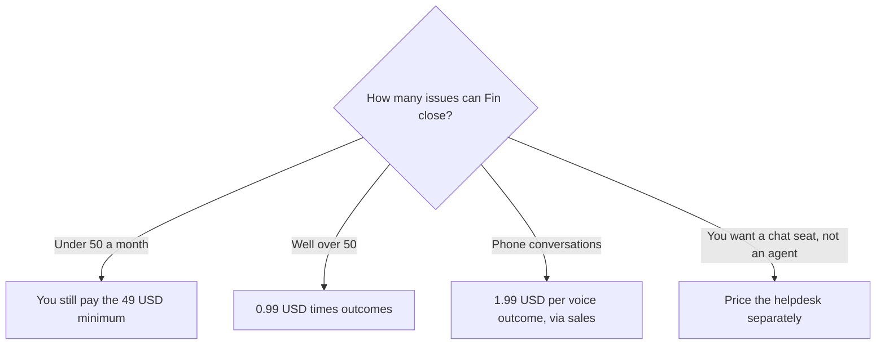

**[Intercom Fin](/tools/intercom-fin/) is an AI support agent priced per outcome.** An outcome, in Intercom's definition on the pricing materials we read, is a customer issue Fin resolves. On October 24, 2026 Fin's pricing page and help materials listed **$0.99 per outcome**, with a **$49 a month minimum that includes 50 outcomes**. The same answers say **no seat costs** and **no setup or integration fees** for the agent. Fin Voice is listed at **$1.99 per voice outcome** through sales. Fin can run on Intercom's helpdesk or alongside a helpdesk you already have, including Salesforce and Zendesk.

We did not measure resolution rate. Any percentage on Intercom's site is their number. Your deflection rate is a report you should pull yourself after a month. This review is how the invoice is built so a "per resolution" pitch does not hide the minimum.

## The meter

| Item | Price printed | What it buys |
|---|---|---|
| Fin outcome | $0.99 | One resolved outcome, as Intercom defines it |
| Monthly minimum | $49 | Includes 50 outcomes. 50 × $0.99 = $49.45, so the minimum is essentially the first 50 |
| Seats on the agent | $0, per their FAQ | The agent line is not a per-teammate fee |
| Setup | $0, per their FAQ | No setup or integration fee on that answer |
| Fin Voice | $1.99 per voice outcome | Sold via sales, not the self-serve card |
| Intercom helpdesk plans | Separate | Essential, Advanced, and Expert. Seat price is a property of those plans |

The invoice is [Intercom Fin pricing explained](/blog/intercom-fin-pricing-explained-2026/).

Fifty outcomes at $0.99 is $49.50, and the minimum is $49. Treat $49 as the floor, not as a discount. If Fin resolves 40 issues, you still pay $49. If it resolves 200, you pay `200 × $0.99 = $198`, and the minimum no longer matters. A pricing example on the page walked through 152 outcomes at $0.99, which is about **$150**, plus a helpdesk line, as an illustration of their calculator. Use your own volume. Their example customer is not your queue.

## What an outcome is, and what it is not

Intercom's help article is the definition that counts, not a paraphrase that flatters the buyer. Read the current article before you forecast. The commercial idea is simple: you pay when the agent finishes the job, not when it sends a greeting. That is attractive next to a per-seat copilot that charges whether or not anyone clicks it. It is also a forecast problem. You cannot know the invoice until you know how many issues qualify. Set a cap in the product if Intercom offers one. The pricing page talks about setting limits. Use them in the trial, not after a busy week.

The helpdesk is a different product. Intercom's plans are named Essential, Advanced, and Expert, and the plan sets seat price and features. A line at **$19** appears on the pricing page next to the helpdesk. We are not going to label that $19 as "per seat" or "per workspace" here, because the unit should be read on the card. Budget the agent and the helpdesk as two lines. Teams that already pay for Zendesk or Salesforce can add Fin without buying Intercom's seats, which is the integration story. Teams that want one vendor will pay both lines. [Tidio](/tools/tidio/) prices billable conversations and a Lyro agent on its own menu. [Chatbase](/tools/chatbase/) is the smaller custom-bot neighbor. [Zendesk AI](/tools/zendesk-ai/) is the incumbent-suite option. [Best AI chatbots for business](/blog/best-ai-chatbots-for-business-2026/) is the roundup. One agent of record is enough.

## A month of support, as arithmetic

Assume the $0.99 definition matches your "resolved" report, which you must verify.

| Resolved outcomes | Agent invoice |
|---|---|
| 20 | $49 minimum |
| 50 | $49 minimum |
| 100 | $99 |
| 500 | $495 |
| 2,000 | $1,980 |

Voice at $1.99 doubles the unit. One hundred voice outcomes are $199, before any human talk time your existing phone vendor charges. Fin does not delete the human queue. It is supposed to shrink the part of the queue that matches the help center. If the help center is thin, the outcome count stays low and the $49 minimum is the whole story, which means you bought a pilot. That can be the right purchase. It is a bad purchase if someone told finance the agent would remove two headcount in month one.

[How to create an AI agent without coding](/blog/how-to-create-an-ai-agent-without-coding/) is the broader build-versus-buy note. Fin is the buy path when the content already lives in a help center and the channel is customer support. A homegrown agent is the path when the workflow is internal and weird. Do not buy Fin to summarize Slack. The meter is customer outcomes.

## Who should pay

**Pay the $49 minimum** when you want a measured pilot and you can afford to learn that volume is under 50. **Pay $0.99 at volume** when the resolved-issue report is large enough that the minimum is noise and the help center is good enough to deserve the answers. **Add voice only** through the $1.99 conversation, with a cap. **Keep your current helpdesk** if Fin's integration story holds, and do not migrate seats just to use the agent. **Skip Fin** when you cannot define an outcome your finance partner accepts. A fuzzy "resolved" flag will become an argument, not a saving.

## FAQ

### How much does Intercom Fin cost?

$0.99 per outcome, with a $49 a month minimum that includes 50 outcomes. No seat fee and no setup fee, according to Intercom's pricing answers checked October 24, 2026. Voice is $1.99 per voice outcome via sales.

### Do we pay if Fin only deflects a few tickets?

You pay the $49 minimum until outcomes pass the included 50. Low volume does not prorate the floor down.

### Does Fin require Intercom seats?

Intercom says Fin works with helpdesks such as Salesforce and Zendesk, and that the agent itself has no seat cost. Intercom's own helpdesk plans are a separate price if you want that inbox too.

### Is the resolution rate guaranteed?

Not on the self-serve $0.99 card we read. Quote your own trial. Vendor averages are advertising until your queue reproduces them.

### What should we cap?

Cap monthly outcomes in the product if the control exists, and cap voice separately at $1.99. A support launch week is how an outcome meter spikes.

## Last verified

October 24, 2026, from fin.ai pricing and Intercom's Fin pricing answers. The definition of an outcome is the clause that moves the invoice. Reread it when you renew. The $0.99 rate is simple. The qualifier is not.

**Sources:** [Fin pricing](https://fin.ai/pricing), [Fin pricing outcomes](https://fin.ai/help/en/articles/13975800-fin-pricing-outcomes), [Fin](https://fin.ai).

[Intercom Fin](/tools/intercom-fin/) is in the [customer support directory](/tools/category/customer-support/). Directory pages may use affiliate links. A purchase through them may earn us a commission at no extra cost to you.
