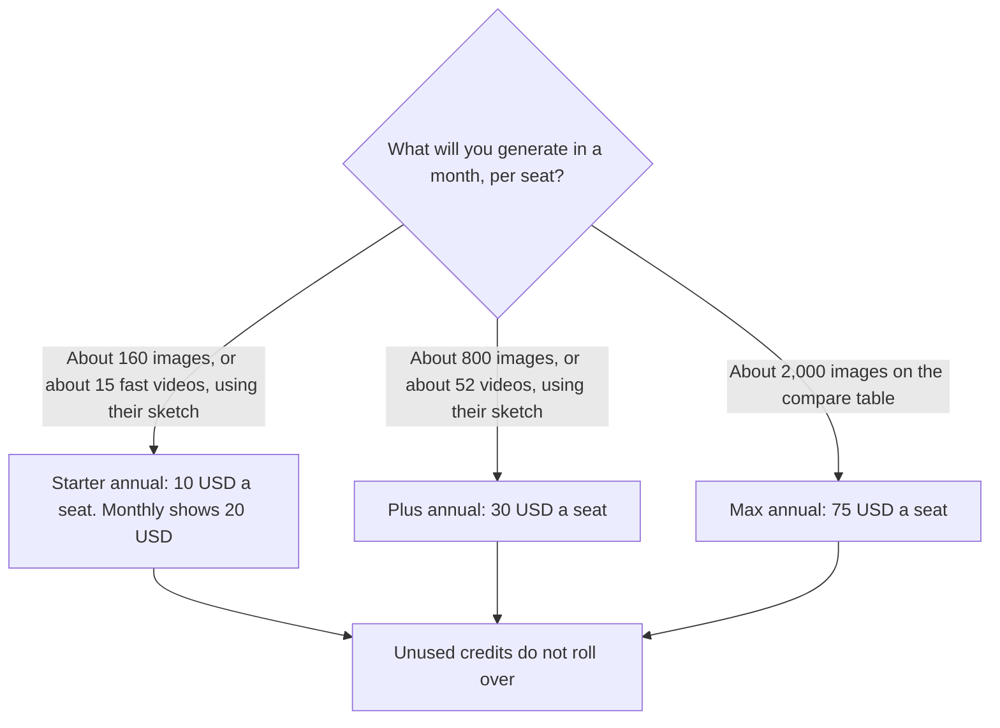

**Budget invideo AI on the annual seat if that is the toggle you will pay, and on the monthly figure if it is not.** The pricing page fetched October 24, 2026 lists Starter at $10 per seat per month billed annually, with $20 shown beside it. Plus is $30 per seat per month billed annually on the compare table. Max is $75 per seat per month billed annually on that table. The directory checked October 16, 2026 recorded the monthly counterparts as $20, $60, and $150. Starter's "save $120 per seat compared to monthly" line matches $20 versus $10 across a year. Credits do not roll over. The page says credit costs can change without notice.

The product page is [invideo AI review](/blog/invideo-ai-review-2026/). A filmed short, which is an edit rather than a generated video, is [Descript vs CapCut for shorts](/blog/descript-vs-capcut-for-shorts-2026/). A different credit meter for generated clips is [Runway pricing explained](/blog/runway-pricing-explained-2026/).

These are US dollar figures from invideo.io/pricing on October 24, 2026, read next to the October 16 directory card. Published October 24, 2026. We did not score video quality. Promotions on the page, including an unlimited-image banner for 30 days on annual plans, can expire. Confirm them before you count on them.

## The seats and the vendor's sketches

| Plan | Annual price on the Oct 24 page | Monthly figure | Credits per seat | Sketch the page or the card attached |
|---|---|---|---|---|
| Starter | $10 per seat a month | $20, shown beside the annual price and recorded in the directory | 400 | About 160 Nano Banana Pro generations, or 15 Seedance 2 fast videos. No guest seats |
| Plus | $30 per seat a month | $60, from the October 16 directory. The Oct 24 extract did not restate $60 in a sentence | 2,000 | About 800 Nano Banana Pro generations, or 52 Seedance 2 videos |
| Max | $75 per seat a month | $150, from the October 16 directory | 5,000 on the directory card. The compare table's 2,000-image sketch matches 5,000 credits at about 2.5 credits an image | About 2,000 Nano Banana Pro images on the compare table. A separate line on the page said 131 Seedance 2 videos |

The compare table says Nano Banana Pro is about 2.5 credits an image. At that rate, 400 credits are 160 images, 2,000 credits are 800, and 5,000 credits are 2,000. That arithmetic matches the image column. It does not match every video sketch on the page, because the page uses more than one Seedance label, including "fast." Do not divide Starter's 15 fast videos into Plus's 52 and call it one rate. Generate one clip, read the debit, then multiply.

## How to read the annual half

Annual Starter at $10 is half of $20, and the page says you save $120 a seat versus monthly. Plus at $30 is half of the directory's $60, and Max at $75 is half of the directory's $150. The October 24 compare table printed the annual numbers directly. Where this article's monthly column relies on the October 16 directory, it says so. If checkout shows a promotion that is not half, checkout wins.

The page says unused credits do not roll over. A quiet month is spent money. It also says generative models are priced differently and that credit costs can change without notice. A forecast that assumes today's 2.5 credits an image for the rest of the year is a hope. Recheck the debit when you change models.

Guest seats: the October 24 page says Starter has none. The October 16 directory recorded 10 free guest seats on Plus, with 190 credits each. The October 24 extract did not restate that allowance. Confirm Plus guests at checkout before you staff a team on guest seats.

An annual-plan banner offered unlimited use of named image models for 30 days. Treat that as a promotion with an end, not as the credit table.

## When another editor is the bill

**[CapCut](/tools/capcut/)** Pro lists at $19.99 a month or $179.99 a year in the US, as a reference price that can change after sign-in. That is an editor for footage you have. It is not 400 invideo credits.

**[Descript](/tools/descript/)** Hobbyist is $16 a person a month billed annually. That meter is media hours, for cutting a recording. A talking-head short belongs there or in CapCut. A prompt-to-video draft belongs on this page.

**[Runway](/tools/runway/)** Standard is $12 a month billed annually, or $15 monthly, with 625 credits. A Runway credit is not an invideo credit. Do not add the balances.

## FAQ

### Is invideo AI free?

The October 16 directory said a permanent free plan was not verified. The October 24 pricing page we fetched led with paid seats. Do not budget a free monthly credit grant from this article. If a trial appears at signup, read its limit there.

### How many videos are on Starter?

The page's own sketch is about 15 Seedance 2 fast videos from 400 credits, or about 160 Nano Banana Pro images. Those are examples. One model at a higher debit will not hit 15. Watch the first generation.

### Do credits roll over?

No. The FAQ on the October 24 page says unused credits do not roll over to the next month.

### Is Max 5,000 or 15,000 credits?

The directory card says 5,000 credits a month on Max. The October 24 page also showed the figures 5,000, 10,000, and 15,000 near Max without a clean label in the extract. The compare table's 2,000-image sketch fits 5,000 credits at the stated 2.5 credits an image. Confirm the credit count on the plan selector before you buy Max. This article will not pick 10,000 or 15,000 as the price of the $75 seat.

## Last verified

October 24, 2026 for annual seat prices, the no-rollover line, Starter's sketches, and the compare table, from invideo.io/pricing. October 16, 2026 for monthly $60 and $150, Max at 5,000 credits, and the Plus guest-seat note that the later extract did not repeat. CapCut, Descript, and Runway are from the October 16 directory check. Published October 24, 2026.

**Sources:** [invideo AI pricing](https://invideo.io/pricing), [invideo AI](https://invideo.io).

*Published by Andrew for [AI Tools Optimizer](https://aitoolsoptimizer.com).*

[invideo AI](/tools/invideo-ai/) is in the [video directory](/tools/category/video/). Directory pages may use affiliate links. A purchase through them may earn us a commission at no extra cost to you.
