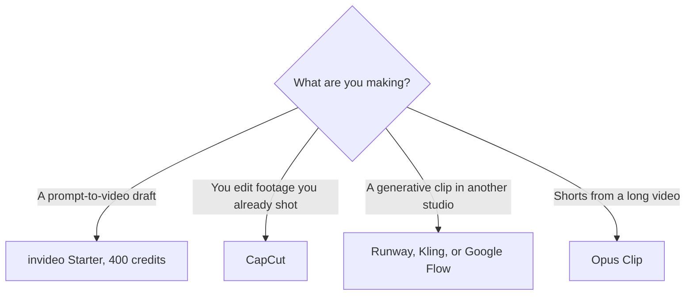

**[invideo AI](/tools/invideo-ai/) turns a prompt into a video draft and meters the generative work in credits.** The compare table on the pricing page prints annual prices: Starter $10 per seat per month, Plus $30, and Max $75. Starter's own card shows $20 a month against that $10 annual price, and says you save $120 a year per seat. Credits do not roll over.

Those figures were read from invideo.io/pricing on October 24, 2026. Plus and Max monthly prices were $60 and $150 when we checked the same page on October 16, 2026, which is double the annual rates. The October 24 page still frames annual plans as 50% off. Confirm the monthly toggle before you quote it. We did not score picture quality. The video shelf is [best AI video generators](/blog/best-ai-video-generators-2026/).

## Seats and credits

| Plan | Annual price printed October 24 | Credits per seat each month | What invideo says that buys |
|---|---|---|---|
| Starter | $10/seat/month ($20 on the monthly card) | 400 | About 160 Nano Banana Pro images, or about 15 Seedance 2 fast videos |
| Plus | $30/seat/month | 2,000 | About 800 images, or about 52 Seedance 2 videos. Frontier agents on Lite, Pro, and Ultra |
| Max | $75/seat/month | 5,000 | About 2,000 images, or about 131 Seedance 2 videos. The lowest cost per credit, on invideo's card |

The credit math is [invideo AI pricing explained](/blog/invideo-ai-pricing-explained-2026/).

invideo's FAQ says a credit is used for generation, not for downloading, and that model prices follow their API rates and can change without notice. The compare table's own examples: Nano Banana Pro is about 2.5 credits an image, and a 5-second Seedance 2.5 clip at 1080p is about 96 credits. Starter does not include every Seedance tier. Plus and Max do, on the cards we read. Unused credits do not roll over. Annual plans mention a promotional line about selected image models. Read the current promo before you count on "unlimited."

The timeline editor, color, audio, and 3D tools are listed on every plan, including Starter. Guest seats are not on Starter. Multiplayer caps rise with the plan.

## What the credit is not

A credit is not a minute of timeline editing. invideo's planner treats timeline hours as separate from generative credits, and says editing on Starter does not spend the credit pool. The bill surprises people when they generate, not when they trim. Price one finished video: script, images, and the Seedance shots. If that one video is 200 credits, Starter's 400 is two of them. Plus is the plan when that count is a weekly job.

[CapCut](/tools/capcut/) is the editor for footage you already have. The [CapCut review](/blog/capcut-review-2026/) is that seat. [Runway](/tools/runway/) is a generative studio with its own credit, in the [Runway review](/blog/runway-review-2026/). [Opus Clip](/tools/opusclip/) cuts long video into shorts. [Google Flow](/tools/google-flow/) is Google's Veo studio. YouTubers choosing a stack should read [best AI tools for YouTubers](/blog/best-ai-tools-for-youtubers-2026/).

Commercial use and model licenses are not the subscription price. invideo says models are available at their API pricing inside the credit. Check the model you will actually render before you promise a client the file.

## Who should pay

**Try one video and read the credit receipt** before you pick a pool. **Pay for Starter annual** if 400 credits and the timeline cover the month and you will still be here next month. The monthly card is $20. **Pay for Plus** when agents and the larger Seedance set are the job. **Pay for Max** when the credit log says Plus ran out. **Skip invideo** for a podcast edit or a screen recording. That is [Descript](/tools/descript/).

## FAQ

### How much is invideo AI?

The compare table lists Starter at $10 per seat per month billed annually, Plus at $30, and Max at $75. Starter monthly is $20 on the card, $120 a year more per seat than annual.

### Do credits roll over?

No. invideo's FAQ says unused credits do not roll over.

### Is the timeline editor extra?

The pricing page lists the timeline editor on every plan, including Starter. Generative models are what spend credits.

## Last verified

October 24, 2026, from invideo's pricing page, for annual seat prices, Starter's $20 monthly card, and the credit examples. Plus and Max monthly dollar amounts were last read as $60 and $150 on October 16, 2026. Model credit costs can change. Recheck the quote on the generate button.

**Sources:** [invideo pricing](https://invideo.io/pricing), [invideo](https://invideo.io).

[invideo AI](/tools/invideo-ai/) is in the [video directory](/tools/category/video/). Directory pages may use affiliate links. A purchase through them may earn us a commission at no extra cost to you.
