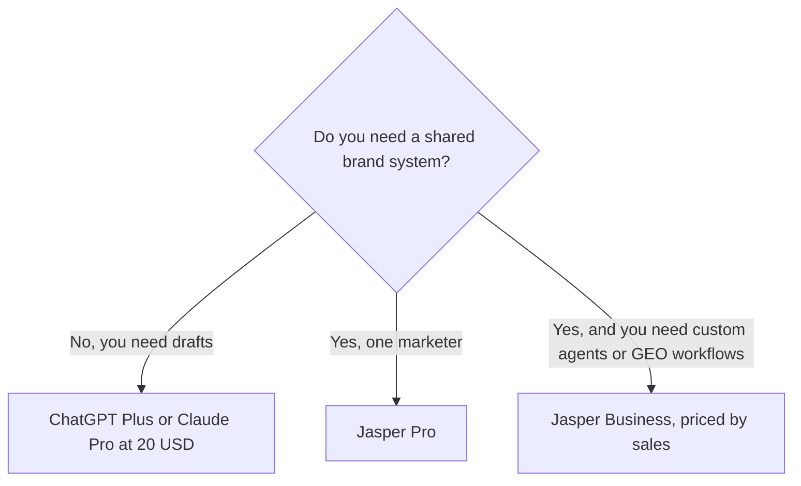

**Jasper is a marketing platform with a seat price, not a cheaper ChatGPT.** Pro is $69 per seat per month, or $59 per seat per month billed yearly, with a 7-day trial. There is no free plan. Business is custom. Buy Pro when a marketer needs brand voices, a campaign workspace, and agents for the core workflows. Skip it when you write alone and a $20 assistant already drafts well enough.

Prices are US list prices from Jasper's pricing page, checked October 16, 2026. We did not score copy in a bake-off. The fit table is about plan scope.

The writing shelf around it is [best AI writing assistants](/blog/best-ai-writing-assistants/). The head-to-head for general drafting is [ChatGPT vs Claude for writing](/blog/chatgpt-vs-claude-for-writing-2026/).

## What the seat includes

| | Pro | Business |
|---|---|---|
| Price | $69/seat/month, or $59/seat/month billed yearly | Custom |
| Trial | 7 days | Sales |
| Workspace | Canvas, agents for core marketing workflows | Adds a no-code agent builder, Jasper Grid, and agents for GEO, translation, and deep research |
| Brand system | 2 Brand Voices, 5 Knowledge assets, 3 Audiences | Unlimited Brand Voices, Knowledge, and Audiences, plus admin controls |
| AI search visibility | The product measures brand presence and citations across answer engines | GEO workflows sit on this tier |

A yearly Pro seat is $59 × 12 = $708, against $69 × 12 = $828 on monthly billing. The gap is $120 a year per seat, which matches the "about 20%" saving Jasper describes. Tax is extra. A team of five on yearly Pro is $3,540 a year before anyone opens Business.

## What you are buying besides a text box

Jasper's pitch has moved from a template library to a marketing system. **Canvas** is the workspace where assets get drafted and revised. **Agents** run workflows such as SEO, campaigns, and translation. On Pro those are the core workflows. The deeper agents, including GEO, translation at the complex end, and deep research, are Business.

**Brand IQ**, in the language of the plan, is Brand Voices, Knowledge, and Audiences. Pro caps them at 2, 5, and 3. That is enough for one brand and a few segments. A company with a sub-brand for every region will hit the cap and either simplify or talk to sales. Business makes those three unlimited and adds admin controls and dedicated support.

Jasper also measures how the brand shows up in AI answer engines and watches citation rates. That is a different job from writing a blog post. If the reason you are here is "rank in Google," a measurement layer is not a crawler suite. [Semrush](/tools/semrush/) and the [SEO tools guide](/blog/best-ai-seo-tools-2026/) are the research side. [Writesonic](/tools/writesonic/) has moved toward the same AI-visibility job, with Starter at $79/month billed annually. Overlapping visibility tools are how marketing stacks get expensive. Pick one.

## The cheaper products people confuse with Jasper

| Need | Cheaper documented option | Price |
|---|---|---|
| One person drafting in a general assistant | [ChatGPT](/tools/chatgpt/) Plus or [Claude](/tools/claude/) Pro | $20/month. Claude Pro is $17/month if you pay $200 annually |
| A company assistant with an admin and a training default | ChatGPT Business | $20/user/month annual, or $25 monthly, 2 or more users |
| Shared multi-model chat for a small go-to-market team | [Copy.ai](/tools/copy-ai/) Chat | $29/month, or $24/month billed annually, including 5 seats |
| Automated go-to-market workflows at company scale | Copy.ai workflow plans | Growth is $1,000/month billed annually. That is not the cheap option |
| Grammar in the browser | [Grammarly](/tools/grammarly/) Pro | $12/member/month annual |

Copy.ai Chat is the honest alternative when five people need a shared chat with OpenAI, Anthropic, and Gemini models and they do not need Jasper's brand-asset caps. Five seats at $24/month annual is $288 a year for the group, against one Jasper Pro seat at $708 a year. The products are not equivalent. Copy.ai's workflow tier then jumps to $1,000, $2,000, or $3,000 a month. If you needed automation, do that comparison with the workflow price, not the Chat price.

ChatGPT Plus will draft a landing page. It will not store two official brand voices as a governed object, and it will not be the system a new marketer is required to use. That governance is what the Jasper seat pays for. If you do not have a second person who must sound like the first, you do not have the problem Jasper sells.

## Who should pay

**Pay for Pro** if you lead content for a brand, you rewrite off-brand drafts every week, and the 7-day trial produces an asset you would ship. Two voices and three audiences should match the real brand, not a future org chart.

**Talk to sales for Business** if you need the no-code agent builder, Jasper Grid, unlimited brand objects, or the GEO and deep-research agents. Get the price in writing. This page cannot compare a custom quote with a $59 seat.

**Do not buy Jasper** for fiction, for occasional email, or for a student paper. [Sudowrite](/tools/sudowrite/) is the fiction tool. Grammarly and a free chatbot cover occasional email. Students have a separate stack in [best AI tools for students](/blog/best-ai-tools-for-students-2026/).

## A trial that answers the seat question

1. Bring one real campaign: a page, three ads, and the audience sentence.
2. Load one Brand Voice and the facts the model must not invent.
3. Generate the set in Canvas. Edit for the time you would have spent in a chatbot.
4. If the edit is shorter and the voice holds on the second asset, price yearly Pro.
5. If you spent the trial fighting the interface, cancel. The chatbot was already doing the job.

## FAQ

### How much does Jasper cost?

Pro is $69 per seat per month, or $59 per seat per month billed yearly. Business is custom. There is a 7-day Pro trial and no free plan.

### Is Jasper better than ChatGPT for marketing?

Jasper is built to keep a team on a brand system, with caps on voices, knowledge, and audiences, plus marketing agents. ChatGPT is a general assistant at a lower seat price. We did not run a quality test. The reason to pay Jasper is governance and workflow, which you can see on the plan page.

### Does Jasper have a free plan?

No. Pro includes a 7-day trial. Copy.ai's pricing page also did not list a permanent free plan when we checked.

## Last verified

October 16, 2026. Recheck [Jasper pricing](https://www.jasper.ai/pricing) before you put a team on annual seats.

**Sources:** [Jasper pricing](https://www.jasper.ai/pricing), [Copy.ai pricing](https://www.copy.ai/pricing), [ChatGPT pricing](https://chatgpt.com/pricing/), [Writesonic pricing](https://writesonic.com/pricing).

The [Jasper](/tools/jasper/) directory page may include an affiliate link. A purchase through it may earn us a commission at no extra cost to you.
