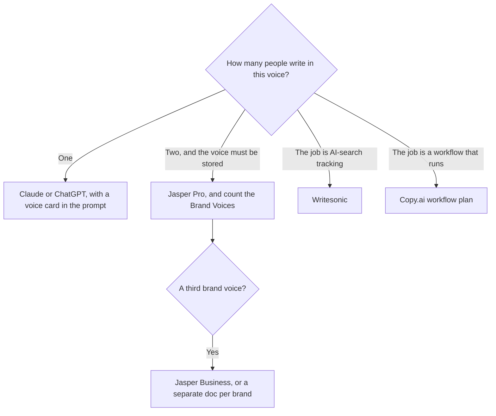

**Leave Jasper when one person is drafting from a brief, when the bill you need is a go-to-market workflow, or when the thing you must measure is whether AI answers cite you.** Stay when two or more writers have to pull the same stored voice, and Pro's two Brand Voices cover the brands you actually have. Jasper is a marketing system with a seat price. It is an expensive place to ask for a first draft.

[Jasper](/tools/jasper/) Pro is $69 per seat per month, or $59 billed yearly, with a 7-day trial and no free plan. Pro includes two Brand Voices, five Knowledge assets, and three Audiences. Business is custom. The three-way with the other platforms is [Jasper vs Copy.ai vs Writesonic](/blog/jasper-vs-copy-ai-vs-writesonic-2026/). The product page is [Jasper review](/blog/jasper-ai-review-2026/).

Prices are US list prices excluding tax from directory pages checked October 16, 2026. Published October 24, 2026. This guide does not score prose.

## Switch on the job, not on the logo

| The job became | Open this | Price that matters |
|---|---|---|
| A draft one editor will rewrite | [Claude](/tools/claude/) or [ChatGPT](/tools/chatgpt/) | Claude Pro is $20/month, or $17 billed annually. ChatGPT Plus is $20. Go is $8 |
| A voice two writers must match, two brands or fewer | Stay on Jasper Pro | $59/seat/month yearly. A third Brand Voice is a Business conversation |
| A shared chat for a small team, five seats | [Copy.ai](/tools/copy-ai/) Chat | $24/month billed annually, or $29 monthly, for five seats |
| Workflows that run a go-to-market motion | Copy.ai workflow plans | Growth starts at $1,000/month billed annually |
| Tracking whether AI answers mention you | [Writesonic](/tools/writesonic/) | Starter is $79/month billed annually, with 50 prompts tracked |
| A proofread after the draft exists | [Grammarly](/tools/grammarly/) | Pro is $12/member/month billed annually |

Building the card you paste into Claude is [how to create a brand voice with AI](/blog/how-to-create-a-brand-voice-with-ai-2026/). The drafting method is [how to write a blog post with Claude](/blog/how-to-write-a-blog-post-with-claude-2026/).

## What you give up when you leave

Jasper Pro is paying for Canvas, marketing agents, and the stored voice and audience objects. A chatbot will draft the paragraph. It will not administer two voices across a team unless you maintain the doc and the habit. Teams that cancel Jasper and paste "sound friendly" into ChatGPT get friendly text that drifts by Thursday.

Copy.ai Chat at $24 a month annually is the cheap shared room. Its workflow plans start at $1,000 a month. Those plans are a system of record for a motion, with 20,000 workflow credits on Growth. Buying Growth because a demo said "agents" is how a five-person team inherits an enterprise bill. Read the card that matches the credits you will run.

Writesonic's current product, as recorded October 16, 2026, centers on AI search visibility: ChatGPT, Perplexity, Claude, Gemini, and others. Starter at $79 a month annually includes AI articles and a site audit, and it tracks 50 prompts. One project on that card means a second brand is another plan. Buy it when the chart of citations is the deliverable. Buy Jasper when the deliverable is on-brand assets and you already know the facts.

Grammarly does not replace the draft. It replaces the last pass. The editing comparison is [Grammarly vs ChatGPT for editing](/blog/grammarly-vs-chatgpt-for-editing-2026/).

## A small team's sequence

One writer: Claude or ChatGPT, plus a one-page voice card, plus Grammarly if the proofread has to happen inside the browser. Two writers and one or two brands: Jasper Pro, and watch the two-voice cap. A team that needs the same campaign to trigger research, a draft, and a handoff into a CRM: price Copy.ai's workflow plan before you add seats of Jasper. A team that reports AI-answer presence to a client: Writesonic, and keep the drafting seat separate.

Agencies multiplying this by clients should count Brand Voices before they count seats. The client version of the stack is [best AI tools for agencies](/blog/best-ai-tools-for-agencies-2026/).

## FAQ

### Is ChatGPT a Jasper alternative?

For a first draft, yes. ChatGPT Plus at $20 does not include Jasper's Brand Voice objects. You bring the voice card every time, or you save it in a project. That is enough for one writer. It gets brittle when a second writer cannot find the card.

### Does Jasper have a free plan?

No. Pro has a 7-day trial. If you need a $0 draft today, start in Claude or ChatGPT's free tier and move up when the cap blocks work you already do.

### When is Writesonic the wrong Jasper alternative?

When you wanted a cheaper brand voice. Writesonic's priced entry on the October 16 card is an AI-visibility plan at $79 a month annually. That is a measurement product that also writes. It is a weak substitute for two stored voices.

### Can I keep Jasper for voice and use Claude for long drafts?

Yes. That is a sane split if the Jasper seat is actually opened by the people who must match the voice. A seat nobody opens is the $59 you can cancel. A voice that lives only in Claude's history is the one a new writer will miss.

## Last verified

October 16, 2026 for Jasper, Claude, ChatGPT, Copy.ai, Writesonic, and Grammarly prices. Published October 24, 2026.

**Sources:** [Jasper pricing](https://www.jasper.ai/pricing), [Copy.ai pricing](https://www.copy.ai/prices), [Writesonic pricing](https://writesonic.com/pricing).

*Published by Andrew for [AI Tools Optimizer](https://aitoolsoptimizer.com).*

[Jasper](/tools/jasper/) is in the [writing directory](/tools/category/writing/). Directory pages may use affiliate links. A purchase through them may earn us a commission at no extra cost to you.
