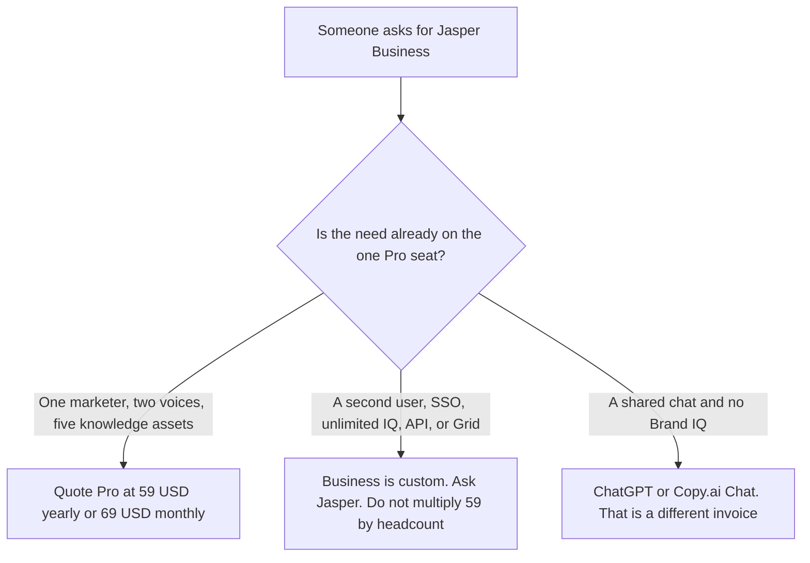

**Jasper Business is custom.** On jasper.ai/pricing fetched October 24, 2026, the Business card says "custom pricing" and "Contact Sales." It lists everything in Pro, plus agents for GEO, translations, and deep research, a no-code builder for custom agents, Jasper Grid, unlimited Brand Voices, Knowledge, and Audiences, API access, admin controls and Groups, dedicated account management and priority support, and secure and flexible deployment options. The same fetch shows Pro at $69 a seat a month, or $59 a seat a month billed yearly, and the card says "Includes 1 seat." The full ladder as the October 16 directory read it is [Jasper pricing explained](/blog/jasper-pricing-explained-2026/). This page is the Business name.

A second marketing suite with a published cliff is [Copy.ai Enterprise pricing explained](/blog/copy-ai-enterprise-pricing-explained-2026/). The product page is [Jasper AI review](/blog/jasper-ai-review-2026/). The general-chat comparison is [Jasper vs ChatGPT for marketing](/blog/jasper-vs-chatgpt-for-marketing-2026/).

The Pro dollars below are US list prices from that October 24 page. The page says prices are in USD and an exchange rate may apply at checkout. Published October 24, 2026. We did not score copy. We did not receive a Business quote. A 7-day Pro trial is not a Business seat.

## What the October 24 page separates

| Plan | Price on the October 24 page | What you may quote as Business |
|---|---|---|
| Pro, for contrast | $69 a seat a month, or $59 billed yearly. The card says it includes 1 seat | Canvas, core marketing agents, 2 Brand Voices, 5 Knowledge assets, 3 Audiences, a 7-day trial. Not SSO |
| Business | Custom. The FAQ says plans begin with a 12-month commitment | Unlimited Brand Voices, Knowledge, and Audiences; advanced agents; the no-code builder; Grid; API; admin controls and Groups |
| A second Pro seat | Not printed as a checkout price | The FAQ says more than one user on Pro means contacting sales to customize Business |

The October 16 directory described Pro as a per-seat price and this site's base article multiplied $59 by seats. The October 24 page still prints "$69 month/seat" and "$59 month/seat," and it also prints "Includes 1 seat." The FAQ on that page, under additional users, says: need more than one user on Pro, contact sales to customize the Business plan, and it names additional seats, unlimited custom agents, SSO, a custom style guide, and API access. If checkout sells a second Pro seat, checkout wins. This page does not invent that seat, and it does not invent the Business dollar.

SSO is on Business. The FAQ says it supports SAML 2.0, including Okta, Azure AD, and Google Workspace, and that role-based access controls and an in-app AI audit log are included. Those sentences are not on the Pro feature list we read. SOC 2 Type II, GDPR, CCPA, and encryption are described as Jasper company statements on that FAQ, not as a Business-only toggle. Do not tell a buyer that Pro is unencrypted.

The credits FAQ says some usage-based features, such as the GEO Hub and Agents, run on credits alongside seat-based pricing on the Business plan, and that standard content creation in Chat and Canvas is not what drives credit usage. The page points at a rate card. This article did not display that card's rates, so it quotes none.

A nonprofit discount of 20% is a separate FAQ line, applied after a trial by emailing hey@jasper.ai with documentation. It is not a Business price.

## What a neighboring invoice does, and does not, tell you

**A published workflow cliff.** [Copy.ai](/tools/copy-ai/) Chat is $29 a month or $24 billed annually for 5 seats, and Scale is $3,000 a month billed annually, on the October 24 prices page. That is a dollar you can print. Jasper Business is not. The enterprise heading on Copy.ai is the other article.

**A general seat with no Brand IQ cap.** [ChatGPT](/tools/chatgpt/) Plus is $20 a month. Business there is a different product's company seat. It does not include two Jasper Brand Voices. The ladder is [ChatGPT pricing explained](/blog/chatgpt-pricing-explained-2026/).

**A long draft in a Project.** [Claude](/tools/claude/) Pro is $17 a month billed annually, $200 up front, or $20 monthly. It does not store unlimited Jasper Audiences. The review is [Claude review](/blog/claude-review-2026/).

**The page the campaign still has to match.** The team that owns messaging, not the invoice, is [best AI tools for product marketing managers](/blog/best-ai-tools-for-product-marketing-managers-2026/).

## What not to assume

Do not print a Business price. Do not take the base article's five-seat Pro arithmetic as the October 24 checkout. Do not say unlimited Brand Voices are on Pro. Do not treat the 12-month Business commitment as optional because Pro can cancel. Do not convert a non-USD charge into $59. The page says the sticker is USD and the exchange rate is applied at purchase.

## FAQ

### How much is Jasper Business?

Custom, on the October 24 pricing page. There is no seat price and no credit total on the card we read. Pro at $59 a seat a month billed yearly, or $69 monthly, is the published dollar, and that card says it includes one seat. A quote you receive is the price. This page will not round it.

### Does Business include SSO?

Yes, on the FAQ we fetched October 24: SSO with SAML 2.0, including Okta, Azure AD, and Google Workspace, plus role-based access and an in-app AI audit log. Those lines are the Business answer. They are not listed on the Pro card's feature set in that fetch.

### Can I put the team on Pro at $59 each?

The October 24 card says Pro includes one seat, and the FAQ sends additional users to a Business conversation. The October 16 directory had described a per-seat Pro price without that one-seat line. Until checkout shows a second Pro seat, do not multiply $59 by headcount and call it either Pro or Business.

### Does this page replace the main Jasper pricing article?

No. That article is the October 16 ladder, including the yearly-versus-monthly gap on Pro. This article is the Business name on the October 24 page: what sits only on the custom contract, and the one-seat line the earlier multiplication did not have.

## Last verified

October 24, 2026, from Jasper's pricing page. The October 16 directory card matches the Pro dollars and the custom Business price, and it does not contain the "Includes 1 seat" line this fetch showed. Published October 24, 2026. No Business quote was received.

**Sources:** [Jasper pricing](https://www.jasper.ai/pricing), [Jasper](https://www.jasper.ai).

*Published by Andrew for [AI Tools Optimizer](https://aitoolsoptimizer.com).*

[Jasper](/tools/jasper/) is in the [writing directory](/tools/category/writing/). Directory pages may use affiliate links. A purchase through them may earn us a commission at no extra cost to you.
