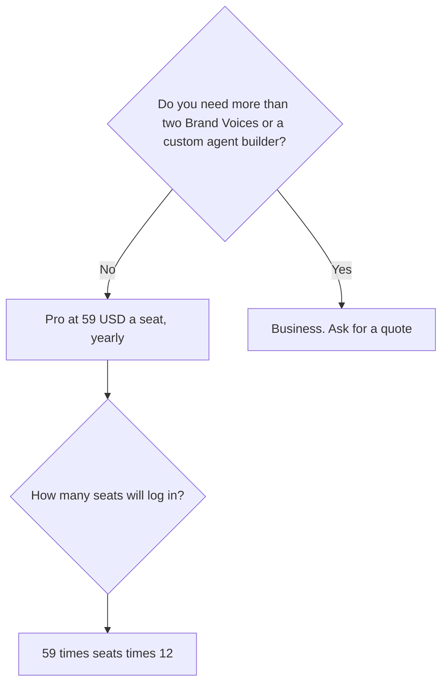

**Jasper Pro is $69 per seat per month, or $59 per seat per month billed yearly, with a 7-day trial.** That seat includes Canvas, agents for core marketing workflows, 2 Brand Voices, 5 Knowledge assets, and 3 Audiences. Business is custom. There is no permanent free plan on the card.

The product page is [Jasper AI review](/blog/jasper-ai-review-2026/). The choice against a general chat seat is [Jasper vs ChatGPT for marketing](/blog/jasper-vs-chatgpt-for-marketing-2026/). The three-way with the other marketing suites is [Jasper vs Copy.ai vs Writesonic](/blog/jasper-vs-copy-ai-vs-writesonic-2026/).

Prices are US dollars before tax, from Jasper's pricing page as recorded in the directory on October 16, 2026. Published October 24, 2026. We did not score copy.

## The two plans

| Plan | Price | What the card includes | What it does not include |
|---|---|---|---|
| Pro | $69 a seat a month, or $59 billed yearly | Canvas, core marketing agents, 2 Brand Voices, 5 Knowledge assets, 3 Audiences, a 7-day trial | A published Business feature set |
| Business | Custom | Advanced agents for GEO, translation, and deep research, a no-code agent builder, Jasper Grid, unlimited Brand Voices, Knowledge, and Audiences, admin controls | A dollar this page can quote |

One Pro seat on the yearly rate is 12 × $59 = $708 a year. The same seat month to month is 12 × $69 = $828 a year. The $120 gap is the billing toggle, about the 20% the card describes. Five seats on yearly Pro are 5 × $708 = $3,540 a year. Five seats month to month are 5 × $828 = $4,140. Quote seats and the cycle together. A shared login is not a fifth seat.

## What Pro is counting

**Brand Voices, Knowledge, and Audiences** are caps, not slogans. Two voices and three audiences fit a single brand with a couple of segments. An agency with a voice per client will hit the wall and need a Business quote. Do not plan ten clients on Pro and hope the cap is soft. The card says two, five, and three.

**Agents** on Pro cover core marketing workflows. GEO, translation, and deep research agents, plus the no-code builder and Jasper Grid, are Business. If the reason you are looking at Jasper is "a custom agent for our campaign process," you are in a sales conversation, not in the $59 checkout.

**The trial** is seven days on Pro. It is not a free tier. When it ends, the seat price starts. Cancel if the voices and the canvas are not how the team will work next month.

## The cheaper drafts, and when they stop being enough

[ChatGPT](/tools/chatgpt/) Plus is $20 a month for one person, with projects and custom GPTs. Five Plus seats are 5 × $20 = $100 a month, or $1,200 a year, with no shared brand system. Business is $20 a user a month billed annually for two or more users. Plus is the right comparison when the team can paste a style sheet and does not need Jasper's voice caps and agents. The ladder is [ChatGPT Go vs Plus vs Pro](/blog/chatgpt-go-vs-plus-vs-pro-2026/).

[Copy.ai](/tools/copy-ai/) Chat is $29 a month, or $24 billed annually, and includes five seats. That is $288 a year for the annual Chat plan. Workflow plans start at $1,000 a month billed annually. Do not wander into Growth because Chat felt small. Read the line. [Writesonic](/tools/writesonic/) Starter is $79 a month billed annually. The alternatives survey is [Jasper alternatives](/blog/jasper-alternatives-2026/).

[Grammarly](/tools/grammarly/) Pro is $12 a member a month billed annually. It edits. It does not store two Brand Voices as a marketing system. Run it after the draft is factually done. The card is [Grammarly pricing explained](/blog/grammarly-pricing-explained-2026/).

A newsletter does not require Jasper. The workflow is [how to create a newsletter with AI](/blog/how-to-create-a-newsletter-with-ai-2026/). The brand rules, if you need them written down first, are [how to create a brand voice with AI](/blog/how-to-create-a-brand-voice-with-ai-2026/).

## Who should pay

Pay for one Pro seat when a marketer will use Canvas and the two-voice cap matches the company. Add seats only for people who will log in. Ask for Business when you need more voices, admin controls, or the advanced agents. Stay on Plus or Copy.ai Chat when the work is drafts and a shared chat, and nobody will maintain Knowledge assets.

## FAQ

### Is $59 the monthly price?

$59 is the yearly rate per seat. Month-to-month is $69 a seat. A quote that says "$59" without "billed yearly" is incomplete.

### Does Pro include unlimited Brand Voices?

No. Unlimited Brand Voices, Knowledge, and Audiences are Business, and Business has no public price on the card. Pro includes two voices, five knowledge assets, and three audiences.

### Is there a free plan?

No. Pro has a 7-day trial. ChatGPT's free tier and Go at $8 are the zero-or-low options if you are not ready for a marketing platform.

### Can I put the whole company on one seat?

The price is per seat. One login shared across a team will break the moment two people need different voices, and it is not the admin model Business is selling. Count humans.

## Last verified

October 16, 2026 for Jasper, ChatGPT, Copy.ai, Writesonic, and Grammarly prices named above. Jasper Business has no public dollar. Published October 24, 2026.

**Sources:** [Jasper pricing](https://www.jasper.ai/pricing), [ChatGPT pricing](https://chatgpt.com/pricing), [Copy.ai pricing](https://www.copy.ai/pricing).

*Published by Andrew for [AI Tools Optimizer](https://aitoolsoptimizer.com).*

[Jasper](/tools/jasper/) is in the [writing directory](/tools/category/writing/). Directory pages may use affiliate links. A purchase through them may earn us a commission at no extra cost to you.
