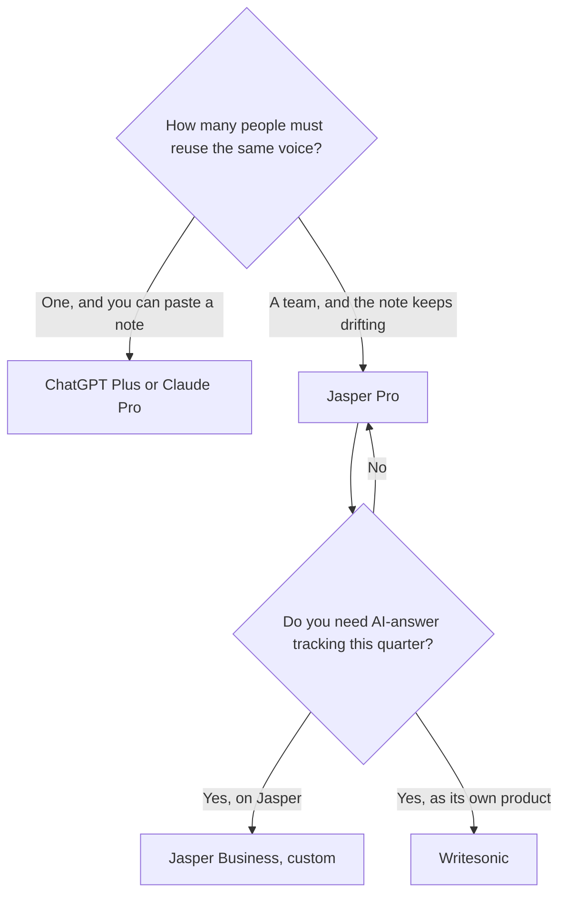

**Use Jasper when several marketers need the same stored voice, knowledge, and audience, and the draft has to stay inside that system. Use ChatGPT when one person can paste a voice note and the month also includes images, research, or a custom GPT.** Jasper Pro is a marketing seat. ChatGPT Plus is a general seat that marketers happen to use. Buying both on day one usually means you have not decided where the campaign lives.

The wider leave-Jasper list is [Jasper alternatives](/blog/jasper-alternatives-2026/). The three-way with the other marketing platforms is [Jasper vs Copy.ai vs Writesonic](/blog/jasper-vs-copy-ai-vs-writesonic-2026/). The product page is [Jasper review](/blog/jasper-ai-review-2026/). The general writing split is [ChatGPT vs Claude for writing](/blog/chatgpt-vs-claude-for-writing-2026/).

Prices are US list prices excluding tax from directory pages checked October 16, 2026. Published October 24, 2026. We did not score marketing copy.

## What the campaign actually needs

| The need | Start here | First paid step |
|---|---|---|
| One marketer, many kinds of tasks, images in the same month | [ChatGPT](/tools/chatgpt/) | Plus is $20. Go is $8. Free is the test |
| A long landing page you will revise from a brief | [Claude](/tools/claude/) | Pro is $20, or $17 billed annually |
| Brand Voices, Knowledge, Audiences, and marketing agents | [Jasper](/tools/jasper/) | Pro is $69 a seat monthly, or $59 billed yearly. 7-day trial. No free plan |
| A shared multi-model chat for up to five people | [Copy.ai](/tools/copy-ai/) | Chat is $24 a month billed annually, 5 seats |
| Tracking whether AI answers mention you | [Writesonic](/tools/writesonic/) | Starter is $79 a month billed annually |
| A last proofread in the browser | [Grammarly](/tools/grammarly/) | $12 a member a month billed annually, or $30 monthly |

## What Pro includes, and what it does not

Jasper's directory page records Pro as Canvas, agents for core marketing workflows, **2 Brand Voices, 5 Knowledge assets, and 3 Audiences**. Business is custom. The same page says Business adds GEO, translation and deep research agents, a no-code agent builder, and Jasper Grid, plus unlimited Brand Voices, Knowledge, and Audiences. Do not buy Pro expecting the visibility tracker. That line is Business, or it is [Writesonic pricing explained](/blog/writesonic-pricing-explained-2026/) if you want a published starter price instead of a sales conversation.

A Pro year at the recorded rate is $59 × 12 = $708 per seat. Month to month is $69, or $828 over a year of monthly bills. The directory calls the yearly gap "about 20% off," not an exact 20. Quote $59 or $69, the toggle you will pay.

ChatGPT Plus at $20 does not store a Brand Voice object. You paste the voice, or you put it in a Project or a custom GPT. That works for a founder and for a careful freelancer. It drifts when five people keep private prompts. The control for a team that wants the note in one place without Jasper is [how to create a brand voice with AI](/blog/how-to-create-a-brand-voice-with-ai-2026/), filed where they already write. If that place is Notion, the writing comparison is [ChatGPT vs Notion AI for writing](/blog/chatgpt-vs-notion-ai-for-writing-2026/).

[Copy.ai](/tools/copy-ai/) Chat at $24 annually is the shared-seat alternative when the problem is five logins, not a brand vault. The workflow plans start at $1,000 a month. That jump is [Copy.ai pricing explained](/blog/copy-ai-pricing-explained-2026/). Leave Jasper for Copy.ai only when the job is a workflow credit, not a voice.

## How a marketer should trial this

Write one real asset in ChatGPT or Claude with the voice note pasted in. Write the same asset in the Jasper trial. Compare the edits you had to make, not a vibe. If the Jasper draft needed the same factual fixes and the voice was only slightly closer, you are paying $59 for a small saving. If five people cannot keep the voice note straight, the vault is the product.

Then check the fact pattern separately. A campaign claim the model invented is [a hallucination](/blog/what-is-ai-hallucination-2026/). The pass is [how to fact-check AI writing](/blog/how-to-fact-check-ai-writing-2026/). A calendar of what you will publish is [how to build an AI content calendar](/blog/how-to-build-an-ai-content-calendar-2026/). The rest of the stack is [best AI tools for marketers](/blog/best-ai-tools-for-marketers-2026/) and [best AI writing assistants](/blog/best-ai-writing-assistants/).

SEO structure, if the asset is an article, is a third tool. Surfer and the brief workflow are [how to use AI for SEO briefs](/blog/how-to-use-ai-for-seo-briefs-2026/) and [Surfer SEO alternatives](/blog/surfer-seo-alternatives-2026/). Jasper does not become Semrush because it can draft.

## FAQ

### Is Jasper worth it if I already pay for ChatGPT?

Worth it when the stored voice and the marketing agents are the thing you are missing, and more than one person writes. Not worth it when Plus plus a pasted voice note already survives review. Run that test on one campaign before you add a $59 seat.

### Does Jasper have a free plan?

No. Pro has a 7-day trial. ChatGPT has a free plan, and Go is $8 if Plus is more than the test requires. Use the trial on a live brief, not on a toy slogan.

### Which one is better for ads?

This page does not score ads. Jasper is built as the marketing workspace. ChatGPT will draft a variant if you bring the offer, the audience, and the constraint. The offer is yours. A tool that only generates ad images is a different shelf. [AdCreative.ai](/tools/adcreative-ai/) is in the directory if the missing piece is the creative, not the sentence. Read [AdCreative.ai review](/blog/adcreative-ai-review-2026/) before you add it.

### Can a small team stay on ChatGPT and a doc?

Yes. Put the voice, the offers, and the words you refuse to use in one page, and make people paste it. Move to Jasper when that page is ignored. Moving earlier buys a system nobody opens.

## Last verified

October 16, 2026 for Jasper, ChatGPT, Claude, Copy.ai, Writesonic, and Grammarly prices named above. Published October 24, 2026.

**Sources:** [Jasper pricing](https://www.jasper.ai/pricing), [ChatGPT pricing](https://chatgpt.com/pricing), [Writesonic pricing](https://writesonic.com/pricing).

*Published by Andrew for [AI Tools Optimizer](https://aitoolsoptimizer.com).*

[Jasper](/tools/jasper/) is in the [writing directory](/tools/category/writing/). Directory pages may use affiliate links. A purchase through them may earn us a commission at no extra cost to you.
