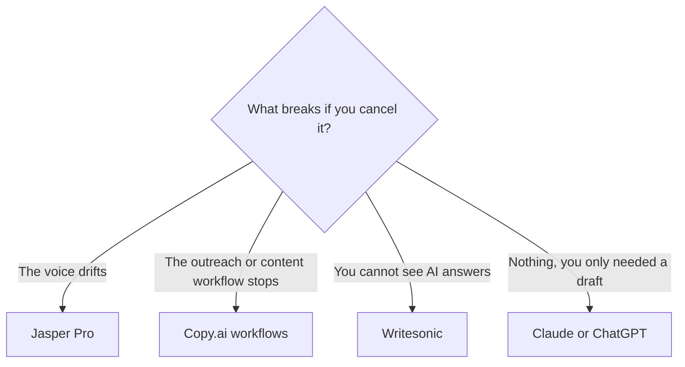

**Jasper is a brand system for marketers. Copy.ai is a go-to-market workflow bill. Writesonic is an AI-search visibility product that still writes articles.** Comparing them as three "AI writers" is how teams buy the expensive one for a job a chatbot already does.

Prices are US list prices excluding tax, from vendor pages checked October 16, 2026, published here on October 24, 2026. A live refetch of those pages that day did not return pricing. Use yearly figures in any budget that lasts past the trial.

The product pages are [Jasper review](/blog/jasper-ai-review-2026/), [Copy.ai review](/blog/copy-ai-review-2026/), and [Writesonic review](/blog/writesonic-review-2026/). A general writing shortlist that includes cheaper tools is [best AI writing assistants](/blog/best-ai-writing-assistants/).

## The job, then the invoice

| If the job is | Buy | Do not buy |
|---|---|---|
| On-brand campaign copy, with a saved voice and a seat per marketer | [Jasper](/tools/jasper/) Pro | Copy.ai's $1,000 workflow plan, unless the work is an automated pipeline |
| A small team sharing chat across several model families | [Copy.ai](/tools/copy-ai/) Chat | Jasper Pro per seat, if you do not need Brand Voices |
| "Where do we show up in ChatGPT and AI Overviews, and what page should we ship?" | [Writesonic](/tools/writesonic/) | A writing seat that does not track prompts |
| A blog post you will edit yourself | [Claude](/tools/claude/) or [ChatGPT](/tools/chatgpt/) | Any of the three, until the brand system or the tracking is the reason |
| A content score against search results | [Surfer SEO](/tools/surfer-seo/) | Writesonic, if you wanted an editor and not a visibility suite |

## The prices that are easy to mix up

| | Jasper | Copy.ai | Writesonic |
|---|---|---|---|
| Entry | Pro $69/seat/month, or $59 billed yearly. 7-day trial. No free plan | Chat $29/month, or $24 billed annually ($288/year), with 5 seats. No permanent free plan on the page we checked | Starter $79/month billed annually, saving $240 a year. Free trial, no free plan |
| What entry includes | Canvas, agents for core marketing workflows, 2 Brand Voices, 5 Knowledge assets, 3 Audiences | Unlimited words, unlimited chat projects, models from OpenAI, Anthropic, and [Gemini](/tools/gemini/) | 50 prompts and 50 answers tracked daily, AI articles, site audits |
| The jump | Business, custom. GEO, translation, deep research agents, a no-code agent builder, Jasper Grid, unlimited voices and audiences | Growth $1,000, Expansion $2,000, Scale $3,000 per month, billed annually | Basic $199 and Growth $399 per month, billed annually. Annual billing saves 20% |
| What the jump is for | Governance and the heavier agents | Workflow credits: 20K, 45K, or 75K a month, and 75 to 200 seats | More prompts, more articles, sentiment, and an Action Center trial on Growth |
| Who it is priced for | A marketing seat | A small shared chat, or a company automating GTM | A team measuring AI visibility |

Copy.ai's price cliff is the point of this comparison. Chat at $24 a year, annualized, is a team chatbot. The next published plan is $1,000 a month. There is no $79 "writer" tier in between on the page we used. If you needed workflows and the quote is four figures, you are buying automation, not synonyms.

Jasper's cliff is per seat and per brand asset. Two Brand Voices on Pro is a real limit for an agency with many clients. Business is where "unlimited" shows up, and Business does not have a public price. Get the quote before you promise a client a voice library.

Writesonic's cliff is the prompt meter. Starter tracks 50 prompts and 50 answers a day. Basic moves to 100 prompts and 300 answers, 25 AI articles, 20 site audits, and 2 users. Growth moves to 200 prompts and 600 answers, 50 AI articles, sentiment, 3 users, and a trial of the Action Center. You are not paying $79 for a blank page. You are paying to watch nine surfaces: [ChatGPT](/tools/chatgpt/), [Perplexity](/tools/perplexity/), [Claude](/tools/claude/), [Gemini](/tools/gemini/), [Grok](/tools/grok/), [Microsoft Copilot](/tools/microsoft-copilot/), Google AI Mode, AI Overviews, and Muse Spark.

## Personas

**A brand marketer with a voice guide and a campaign calendar.** Jasper Pro, one seat, yearly, at $59. Put the voice and the product facts in Knowledge. Use the two Brand Voices on the two lines that must not drift. If you need a third voice, that is a Business conversation, not a workaround in a chatbot. The writing workflow that starts in a general model, before you need Jasper, is [how to write a blog post with Claude](/blog/how-to-write-a-blog-post-with-claude-2026/).

**A founder plus two marketers who want Claude and GPT in one login.** Copy.ai Chat. Five seats are included, so you are not paying $59 three times. Stay off the workflow plans until a workflow has a weekly volume: a list of accounts, a set of briefs, a translation run. Credits exist to be spent by those runs. An idle $1,000 plan does not write better email.

**An SEO or GEO lead who has to show a chart of AI citations.** Writesonic, or the tracking products compared in [Surfer SEO vs Frase](/blog/surfer-seo-vs-frase-2026/). Writesonic's difference is the fix loop: articles and audits attached to the gaps, with the Action Center reserved for the higher tiers. Do not expect Starter to include the full action pack. Growth's Action Center is a trial quantity, not an unlimited agency retainer.

**A solo freelancer writing client blogs.** None of the three until a client requires the brand vault or the visibility report. Claude Pro is $20 a month, or $17 on annual billing. ChatGPT Plus is $20. That is the draft. Jasper is the system you add when the client will pay for the system.

## What "agents" means on each invoice

All three use the word. Jasper's Pro agents cover core marketing workflows, and the custom builder is Business. Copy.ai's agents sit inside workflows that spend workflow credits, on the plans that start at $1,000. Writesonic's agentic actions are the Action Center, which the Growth plan only trials. If a sales call said "agents included," ask which plan name is on the order form.

## FAQ

### Which is the cheapest, Jasper, Copy.ai, or Writesonic?

Copy.ai Chat, at $24/month on annual billing for five seats. Jasper Pro is $59 per seat on annual billing. Writesonic Starter is $79/month on annual billing. The cheapest product is also the one that does not include brand governance or AI-answer tracking.

### Is Writesonic still an AI writer?

It still produces AI articles, with monthly article counts on Basic and Growth. The product you are sold is visibility tracking across AI answers, plus content to close the gaps. If you wanted a blank-page writer, you are in the wrong aisle.

### Can Copy.ai replace Jasper?

For shared chat, yes. For a governed brand voice, a knowledge vault, and audience fields, no. Those are Jasper's Pro limits and Business's reason to exist. Copy.ai replaces Jasper when the work is a workflow over accounts and content, at workflow-plan prices.

### Do any of them have a free plan?

Not a permanent one on the pages we checked. Jasper offers a 7-day Pro trial. Writesonic offers a free trial. Copy.ai starts at Chat.

## Last verified

October 16, 2026 for prices. Published October 24, 2026. Pricing pages did not return a fresh fetch that day.

**Sources:** [Jasper pricing](https://www.jasper.ai/pricing), [Copy.ai pricing](https://www.copy.ai/prices), [Writesonic pricing](https://writesonic.com/pricing).

[Jasper](/tools/jasper/), [Copy.ai](/tools/copy-ai/), and [Writesonic](/tools/writesonic/) are in the [writing directory](/tools/category/writing/) and the [marketing directory](/tools/category/marketing-seo/). Directory pages may use affiliate links. A purchase through them may earn us a commission at no extra cost to you.
