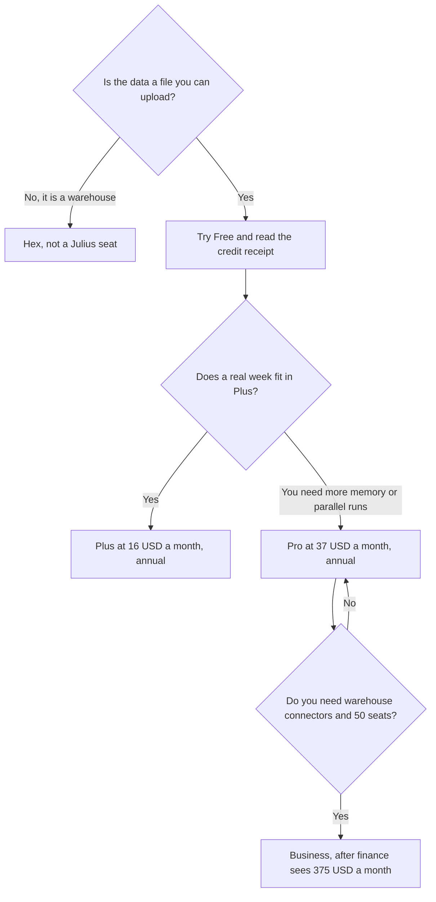

**Julius AI pricing is a free daily credit allowance plus paid credit pools for asking questions of files you upload.** Plus is $20 a month, or $16 a month billed annually, with 2,000 monthly credits and 16 GB of RAM. Pro is $45 a month, or $37 billed annually, with 5,000 credits, 32 GB of RAM, and unlimited parallel agents. Business is $450 a month, or $375 billed annually, with 60,000 credits, data connectors, and up to 50 members. Enterprise is custom. Paid plans add 100 daily refresh credits. The directory says every plan can create presentations, websites, and videos.

The spreadsheet chat, if you only needed a draft next to Excel, is [ChatGPT vs Claude for Excel analysis](/blog/chatgpt-vs-claude-for-excel-analysis-2026/). The warehouse notebook is [Hex pricing explained](/blog/hex-pricing-explained-2026/). The analyst shelf is [best AI tools for data analysts](/blog/best-ai-tools-for-data-analysts-2026/).

Prices are US list prices excluding tax from Julius's pricing page as recorded in the directory on October 16, 2026. Published October 24, 2026. We did not score statistical accuracy. A chart still has to match the file. The directory says paid plans include frontier models, which Julius lists as including GPT-6.1 Sol and Claude Opus 5.5. That is Julius's list, not a benchmark from this site.

## The plans

| Plan | Monthly | Annual, per month | Credits | What changes |
|---|---|---|---|---|
| Free | $0 | $0 | A daily allowance. The card does not print a daily number here | Presentations, websites, and video are listed on every plan |
| Plus | $20 | $16 | 2,000 a month, plus 100 daily refresh credits | Frontier models, 16 GB RAM |
| Pro | $45 | $37 | 5,000 a month, plus 100 daily | 32 GB RAM, unlimited parallel agents, priority support |
| Business | $450 | $375 | 60,000 a month, plus 100 daily | Postgres, BigQuery, Snowflake, and other connectors. Up to 50 members. No table limits on the card |
| Enterprise | Custom | Custom | Custom | Advanced controls, through sales |

Plus annual is 12 × $16 = $192 a year. Plus monthly for a year is 12 × $20 = $240. Pro annual is 12 × $37 = $444. Pro monthly is 12 × $45 = $540. Business annual is 12 × $375 = $4,500. Business monthly is 12 × $450 = $5,400. The jump from Pro to Business is the decision. Connectors and a 50-person workspace are the reason on the card. A larger credit pool alone is an expensive way to avoid sampling a file.

The directory does not print a credits-per-question rate. Run one real workbook and read the receipt before you annualize. A 2,000-credit month of short charts is a different product from a 2,000-credit month of wide joins.

## Four buyers

**A student or an operator with one spreadsheet.** Free, until the daily allowance blocks a real question. Then Plus. Remove columns the question does not need before you upload.

**An analyst who hits memory limits or wants parallel runs.** Pro, at $37 a month on the annual rate, after a week on Plus proved the receipt. Priority support is on this row. It does not make a wrong chart true.

**A team that must query Postgres, BigQuery, or Snowflake from this product.** Business. Confirm the connector you need is in the quote. Up to 50 members is the seat cap on the card. Past that, the conversation is Enterprise, and Enterprise has no public dollar.

**Someone who wanted a notebook the company will rerun on a schedule.** That is [Hex](/tools/hex/), not a Julius credit. Hex Professional is $36 an editor a month. Team is $75 when you need scheduled runs. Community is free with a Hex agent trial and small compute.

## When a chat is enough

[ChatGPT](/tools/chatgpt/) Plus is $20 a month if the job is one workbook in a Project and you will recompute the total yourself. [Claude](/tools/claude/) Pro is $20 a month, or $17 billed annually, if you want the long written read of the same file. Neither is a connector plan. The pair is [ChatGPT vs Claude for Excel analysis](/blog/chatgpt-vs-claude-for-excel-analysis-2026/). A SQL draft against a warehouse schema is [ChatGPT vs Claude for SQL](/blog/chatgpt-vs-claude-for-sql-2026/).

A prompt that holds the line:

"Using only this file, name the columns you used. Show the filter. If a column is missing, write Missing. Do not invent rows. I will check the total before I share it."

The person who checks is [what human-in-the-loop AI is](/blog/what-is-human-in-the-loop-ai-2026/).

## FAQ

### Is Julius free?

Yes. Free includes a daily credit allowance, and the card says every plan can create presentations, websites, and videos. The directory does not print the size of the daily allowance as a number. The product meter is the record. Paid plans add the 100 daily refresh credits on top of the monthly pool.

### Why is Business so much more than Pro?

The card's differences are the credit pool (60,000 versus 5,000), the connectors, and up to 50 members. If you do not need a warehouse connection, stay on Pro and sample the file. Do not buy Business to feel safer about a CSV.

### Which model will I get?

The directory says paid plans include frontier models and records Julius's own examples: GPT-6.1 Sol and Claude Opus 5.5. Treat that as the vendor's list from October 16, 2026. It can change. It is not a quality ranking.

### Can I connect a database on Plus?

No. Connectors are on Business, on the card. Plus and Pro are file-and-credit plans with the RAM figures above.

## Last verified

October 16, 2026, from the directory record of Julius's pricing page. Hex, ChatGPT, and Claude use the same October 16 directory check. Published October 24, 2026.

**Sources:** [Julius AI pricing](https://julius.ai/pricing), [Hex pricing](https://hex.tech/pricing/), [ChatGPT pricing](https://chatgpt.com/pricing/).

*Published by Andrew for [AI Tools Optimizer](https://aitoolsoptimizer.com).*

[Julius AI](/tools/julius-ai/) is in the [data and analytics directory](/tools/category/data-analytics/). Directory pages may use affiliate links. A purchase through them may earn us a commission at no extra cost to you.
