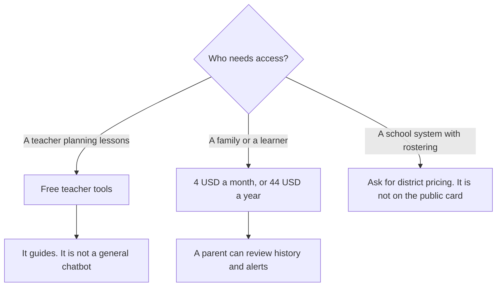

**Khanmigo is free for teachers. Learners and families pay $4 a month or $44 a year, plus sales tax, on the pricing page recorded in the directory.** A parent account can include up to 10 children. District tools, including student access and rostering, are priced on request. There is no separate public "Pro" sticker on that card.

The classroom-tool invoices next to it are [MagicSchool pricing explained](/blog/magicschool-pricing-explained-2026/) and [Brisk Teaching pricing explained](/blog/brisk-teaching-pricing-explained-2026/). A language app is a different product: [Duolingo Max pricing explained](/blog/duolingo-max-pricing-explained-2026/). The teacher roundup is [best AI tools for teachers](/blog/best-ai-tools-for-teachers-2026/).

Prices are US list prices excluding tax from Khan Academy's Khanmigo pricing page as recorded in the directory on October 16, 2026. The live pricing page returned an authentication error when this article was drafted, so the figures below are the directory record, not a fresh checkout. Published October 24, 2026. We did not score tutoring quality.

## The three ways you pay

| Who | Price recorded | What the card says you get |
|---|---|---|
| Teachers | $0 | Planning tools: lesson plans, rubrics, exit tickets, student-work summaries |
| Learners and families | $4 a month, or $44 a year | The tutor on a parent account, up to 10 children, interaction history, moderation alerts |
| Districts | On request | District tools: student access, school data, SSO and rostering via Clever or ClassLink, a customer success manager |

Sales tax is extra, on the card. The annual price is $44, which is less than twelve times $4. This page does not invent a monthly equivalent beyond the two numbers Khanmigo published. If checkout shows a different tax line, checkout wins.

## What the family plan is buying

The product is a Socratic tutor tied to Khan Academy's content: it asks questions instead of handing over the final answer, and it includes a writing coach. That design is the reason to pay $4. It is also the reason a student who wants an unrestricted answer key will call it slow. The slowness is the product.

Parents get a dashboard: up to 10 children, history, and moderation alerts. Ten children is the recorded cap. An eleventh child is a second account or a district plan, not a toggle this page can promise.

Teachers who only need planning can stay on the free teacher tools. Paying the family price so a teacher can generate a rubric is unnecessary on this card. [MagicSchool](/tools/magicschool/)'s free tier is the other individual-teacher path, and Plus there is $8.33 a user a month billed annually, or $12.99 monthly. [Brisk Teaching](/tools/brisk-teaching/) is free for individual teachers, with Premium and Intelligence priced custom. Those are classroom workflow tools. Khanmigo's family row is the learner in the account.

## What it will not replace

**A general assistant.** [ChatGPT](/tools/chatgpt/) Plus is $20 a month when the homework is outside Khan Academy's approach and you want a general draft. Free exists. A general chatbot will often give the answer Khanmigo is built to withhold. Use it with the academic-integrity rules of the class. The ladder is [ChatGPT Go vs Plus vs Pro](/blog/chatgpt-go-vs-plus-vs-pro-2026/).

**A language course.** [Duolingo](/tools/duolingo-max/)'s prices are not a single sticker on Duolingo's website. Do not compare $4 to a Max price this directory does not treat as official. Read the Duolingo article before you assume Max is the plan that includes speaking practice.

**A literature review.** Khanmigo is not [Consensus](/tools/consensus/) or [Elicit](/tools/elicit/). Evidence questions belong on those invoices: [Consensus pricing explained](/blog/consensus-pricing-explained-2026/) and [Elicit pricing explained](/blog/elicit-pricing-explained-2026/).

A wrong step in a solution the student then memorizes is still [a hallucination](/blog/what-is-ai-hallucination-2026/) if the step is false. The student should be able to check the worked example against the textbook. The parent alert is not that check.

## FAQ

### Is Khanmigo free?

For teachers, yes, on the recorded card. Learners and families pay $4 a month or $44 a year, plus tax. A student using a parent's paid account is on the family plan, not on the teacher plan.

### Does the annual plan cost $48?

No. The recorded annual price is $44 a year, not $4 times 12. Confirm the button in your account before you share the number with another family. Tax can change the charge.

### How many children can one subscription cover?

Up to 10, on the directory card, from a parent account. District rollout is a different contract.

### Is there a public district price?

Not on the card we recorded. District tools are on request. Ask for the rostering path you need, Clever or ClassLink, and for what student data is stored. Do not budget a per-student figure this page did not print.

## Last verified

October 16, 2026, from khanmigo.ai/pricing as recorded in the directory. A live fetch of that page returned HTTP 401 on October 24, 2026, so this article does not claim a newer sticker. Published October 24, 2026.

**Sources:** [Khanmigo pricing](https://www.khanmigo.ai/pricing), [MagicSchool pricing](https://www.magicschool.ai/pricing).

*Published by Andrew for [AI Tools Optimizer](https://aitoolsoptimizer.com).*

[Khanmigo](/tools/khanmigo/) is in the [education directory](/tools/category/education/). Directory pages may use affiliate links. A purchase through them may earn us a commission at no extra cost to you.
