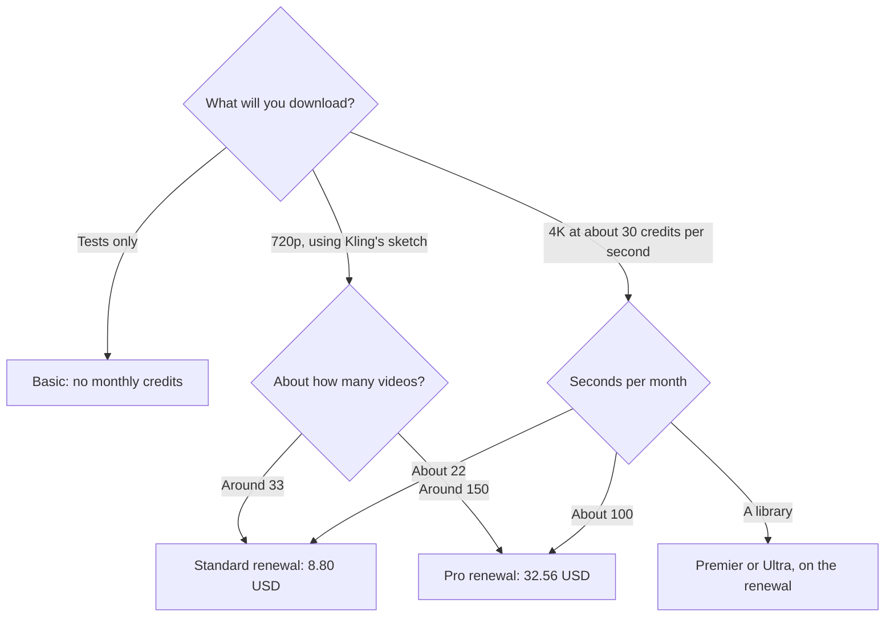

**Budget Kling on the renewal, not the first month.** Standard is recorded at $6.99 the first month and $8.80 after that, for 660 credits, with a $10 list price shown. Pro is $25.99 then $32.56, for 3,000 credits, with $37 shown. Premier is $64.99 then $80.96, for 8,000 credits, with $92 shown. Ultra is $127.99 then $159.99, for 26,000 credits, with $180 shown. Basic is free and includes no monthly credits.

The product page is [Kling AI review](/blog/kling-ai-review-2026/). A clip inside a wider editor is [Runway vs Kling for ads](/blog/runway-vs-kling-for-ads-2026/). The category shelf is [best AI video generators](/blog/best-ai-video-generators-2026/).

These are US dollar monthly figures from Kling's VIDEO 3.0 credit guide, as recorded in the directory on October 16, 2026. A fetch of the live pricing page on October 24, 2026 returned 401, so this article does not update the table from memory. Published October 24, 2026. We did not score motion quality. Tax and region can change checkout.

## The two prices, then the sketch

| Plan | List price shown | First month | Renewal | Credits / month | Kling's output sketch |
|---|---|---|---|---|---|
| Basic | $0 | $0 | $0 | None | The interface, without a monthly allowance |
| Standard | $10 | $6.99 | $8.80 | 660 | About 660 images or 33 videos at 720p |
| Pro | $37 | $25.99 | $32.56 | 3,000 | About 3,000 images or 150 videos at 720p |
| Premier | $92 | $64.99 | $80.96 | 8,000 | About 8,000 images or 400 videos at 720p |
| Ultra | $180 | $127.99 | $159.99 | 26,000 | About 26,000 images or 1,300 videos at 720p |

Kling's guide uses about 30 credits per second as a reference for 4K Kling VIDEO 3.0. On that rate, Standard's 660 credits are 22 seconds of 4K. Pro's 3,000 credits are 100 seconds of 4K. The "150 videos at 720p" line and the "100 seconds of 4K" line are different exports. Budget the resolution you will actually download.

## How to read the first month

The first-month price is a new-subscription discount. The renewal is the number that repeats. A yearly plan of "Standard at $6.99" will not match the second invoice if the renewal is $8.80. Put $8.80 in the forecast for Standard, $32.56 for Pro, $80.96 for Premier, and $159.99 for Ultra. Treat the list prices ($10, $37, $92, $180) as the figures the page showed beside those discounts. Confirm which number checkout charges today, because this article could not re-fetch the page.

The 720p sketch divides evenly at 20 credits per video: 660 ÷ 33, 3,000 ÷ 150, 8,000 ÷ 400, and 26,000 ÷ 1,300. That is Kling's sketch, not a promise that your prompt costs 20 credits. A longer clip or a higher resolution moves the debit. Watch one generation before you multiply.

## When another studio is the other bill

**Runway** Standard is $12 a month billed annually, or $15 monthly, with 625 credits. That credit is not a Kling credit. Do not add the balances. The invoice is [Runway pricing explained](/blog/runway-pricing-explained-2026/).

**Luma** Plus is $30 a month or $300 a year for 10,000 credits. Again, a different meter. [Luma AI pricing explained](/blog/luma-ai-pricing-explained-2026/) keeps the units apart.

**Pika** is a third credit system. Read [Pika pricing explained](/blog/pika-pricing-explained-2026/) before you put a dollar next to Kling's renewal. The three-way context is [Runway vs Kling vs Veo](/blog/runway-vs-kling-vs-veo-2026/). This page does not print a Veo price.

An API exists, on the directory card. This article does not print a separate API rate, because the credit guide we are quoting is the membership table. Ask for the API card before you model a product feature.

## FAQ

### Is Kling free?

Basic is free and includes no monthly credits. You can open the product. A monthly video habit needs a paid plan, or a credit purchase the current page describes. We are not quoting a top-up pack beyond the memberships above.

### Why are there three dollar figures on one plan?

The directory recorded a list price shown, a first-month discount, and a renewal. Budget the renewal. The first month is a discount for a new subscription, not the run rate.

### How many 4K seconds are on Premier?

8,000 ÷ 30 is about 266 seconds, if the 30-credits-per-second reference holds. Ultra's 26,000 credits are about 866 seconds at that same reference. Confirm the debit on one 4K second before you promise a library.

### Do credits roll over?

The guide we recorded describes a monthly allowance. It does not describe rollover. Assume unused credits expire with the month until the membership page you are looking at says otherwise.

## Last verified

October 16, 2026, from the directory's record of Kling's VIDEO 3.0 credit guide. A fetch on October 24, 2026 returned 401. Runway, Luma, and Pika figures are from the same October 16 directory check. Published October 24, 2026.

**Sources:** [Kling VIDEO 3.0 credit cost guide](https://kling.ai/blog/kling-video-3-0-credit-cost-guide), [Kling AI](https://kling.ai).

*Published by Andrew for [AI Tools Optimizer](https://aitoolsoptimizer.com).*

[Kling AI](/tools/kling-ai/) is in the [video directory](/tools/category/video/). Directory pages may use affiliate links. A purchase through them may earn us a commission at no extra cost to you.
