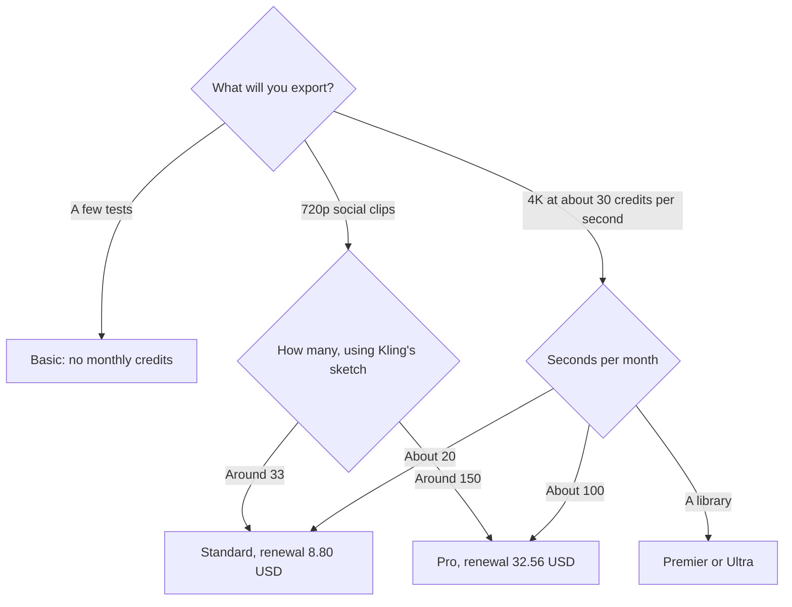

**[Kling AI](/tools/kling-ai/) generates video and images from prompts and reference frames.** Basic is free and includes no monthly credits. Standard lists at $10, with a first month at $6.99 and a renewal at $8.80, for 660 credits. Pro lists at $37, first month $25.99, renewal $32.56, for 3,000 credits. Premier lists at $92, first month $64.99, renewal $80.96, for 8,000 credits. Ultra lists at $180, first month $127.99, renewal $159.99, for 26,000 credits.

Those figures are US dollar monthly prices from Kling's VIDEO 3.0 credit guide, recorded October 16, 2026. The first-month price is a discount for a new subscription. The renewal is the number that repeats. Offers, tax, and region can change the checkout. We did not score motion quality against Runway or Luma.

Compare generators in [best AI video generators](/blog/best-ai-video-generators-2026/). If you want Kling's model inside a wider editor, read the [Runway review](/blog/runway-review-2026/) as well. The meters are separate.

## Two prices, then the credits

| Plan | List price shown | First month | Renewal | Credits / month | Kling's own output sketch |
|---|---|---|---|---|---|
| Basic | $0 | $0 | $0 | None | The interface, without a monthly allowance |
| Standard | $10 | $6.99 | $8.80 | 660 | About 660 images or 33 videos at 720p |
| Pro | $37 | $25.99 | $32.56 | 3,000 | About 3,000 images or 150 videos at 720p |
| Premier | $92 | $64.99 | $80.96 | 8,000 | About 8,000 images or 400 videos at 720p |
| Ultra | $180 | $127.99 | $159.99 | 26,000 | About 26,000 images or 1,300 videos at 720p |

Kling's guide also uses about 30 credits per second as a reference for 4K Kling VIDEO 3.0. On that rate, Pro's 3,000 credits are 100 seconds of 4K. Standard's 660 credits are 22 seconds of 4K. The "150 videos" line and the "100 seconds of 4K" line describe different exports. Budget the resolution you will actually download.

A year of Pro at the renewal rate is $32.56 × 12 = $390.72, plus a cheaper first month if the discount still applies when you start. A year priced off the $37 list price is $444. Use the renewal column in any budget that lasts past month one. The list price is the sticker Kling shows. The renewal is what the guide says you pay next.

## What the studio is

Kling, from Kuaishou, is a generation studio and an API. You prompt, or you animate a still. VIDEO 3.0 is the model family the credit guide is about, with cost that scales by length and resolution. Image generation spends the same credit balance. The developer platform is how an app calls the model without the membership UI.

There is no timeline editor here that replaces [CapCut](/tools/capcut/) or [Descript](/tools/descript/). There is no avatar presenter that replaces [HeyGen](/tools/heygen/). If the job is "a person explains the policy," leave Kling. If the job is "the product turns on a table," Kling is in the right category, next to [Runway](/tools/runway/), [Luma](/tools/luma-ai/), [Pika](/tools/pika/), and [Google Flow](/tools/google-flow/).

Pika's Starter plan is $10 a month for 900 credits, with a commercial license on Creator at $35. Luma Plus is $30 a month or $300 a year. Those are neighboring list prices, not a quality ranking.

## Fit score

| Question | Basic | Standard | Pro | Premier / Ultra |
|---|---|---|---|---|
| Monthly credits | No | 660 | 3,000 | 8,000 or 26,000 |
| Price after month one | $0 | $8.80 | $32.56 | $80.96 or $159.99 |
| 4K seconds at 30 credits each | 0 | About 22 | About 100 | About 266 or 866 |
| 720p videos in Kling's sketch | 0 | About 33 | About 150 | About 400 or 1,300 |
| Edit a filmed interview | Poor fit | Poor fit | Poor fit | Poor fit |
| Flat price with no intro discount | The free plan | The renewal, once you know it | The renewal | The renewal |

The second and third rows are arithmetic on Kling's published rates. They are not a render test.

## Before you take the first-month discount

1. Open the membership page and write down three numbers: today, next month, and the credit total.
2. Generate one 720p clip and one short 4K clip. Read both deductions.
3. If 4K is the delivery format, ignore the "150 videos" marketing line and use the per-second rate.
4. If you only need a handful of Kling shots inside a graded edit, price the same shots as Runway credits before you open a Kling Ultra seat.
5. Set a reminder for the renewal date. The discount is the first month.

## FAQ

### Is Kling AI free?

Basic is free and does not include monthly credits. Paid plans are how you get an allowance.

### How much does Kling cost after the first month?

On the guide we used: Standard $8.80, Pro $32.56, Premier $80.96, Ultra $159.99. First-month prices are lower. List prices shown are $10, $37, $92, and $180.

### How many credits does 4K use?

About 30 credits per second for Kling VIDEO 3.0 at 4K, as a reference rate in Kling's guide. Confirm it in the product. Resolution and length both move the cost.

### Is the API separate?

Kling offers a developer platform. Price API usage on that platform's own page if you are embedding video in an app. The membership table above is the studio plan.

## Last verified

October 16, 2026.

**Sources:** [Kling VIDEO 3.0 credit cost guide](https://kling.ai/blog/kling-video-3-0-credit-cost-guide), [Kling AI](https://kling.ai).

[Kling AI](/tools/kling-ai/) is in the [video directory](/tools/category/video/). Directory pages may use affiliate links. A purchase through them can earn us a commission at no extra cost to you.
