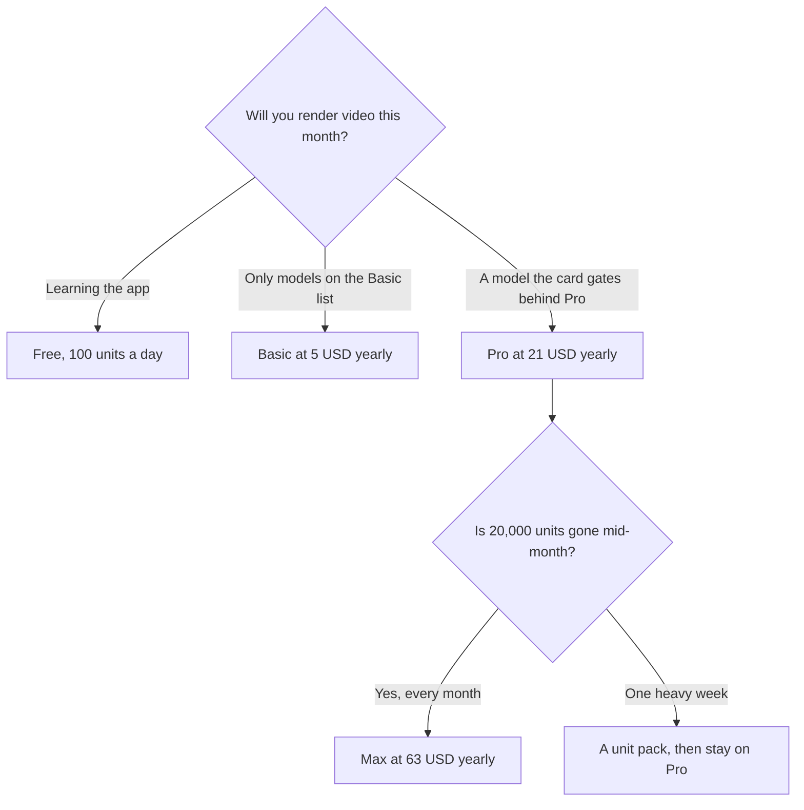

**Krea pricing is a pool of compute units, and the video-model list changes at Pro.** Free is 100 units a day and does not ask for a card. Basic is $9 a month, or $5 a month billed yearly, for 5,000 units. Pro is $35, or $21 yearly, for 20,000 units, and it is the first card that says all video models. Max is $105, or $63 yearly, for 60,000 units.

Those figures were on Krea's pricing page on October 24, 2026, with a yearly toggle marked 40% off, as recorded in the [Krea review](/blog/krea-review-2026/). A refetch for this article returned 401. Published October 24, 2026. The picture quality is not scored here. The switchboard versus one image family is [Midjourney vs Krea](/blog/midjourney-vs-krea-2026/).

## The ladder

| Plan | Monthly | Yearly, per month | Units | What you crossed up for |
|---|---|---|---|---|
| Free | $0 | $0 | 100 a day | The interface. Video models were listed on the free set read that day |
| Basic | $9 | $5 | 5,000 a month | A monthly pool. Selected video models |
| Pro | $35 | $21 | 20,000 a month | All video models on that card |
| Max | $105 | $63 | 60,000 a month | The larger pool. A slider goes higher |
| Business / Enterprise | Contact | — | Custom | A team contract |

Forty percent off matches Pro ($35 × 0.6 = $21) and Max ($105 × 0.6 = $63). Basic's yearly cell prints **$5**. Forty percent off $9 is $5.40. Quote $5, because that is the cell, not because the percentage lands cleanly. A Basic year is $60. A Pro year is $252. A Max year is $756. Those are the card rates before packs.

One higher Max line on the same page showed **$200 a month and $160 yearly** for a larger pack. If you moved the slider, email that cell. Do not forward "$63" for a pack you changed.

## What a unit is not

Krea prints rough translations: Basic's 5,000 units as on the order of a hundred stills on one named model, or about 15 short videos on another; Pro's 20,000 as about 65 of a named video model; Max's 60,000 as about 197. Those are Krea's estimates for the models named that day. They are a budget sketch. They are not a quota you can put in a statement of work. A different model spends units at a different rate. Generate one keeper and divide.

Paid plans add a commercial-use line. The October 24 read also printed commercial use on free. That sentence sits under Krea's terms and under the license of any third-party model in the chain. A client contract that names a specific model still needs that model's terms. The subscription is not a universal indemnity.

Paid plans describe unlimited relaxed generations on supported in-house image models after units are gone. Video was not described as unlimited. Assume a clip still spends units until the card says otherwise. Krea Agent is listed on the cards, including free. It spends the same units when it generates. Briefing an agent is not a second invoice. It is a faster way to empty the pool.

## Krea next to a single-model bill

[Midjourney](/tools/midjourney/) has no free plan. Basic is $10, or $8 billed annually, for 3.3 Fast hours. Standard at $30, or $24 annually, is the Relax step. The clock is [Midjourney pricing explained](/blog/midjourney-pricing-explained-2026/). Buy Midjourney when you already know you want that family. Buy Krea when the month includes more than one model, or a video model you do not want a second subscription for.

[Leonardo](/tools/leonardo-ai/) Essential is $12 a month for 8,500 tokens. [Flux](/tools/flux/) is pay as you go, from about $0.008 an image on the directory's named rate, with no seat. [Runway](/tools/runway/) Standard is $12 a month billed annually if the job is only video and you already like that timeline. Krea's reason to exist is the switchboard: real-time drawing, nodes, an upscaler, video, and an agent. You pay for the switchboard even when you touch one model. The stills shelf is [best AI image generators](/blog/best-ai-image-generators-2026/).

## FAQ

### Is Krea free?

Yes. 100 compute units a day, no card, on the October 24 page. That grant resets daily. It is not 5,000 units. Basic is the first monthly pool.

### Does Basic include every video model?

No. The Basic card says selected video models and points at Pro for all of them. If the clip in the demo used a model Basic does not list, the $5 plan is the wrong savings. Pro at $21 yearly is the first "all video models" cell we read.

### Does yearly billing save 40%?

That is the label, and it matches Pro and Max. Basic's printed yearly price is $5 a month. Read the toggle you are about to pay.

### Can I buy units without moving plans?

Paid plans sell additional compute packs, on the review of that page. Packs are the right hatch for one heavy week. They are the wrong habit if every week is heavy. Move to Max when 20,000 units are the bottleneck, not when one launch was.

## Last verified

October 24, 2026, from Krea's pricing page, as recorded in the Krea review. A later fetch for this article returned 401. Generation estimates are Krea's, for the models named that day. October 16, 2026 for Midjourney, Leonardo, Flux, and Runway comparison prices. Published October 24, 2026.

**Sources:** [Krea pricing](https://www.krea.ai/pricing), [Midjourney plans](https://docs.midjourney.com/hc/en-us/articles/27870484040333-Comparing-Midjourney-Plans).

*Published by Andrew for [AI Tools Optimizer](https://aitoolsoptimizer.com).*

[Krea](/tools/krea/) is in the [image generation directory](/tools/category/image-generation/). Directory pages may use affiliate links. A purchase through them may earn us a commission at no extra cost to you.
