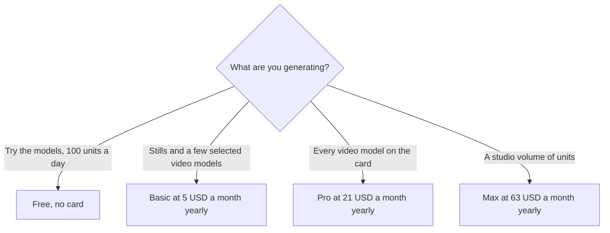

**[Krea](/tools/krea/) is a creative workspace that fronts many image, video, and 3D models, plus its own Krea 3 model and an agent that can run a brief across them.** You pay in compute units. On October 24, 2026 the pricing page, with a yearly toggle marked **40% off**, showed Basic at **$9 a month or $5 a month yearly** for 5,000 units, Pro at **$35 or $21** for 20,000 units, and Max at **$105 or $63** for 60,000 units. Free is **100 units a day** and does not ask for a card.

We did not rank Krea's pictures against Midjourney. The wider map is [best AI image generators](/blog/best-ai-image-generators-2026/). This page is which Krea plan actually includes the video models you saw in the demo.

## The plans

| Plan | Monthly | Yearly, per month, as printed | Units | Video access on the card |
|---|---|---|---|---|
| Free | $0 | $0 | 100 a day | All video models are listed on the free feature set we read |
| Basic | $9 | $5 | 5,000 a month | Selected video models. The card says Pro unlocks all video models |
| Pro | $35 | $21 | 20,000 a month | All video models, including the ones named on the card such as Veo, Seedance, and Kling |
| Max | $105 | $63 | 60,000 a month, with a slider for more | All video models |

Krea prints rough translations next to the packs: Basic's 5,000 units as on the order of a hundred Nano Banana 2 stills or about 15 Seedance 2.0 Fast videos, Pro's 20,000 as more stills and about 65 Seedance 2.5 videos, Max's 60,000 as about 197 of those videos. Those are Krea's estimates for named models on that day. A different model spends units at a different rate. The estimate is a budget sketch, not a quota of 15 finished videos.

Forty percent off is the yearly label. It matches Pro ($35 × 0.6 = $21) and Max ($105 × 0.6 = $63). Basic's card prints **$5**, while 40% off $9 is $5.40. Quote $5 because that is the figure on the yearly card, not because the percentage lands on a clean dime. There is also a higher Max slider. One line on the page shows **$200 a month and $160 a month yearly** for a much larger unit pack. If you need that step, read the slider. Do not email "$63" for a pack you moved.

## What is included before you look at units

The free card lists Krea 3, the agent, real-time models, image models, video models, 3D and lipsync, limited LoRA training up to 50 images, upscaling that is capped relative to paid upscalers, nodes, an app builder, and a commercial-use line. Paid cards add paid upscaling, including Topaz Standard, up to 22K on the upscaler description, bulk discounts on extra unit packs, unlimited relaxed generations on supported in-house image models after units run out, and more room to queue jobs.

Read the video line twice. Free's feature list and Basic's feature list do not say the same thing about video. Basic says selected video models and points at Pro for all of them. If the clip you want is on a model Basic does not list, the $5 plan is the wrong savings. Pro is the first card that says all video models in the section we read.

Commercial use is printed on the plans, including free. A commercial-use sentence on a pricing page still sits under Krea's terms and under the license of any third-party model in the chain. If a client contract needs a specific model license, open that model's terms. The Krea subscription is not a universal indemnity.

## How this differs from a single-model membership

[Midjourney](/tools/midjourney/) is one family of models with its own plan. [Leonardo](/tools/leonardo-ai/) and [Flux](/tools/flux/) are the other stills tools in this directory cluster. Krea's reason to exist is the switchboard: real-time drawing, nodes that chain models, an upscaler, video, and an agent that can plan a set of generations. You pay for that switchboard even when you only touch one model. If you already know you only want Midjourney, a second subscription is a second meter. The decision guide for leaving a Discord-based generator is [best free Midjourney alternatives](/blog/best-free-midjourney-alternatives-no-discord-2026/). Krea is one of the browser-based options on that shelf, not a free clone of Midjourney's plan.

Units reset on the plan's cycle. The free grant is daily. A paid plan's monthly units are the number to divide into a campaign. Five thousand units that become about 15 short videos, in Krea's own Seedance example, is a test budget. It is not a month of daily client delivery. Twenty thousand units is the first pack that looks like production if those estimates hold for the model you actually click.

## Who should pay

**Use free** while 100 units a day teach you the interface. **Buy Basic yearly at $5** when you want a monthly pool and you can live inside the selected video list. **Buy Pro** when the model you need is behind the "all video models" line, or when 5,000 units are gone before the work is. **Buy Max** when the unit math, not the tier name, says 20,000 is short. **Skip Krea** when you need a single approved model and you already pay for it. Extra switchboards feel productive until the renewal email.

A Basic year at the printed $5 rate is **$60**. A Pro year at $21 is **$252**. A Max year at $63 is **$756**. Those are the card rates, before extra unit packs. Packs are the right escape hatch for one heavy week. They are the wrong habit if every week is heavy. Move the plan instead.

## FAQ

### How much does Krea cost?

Free is $0 for 100 units a day. Basic is $9 a month or $5 a month billed yearly. Pro is $35 or $21. Max is $105 or $63 for 60,000 units. Checked October 24, 2026. The yearly toggle is labeled 40% off.

### Does Basic include every video model?

The Basic card says selected video models and says Pro unlocks all video models. Confirm the model name on your card before you rely on a demo you saw under a different plan.

### Is there a commercial license?

The pricing page prints a commercial-use line on the plans we read, including free. Third-party models can have their own terms. Read those if the work is for a client.

### What happens when monthly units run out?

Paid plans describe unlimited relaxed generations on supported in-house image models after units are gone, and they sell additional compute packs. Video models were not described as unlimited. Assume a video render still needs units until the card says otherwise.

### Is the agent a separate bill?

Krea Agent is listed on the plan cards, including free. It spends the same compute units when it generates. Briefing the agent does not open a second invoice by itself.

## Last verified

October 24, 2026, from Krea's pricing page. Generation estimates are Krea's, for the models named on the cards that day. Recheck the video-access line if you are buying Basic to save money.

**Sources:** [Krea pricing](https://www.krea.ai/pricing), [Krea](https://www.krea.ai).

[Krea](/tools/krea/) is in the [image generation directory](/tools/category/image-generation/). Directory pages may use affiliate links. A purchase through them may earn us a commission at no extra cost to you.
