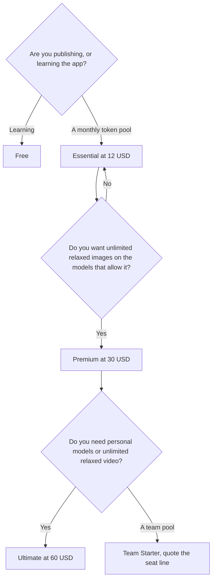

**Leonardo pricing, on the monthly card this directory recorded, is a token pool.** Free is for trying it. Essential is $12 a month for 8,500 fast tokens. Premium is $30 a month for 25,000 fast tokens and unlimited relaxed image generation on select models. Ultimate is $60 a month for 60,000 fast tokens, 50 personal models, and unlimited relaxed image and video generation. The October 16 page was monthly billing. This article does not invent an annual discount.

The product page is [Leonardo review](/blog/leonardo-ai-review-2026/). The stills comparison is [Midjourney vs Leonardo vs Flux](/blog/midjourney-vs-leonardo-vs-flux-2026/). The shelf is [best AI image generators](/blog/best-ai-image-generators-2026/).

Prices are US list prices excluding tax from the directory page checked October 16, 2026. Published October 24, 2026. We did not score images.

## The ladder

| Plan | Monthly price | Fast tokens | The line you crossed up for |
|---|---|---|---|
| Free | $0 | Limited, for casual exploration | The interface |
| Essential | $12 | 8,500, with a 25,500 token bank | Top-up tokens |
| Premium | $30 | 25,000, with a 75,000 token bank | Unlimited relaxed images on select models |
| Ultimate | $60 | 60,000, with a 180,000 token bank | 50 personal models, and unlimited relaxed images and video |
| Team Starter | $24 per seat, with $72 a month printed on the same line | 25,000 per seat, shared | Private team generations |
| Team Growth | $48 per seat, with $144 a month printed on the same line | A larger shared pool | More capacity |

The bank is larger than the monthly grant: Essential 25,500, Premium 75,000, Ultimate 180,000, beside 8,500, 25,000, and 60,000 fast tokens. The directory records those pairs. It does not spell a rollover rule in the sentence this article is willing to stretch. Treat the bank figure as the number printed next to the plan, and confirm in checkout before you promise a quarter of unused tokens to a client.

Team Starter is printed as $24 per seat and as $72 a month. Team Growth is printed as $48 per seat and as $144 a month. $24 × 3 = $72 and $48 × 3 = $144, which is consistent with a three-seat illustration, and this directory does not say "minimum three seats" in a separate sentence. Quote the line your checkout shows. Do not send "$24" to finance if the screen says $72, and do not send "$72" if you are adding seats above whatever that line assumed.

## What a token is not

A token here is Leonardo's generation credit, not the text token on a chat API. [What AI tokens are](/blog/what-are-ai-tokens-explained-2026/) is the chat meaning. Do not divide $12 by 8,500 and compare it to a chat price per million. Generate one keeper, note the tokens it spent, and divide that.

Relaxed generation is the pressure valve on Premium and Ultimate, for the models the card includes. Ultimate adds video to that unlimited relaxed line. Essential is the pool without that valve, plus top-ups. If every image has to be fast, price the fast grant, not the relaxed sentence.

Personal model training shows up as a count on Ultimate: 50 personal models. The directory does not give Essential or Premium a personal-model count in the table we are using. If training a character is the reason you came, read that row before you stay on $12.

## Leonardo next to a different meter

[Midjourney](/tools/midjourney/) has no free plan. Basic is $10 a month, or $8 billed annually, for a Fast-hour allowance. Standard is $30, or $24 annually. You buy Midjourney when you want that one family. You buy Leonardo when you want tokens, a relaxed mode, personal models, or a team pool. The clock is [Midjourney pricing explained](/blog/midjourney-pricing-explained-2026/).

[Krea](/tools/krea/) is a compute-unit switchboard. Free is 100 units a day. Basic is $9, or $5 billed yearly. The card is [Krea pricing explained](/blog/krea-pricing-explained-2026/). [Flux](/tools/flux/) has no seat. FLUX 3 Klein starts at $0.008 an image at 768×768 on the directory rate. Pay per image when you do not want a monthly pool. [Adobe Firefly](/tools/adobe-firefly/) Standard is $9.99 a month for 2,000 credits, with unlimited standard image generations on paid plans and credits spent on premium video and partner models. The review is [Adobe Firefly review](/blog/adobe-firefly-review-2026/). The comparison is [Midjourney vs Adobe Firefly](/blog/midjourney-vs-adobe-firefly-2026/).

None of those credits equals a Leonardo token. One image on each trial is the conversion.

## FAQ

### Is Leonardo free?

Yes, as a limited plan for casual exploration, on the October 16 card. Essential at $12 is the first monthly token pool.

### Does Premium include unlimited everything?

It includes unlimited relaxed image generation for select models, plus 25,000 fast tokens. Video's unlimited relaxed line is on Ultimate, on this table. "Select models" means the card, not every model in the app.

### Is there a yearly discount?

The directory read we are using is monthly billing, excluding tax. It does not record an annual Leonardo price. If a yearly toggle exists when you check out, the toggle wins, and this page should not be quoted over it.

### How do team plans work?

The directory lists Team Starter at $24 per seat, with a $72 a month figure, and Team Growth at $48 per seat, with $144 a month, plus shared tokens and private team generations. Confirm the seat count on the invoice before you multiply.

## Last verified

October 16, 2026 for Leonardo, Midjourney, Flux, and Firefly prices named above. Krea's yearly cells match the October 24 pricing explainer. Published October 24, 2026.

**Sources:** [Leonardo pricing](https://leonardo.ai/pricing), [Midjourney plans](https://docs.midjourney.com/hc/en-us/articles/27870484040333-Comparing-Midjourney-Plans), [Adobe Firefly](https://www.adobe.com/products/firefly.html).

*Published by Andrew for [AI Tools Optimizer](https://aitoolsoptimizer.com).*

[Leonardo](/tools/leonardo-ai/) is in the [image generation directory](/tools/category/image-generation/). Directory pages may use affiliate links. A purchase through them may earn us a commission at no extra cost to you.
