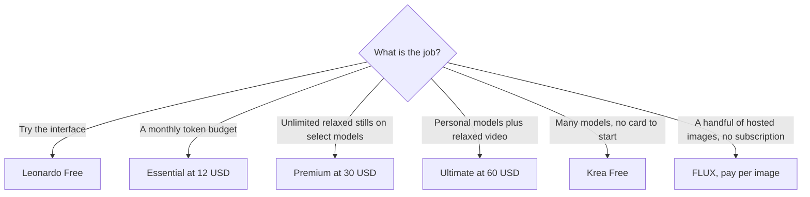

**Leonardo.Ai is a token studio for images, video, and personal models, now owned by Canva.** Essential is $12/month for 8,500 fast tokens. Premium is $30/month for 25,000 fast tokens and unlimited relaxed image generation on select models. Ultimate is $60/month for 60,000 fast tokens, 50 personal models, and unlimited relaxed video on select models. A free plan exists for casual use. Prices exclude tax.

Figures are monthly US list prices from Leonardo's pricing page, checked October 16, 2026. We did not score image quality. The reason to pick Leonardo, [Krea](/tools/krea/), or [FLUX](/tools/flux/) is the meter and the license, which are published.

The commercial shelf is [best AI image generators](/blog/best-ai-image-generators-2026/). A no-card way to try a different studio is [free Midjourney alternatives](/blog/best-free-midjourney-alternatives-no-discord-2026/).

## The individual plans

| Plan | Price / month | Fast tokens | Token bank | What is unlimited, and slow |
|---|---|---|---|---|
| Free | $0 | A casual allowance. We did not record a token count | — | Exploration, not a production pool |
| Essential | $12 | 8,500 | Up to 25,500 | Nothing unlimited on the notes we stored |
| Premium | $30 | 25,000 | Up to 3× the monthly allowance | Unlimited relaxed images for select models |
| Ultimate | $60 | 60,000 | Up to 3× | Unlimited relaxed images and video for select models. 50 personal AI models |

Leonardo says unused tokens can accumulate in a bank up to three times the monthly allowance. Essential's bank cap is listed as 25,500, which is 8,500 × 3. Premium's 25,000 × 3 is 75,000. Ultimate's 60,000 × 3 is 180,000. Use the published bank caps, and confirm Essential's 25,500 still matches 3× if the monthly grant changes. Tokens in the bank are not a second high-speed queue. Relaxed mode is slower. That is the trade for "unlimited" on Premium and Ultimate, and it applies to select models, not to every model in the picker.

## Teams

Team Starter is $24 per seat, and Leonardo lists that as $72 a month, which is three seats at $24. Growth is $48 per seat, listed as $144 a month, which is three seats at $48. The plans include shared tokens and private team generations. If your team is not three people, multiply the seat price yourself and confirm the minimum on the pricing page. We are reading $72 and $144 as the three-seat packages Leonardo displayed, not as a rule that a fourth seat is free.

A Canva Pro seat does not include these tokens. Canva's own AI allowance is reviewed in [Canva Magic Studio](/blog/canva-magic-studio-review-2026/). Owning both products is a reason the company may keep Leonardo around. It is not a merged invoice.

## What the tokens are for

Fast tokens pay for full-speed generation. Image work, video, and training a personal model all draw on that idea of a balance. We do not have a published "tokens per image" rate in the notes from October 16, so this review does not convert 8,500 tokens into a picture count. Generate a real set, read the drop, and then decide whether Essential's 8,500 is a week or a month.

Personal models are why a game artist or a brand team stays. Ultimate lists 50 of them. Premium is the stills plan: unlimited relaxed generation for select models once the fast tokens are gone. If your deadline cannot wait on a slow queue, the unlimited line is not the capacity number. The fast-token grant is.

Video follows the same warning. Ultimate adds unlimited relaxed video for select models. A client delivery at full speed still spends tokens. Price a storyboard in fast tokens before you call Ultimate an unlimited video plan.

## When Krea or FLUX is the clearer buy

**Krea** if you want many image and video models, real-time iteration, and a free start that states no credit card. Free is 100 compute units a day. Basic is $9/month or $5/month yearly, with 5,000 units, which Krea sketches as about 64 Nano Banana 2 images or 20 Seedance 2.0 videos. Pro is $35/month or $21/month yearly and adds the video models and upscaling up to 22K. Paid plans include a commercial license. Leonardo's free plan does not, in our notes, include that no-card sentence. If the test must not touch a card, open Krea first.

**FLUX** if you refuse a subscription. Black Forest Labs charges credits at $0.01, with FLUX 3 Klein images from $0.008 at 768×768 to $0.036 at 4K. Ten 768px images are $0.08. A hundred are $0.80. There is no monthly pool to expire, and there is no relaxed queue. Open-weight models can be run on your own hardware under their licenses. FLUX is a weak fit if you wanted Leonardo's personal-model training inside a hosted app.

**Stay on Leonardo** if the work is a consistent character or style you will train, a small team sharing tokens, or a Premium relaxed queue you are willing to wait on. Essential at $12 is the cheapest paid individual plan in this trio's subscription column. Krea Basic yearly at $5 is cheaper if yearly billing is acceptable and the compute units cover your models. Those are different pools. Do not pick the lower sticker until you have measured one.

## The generators Leonardo does not replace

| Need | Use instead | Entry |
|---|---|---|
| Readable words in the image | [Ideogram](/tools/ideogram/) | 30 free credits a week. Plus is $15/month yearly |
| Adobe apps and a training-data story | [Adobe Firefly](/tools/adobe-firefly/) | Standard $9.99/month. See the [Firefly review](/blog/adobe-firefly-review-2026/) |
| A paid artistic default | [Midjourney](/tools/midjourney/) | Basic $10/month or $8 annual. No free plan |
| A template and a Brand Kit | [Canva](/tools/canva/) | Free, or Pro at $180/year |

## A month that tells you the tier

1. Use the free plan on one real brief. If you cannot finish the brief, look at the token drop rather than at the gallery.
2. If fast tokens are the bottleneck and you do not need unlimited stills, Essential at $12 is the test month.
3. If you keep hitting the cap and you can wait, Premium at $30 is the relaxed-image plan.
4. Move to Ultimate only for the personal-model count or relaxed video you actually used in the Premium month.
5. If the brief was "ten pictures, once," price FLUX per image before you take any seat.

## FAQ

### Is Leonardo.Ai free?

Yes. The free plan is for casual use. We did not record a monthly token count for it, and we did not record a promise that signup skips a credit card. Essential at $12/month is the first paid individual tier we could price.

### How much does Leonardo cost?

On monthly billing, Essential is $12, Premium is $30, and Ultimate is $60, excluding tax. Team Starter is $24 per seat and Growth is $48 per seat, displayed as $72 and $144 a month at three seats.

### Is Leonardo the same as Canva?

Leonardo.Ai is part of Canva. The products are billed separately. Canva Pro does not include Leonardo's fast-token allowance.

## Last verified

October 16, 2026. Recheck [Leonardo pricing](https://leonardo.ai/pricing/), [Krea pricing](https://www.krea.ai/pricing), and [FLUX pricing](https://bfl.ai/pricing) before you choose a yearly plan.

The [Leonardo.Ai](/tools/leonardo-ai/) directory page may include an affiliate link. A purchase through it may earn us a commission at no extra cost to you.
