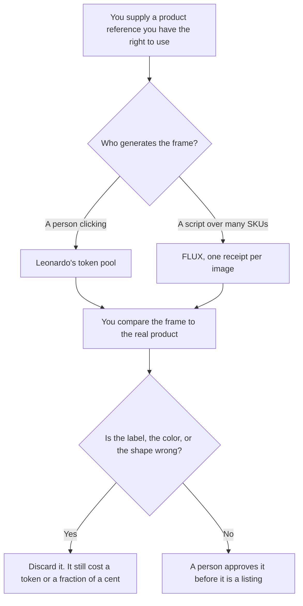

**Use Leonardo when a person will click Generate and you want a monthly token pool, starting at Essential for $12 with 8,500 fast tokens. Use FLUX when a developer will call an API and you want a receipt per image, with FLUX 3 Klein at $0.008 for a 768×768 image.** Neither tool has seen your product unless you supplied a reference you have the right to use. We did not score which still looks more like the object.

The subscription look, which is a different pair, is [Midjourney vs FLUX for product shots](/blog/midjourney-vs-flux-for-product-shots-2026/). The three-way with Midjourney is [Midjourney vs Leonardo vs FLUX](/blog/midjourney-vs-leonardo-vs-flux-2026/). The workflow is [how to generate product photos with AI](/blog/how-to-generate-product-photos-with-ai-2026/).

Prices are US list prices excluding tax from directory pages checked October 16, 2026. Leonardo's pricing page returned HTTP 403 on October 24, 2026, so this page does not update those token figures. FLUX's table is the October 16 directory record. Published October 24, 2026. We did not score images.

## Which meter matches the shot

| The shot you actually need | Start here | First paid step | The limit |
|---|---|---|---|
| A person exploring a few frames | [Leonardo](/tools/leonardo-ai/) Free | Essential at $12 a month for 8,500 fast tokens and a 25,500 token bank | Tokens are not dollars per image |
| More frames, and relaxed generation on select models | Leonardo Premium | $30 a month, 25,000 fast tokens, unlimited relaxed image generation for select models | Relaxed is slower. It is not a second product |
| A catalog large enough to script | [FLUX](/tools/flux/) | $0.008 a FLUX 3 Klein image at 768×768. One credit is $0.01. No seat | You pay for the frames you throw away |
| A keeper at higher resolution | FLUX 3 Klein | $0.009 at 1K, $0.011 at 1.5K, $0.014 at 2K, $0.036 at 4K | A wrong label is wrong at every size |
| Words on the package must be spelled | [Ideogram](/tools/ideogram/) | Plus is $15 a month billed yearly | This pair is the wrong tool when the letters are the job |

Leonardo Ultimate is $60 a month for 60,000 fast tokens. Team Starter is $24 a seat, stated as $72 a month on the directory card, and Growth is $48 a seat, stated as $144 a month. Those team figures are the October 16 card. Two hundred FLUX 768 keepers are $1.60. Two hundred 4K keepers are $7.20. The failures cost the same cell. A Leonardo token and a FLUX credit are not the same unit. FLUX's credit is $0.01. Leonardo's token is a plan currency.

## What the shot may show

The product you provided, on a background you asked for, without a claim you did not write. A generated logo, a badge, or a price is a defect. If the real product has text, expect to fix it. Ideogram is the neighbor when the letters are the point. The card is [Ideogram pricing explained](/blog/ideogram-pricing-explained-2026/).

**Leonardo Essential at $12** is the paid path for a designer who will iterate by hand. Premium at $30 is the path when relaxed generation on select models is the reason to leave Essential. The invoice is [Leonardo pricing explained](/blog/leonardo-ai-pricing-explained-2026/). The review is [Leonardo review](/blog/leonardo-ai-review-2026/).

**FLUX** is the paid path when the count of SKUs makes clicking the wrong workflow. Prototype at 768. Re-render the keeper. The 4K cell is 4.5 times the 768 cell. The invoice is [FLUX pricing explained](/blog/flux-pricing-explained-2026/).

The shelf is [best AI image generators](/blog/best-ai-image-generators-2026/).

A prompt that holds the line:

"Describe a product still from the reference notes I pasted. Do not add a logo, a price, or a claim. If I did not paste a reference, write Reference missing and stop."

## What not to delegate

Do not generate a competitor's product and label it yours. Do not ship a frame with a misspelled label because the lighting looks right. Do not treat a token pool and an API receipt as one budget. The person who owns the listing approves the still.

## FAQ

### How is this different from Midjourney vs FLUX for product shots?

That page is the look subscription against the API. This page is Leonardo's token pool against the same API. Midjourney Basic is $10 a month and has no free plan, on the directory card. It is a third workflow. Use the page that matches the seat you are actually choosing.

### Is Leonardo's free plan enough for a catalog?

The directory says the free plan is for casual creators. A catalog is a volume problem. Essential is the first paid pool. FLUX is the path when a script should call the model. Try a handful of frames before you buy a year.

### Do I pay for bad frames?

Yes. Leonardo spends tokens. FLUX bills the image, including the one you discard. A cheaper resolution is for the test. The keeper is a second render after a person has said the shape is right.

### Can I train a model on my product?

Leonardo's directory card lists personal model training, with more personal models on higher tiers. Training still needs images you have the right to use. FLUX's open-weight terms are a license you read before you ship. This page does not turn a training run into a price.

## Last verified

October 16, 2026 for Leonardo and FLUX prices. Leonardo's pricing page returned HTTP 403 on October 24, 2026. Published October 24, 2026.

**Sources:** [Leonardo pricing](https://leonardo.ai/pricing/), [FLUX pricing](https://bfl.ai/), [Ideogram pricing](https://ideogram.ai/pricing).

*Published by Andrew for [AI Tools Optimizer](https://aitoolsoptimizer.com).*

[Leonardo](/tools/leonardo-ai/) is in the [image generation directory](/tools/category/image-generation/). Directory pages may use affiliate links. A purchase through them may earn us a commission at no extra cost to you.
