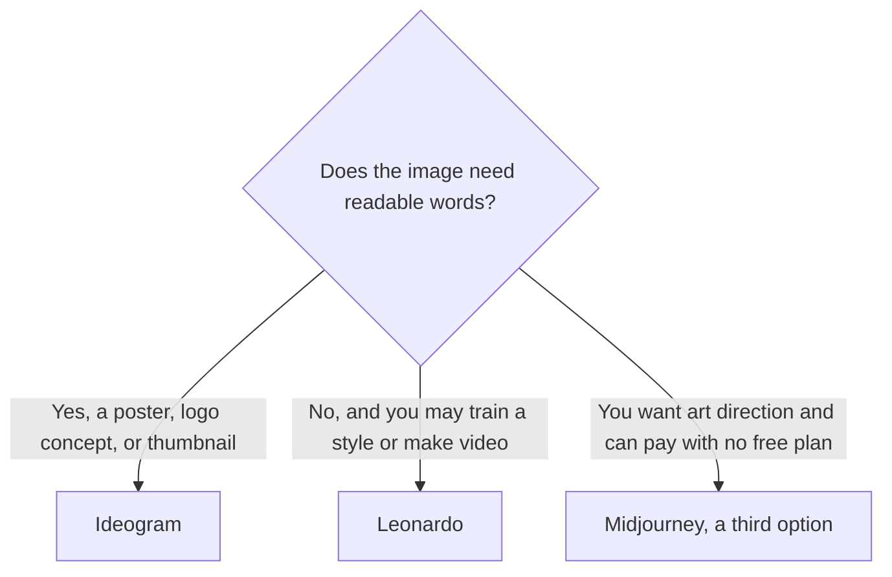

**Use Ideogram when the image has to contain readable text. Use Leonardo when you want a broader studio: custom models, video, and a token bank.** This directory has no Stable Diffusion product page, so this comparison stays on two tools we can price. It does not rank which pictures look better.

Prices are US list prices excluding tax. Ideogram's figures follow its docs as checked October 16, 2026, which Ideogram had marked October 15, 2026. Leonardo's figures are from its pricing page the same day.

## Two meters

| | [Leonardo.Ai](/tools/leonardo-ai/) | [Ideogram](/tools/ideogram/) |
|---|---|---|
| Best-fit job on the directory page | Controllable images and video, including personal models | Graphics that need clean, readable text |
| Free | A free plan for casual use. The page does not print a token count for it | 30 credits a week. Free images are not private |
| First paid plan | Essential $12/month, 8,500 fast tokens, bank up to 25,500 | Plus $20/month, or $15/month yearly ($180), 2,400 credits |
| The step people mean | Premium $30/month, 25,000 fast tokens, unlimited relaxed images on select models | Pro $60/month, or $42/month yearly ($504), 7,500 credits, batch generation |
| Above that | Ultimate $60/month, 60,000 fast tokens, 50 personal models, unlimited relaxed images and video on select models | Team, minimum 2 users, $30/user/month or $20 yearly, 3,600 credits per user |
| After the allowance | Top-up tokens. Relaxed generation is a higher-tier feature, not the free plan | Plus, Pro, and Team can keep generating on Ideogram models in a slower queue after credits run out |
| Text in the image | The directory points text-heavy work to Ideogram | The reason to open Ideogram |

The three-way with Midjourney and FLUX is [Midjourney vs Leonardo vs FLUX](/blog/midjourney-vs-leonardo-vs-flux-2026/). Ideogram next to FLUX and Firefly is [FLUX vs Ideogram vs Firefly](/blog/flux-vs-ideogram-vs-firefly-2026/). The shelf is [best AI image generators](/blog/best-ai-image-generators-2026/).

## Leonardo, when the studio is the product

Leonardo is a platform: image generation, video, personal model training, and Realtime Canvas. Essential at $12 is the entry. Premium at $30 is the plan that adds unlimited relaxed image generation for select models. Relaxed is slower. Fast tokens are the full-speed meter, and unused tokens can bank up to three times the monthly allowance. Ultimate at $60 adds more personal models and unlimited relaxed video for select models.

Team Starter is $24 a seat, listed as $72 a month, with shared tokens. Team Growth is $48 a seat, listed as $144 a month. Those are the plans when generations should stay in a private team workspace.

A storyboard that spends fast tokens on every frame is a real bill. Price the frames before you call Premium "unlimited." The product page is [Leonardo.Ai review](/blog/leonardo-ai-review-2026/).

Leonardo is part of Canva. [Canva](/tools/canva/) Pro at $18 a month, or $180 a year, is still the template editor. Use Canva when the deliverable is a laid-out design. Use Leonardo when the deliverable is a generated image or a short video.

## Ideogram, when the letters have to be letters

Ideogram's directory page is explicit: text in images is the job, for posters, logo concepts, thumbnails, and ads. Free gives 30 credits a week, and those images are not private. Plus at $15 a month on yearly billing, or $20 month to month, adds private generation, quality export, and 2,400 credits. Monthly credits do not roll over. Edits, upscales, and reference images cost credits even when a slow queue is available.

Pro at $42 a month yearly, or $60 monthly, is the batch plan. If you are making one thumbnail a week, Plus is the plan to test. If you are producing a set of ads, Pro's 7,500 credits and batch generation are the line to read.

The review is [Ideogram review](/blog/ideogram-review-2026/). A design system around the image, with brand kits, is Canva or [Adobe Firefly](/tools/adobe-firefly/). Firefly Standard is $9.99 a month for 2,000 credits. The commercially-safe Adobe workflow is a different requirement than readable type.

## Where Midjourney fits, briefly

[Midjourney](/tools/midjourney/) has no free plan. Basic is $10 a month, or $8 billed annually. Standard at $30 adds unlimited Relax image generation. It is the art-directed option, and the directory page says it is less precise for text and layout than some rivals. If the words in the image are the product, start with Ideogram. If the look is the product and you will typeset the words in Canva afterward, Midjourney or Leonardo can be the generator. The GPU-time bill is [Midjourney pricing explained](/blog/midjourney-pricing-explained-2026/).

[FLUX](/tools/flux/) is pay as you go, from $0.008 an image for FLUX 3 Klein at 768×768 on the October 16 page, with 1 credit equal to $0.01. Use it when you want a per-image API price instead of a monthly token plan.

## FAQ

### Is Ideogram better than Leonardo?

For readable text, Ideogram is the tool this directory points you to. For custom models, a token bank, and relaxed video on higher tiers, Leonardo is the broader studio. "Better" depends on which of those jobs you have.

### Which has the better free plan?

Ideogram prints a number: 30 credits a week, and free images are not private. Leonardo's free plan is described as casual exploration without a token count on the page we used. Test both on one real asset before you pay.

### Can I do logos in Leonardo?

You can generate concepts anywhere. If the letters in the logo have to be right, Ideogram is the first test. Then redraw the mark in a design tool. A generated image is a concept, not a finished trademark file.

### Does either include video?

Leonardo Ultimate includes unlimited relaxed video for select models, and lower plans can spend tokens on video. Ideogram's directory page is an image product. For a motion test, price Leonardo or see [Runway vs Kling vs Veo](/blog/runway-vs-kling-vs-veo-2026/).

## Last verified

October 16, 2026. Published October 24, 2026.

**Sources:** [Leonardo pricing](https://leonardo.ai/pricing), [Ideogram](https://ideogram.ai/), [Midjourney](https://www.midjourney.com/).

*Published by Andrew for [AI Tools Optimizer](https://aitoolsoptimizer.com).*

[Leonardo.Ai](/tools/leonardo-ai/) and [Ideogram](/tools/ideogram/) are in the [image generation directory](/tools/category/image-generation/). Directory pages may use affiliate links. A purchase through them may earn us a commission at no extra cost to you.
