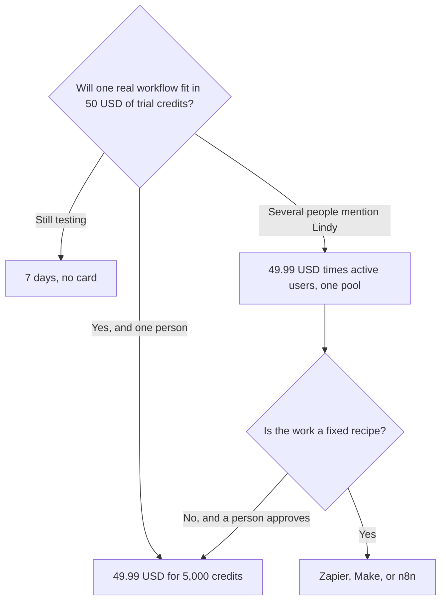

**Lindy pricing starts with $50 in free credits for 7 days, then $49.99 per active user per month for 5,000 credits.** Every active user is billed. Each seat adds its credits to one shared pool. Top-ups are $10 per 1,000 credits. Monthly credits refresh and do not roll over. Top-up credits stay until you use them. If the pool runs out, Lindy pauses credit-using actions. There is no surprise overage on the page read October 24, 2026.

Those sentences are from [Lindy's pricing page](https://www.lindy.ai/pricing) and its FAQ, fetched October 24, 2026. A product review published the same day described a slider whose first printed row was $29.99 for 3,000 credits. This article uses the FAQ's starting line, because that is the sentence the page states in prose. If your screen shows a lower slider row, price the row you will buy and screenshot it. The product page is [Lindy review](/blog/lindy-review-2026/).

## The bill

| What you pay | Amount on the October 24 FAQ | What it includes |
|---|---|---|
| Trial | $0, and $50 in credits | No card. Credits last 7 days. Then paid use starts |
| Each active user | From $49.99 a month | 5,000 credits, added to the shared pool |
| Five active users at that floor | $249.95 a month | 25,000 credits in one pool, if each seat is on the 5,000-credit line |
| Top-up | $10 per 1,000 credits | About 1 cent a credit. These credits do not expire with the monthly refresh |
| Enterprise | Custom | HIPAA with a BAA, SSO, SCIM, audit logs, on the Enterprise card |

The FAQ also says you pick the monthly credits the team needs, starting at 5,000 for $49.99. Larger packs exist. The page fetched for this article did not print a full slider in text, so this table stops at the starting line. A cent per credit at $49.99 for 5,000 matches the $10 top-up. If a larger pack on your screen is well under a cent, that row is the volume discount. Do the division before you top up every week.

## Who counts as a seat

Anyone who uses Lindy takes a seat: a direct signup, someone who joins the workspace, or someone who @mentions Lindy in Slack. The FAQ says new teammates who join through Slack get a 7-day free trial before the seat is billed, and direct signups are billed right away. The free week is once per teammate. Someone who leaves and returns goes onto a billed seat.

Credits are pooled. An admin can set an allocation per seat. Removing a seat keeps it active through the cycle already paid, with no mid-cycle proration, on that FAQ. One workspace subscription, one bill.

The Team card lists model choice, computer use, and live onboarding. A feature list on the same page also says "computer use on Pro and Max." Those names do not match the Team / Enterprise cards in the FAQ. Confirm which plan name your checkout uses before you tell a buyer that computer use is on the $49.99 line.

Anything with outside impact waits for approval: sending an email, updating a ticket, posting to a channel, publishing a doc. Read-only lookups from approved sources do not. That split is the guardrail. The definition is [what AI guardrails are](/blog/what-is-ai-guardrails-2026/).

## Lindy next to a workflow tool

[Zapier](/tools/zapier/) Professional is $19.99 a month annually for 750 tasks. [Make](/tools/make/) Core is from $9 a month annually for 10,000 credits. [n8n](/tools/n8n/) Starter is €20 a month billed annually for 2,500 executions. This article does not convert the euro price. Those three run a path you can draw. Lindy is the step where the next action depends on the text, and a person still approves the send. The comparison is [Zapier vs Make vs n8n](/blog/zapier-vs-make-vs-n8n/). Leaving n8n for an agent is [n8n alternatives](/blog/n8n-alternatives-2026/).

Stack them when the systems differ: n8n or Make for the record, Lindy for a draft a person sends. Stacking them on the same inbox produces two emails.

Credit sizes on Lindy's own examples, from the page read October 24: everyday asks about 2 to 250 credits, deeper work about 250 to 1,000, and larger builds about 1,000 to 2,500. A 5,000-credit seat is a handful of deep tasks, or many short ones. Heavier models spend faster. Watch the first real runs, then move the pack. The agent explainer is [what an AI agent is](/blog/what-is-an-ai-agent-2026/).

## FAQ

### How much does Lindy cost?

$49.99 per active user per month for 5,000 credits, on the FAQ read October 24, 2026. The trial is $50 in credits for 7 days, without a card. Top-ups are $10 per 1,000 credits.

### Do credits roll over?

Monthly credits do not. They refresh at the start of the cycle. Top-up credits remain until you use them.

### Is $49.99 the whole team?

It is the starting price per active user. Five active users on that line are $249.95, and the credits pool. A Slack mention can create a seat after a 7-day trial.

### What happens if we run out?

Lindy pauses credit-using actions. Admins can top up or move to a larger monthly pack. The page says that pause is the alternative to a surprise bill.

## Last verified

October 24, 2026, from lindy.ai/pricing. Zapier, Make, and n8n comparison prices are from directory pages checked October 16, 2026. Published October 24, 2026.

**Sources:** [Lindy pricing](https://www.lindy.ai/pricing).

*Published by Andrew for [AI Tools Optimizer](https://aitoolsoptimizer.com).*

[Lindy](/tools/lindy/) is in the [automation directory](/tools/category/automation-agents/). Directory pages may use affiliate links. A purchase through them may earn us a commission at no extra cost to you.
