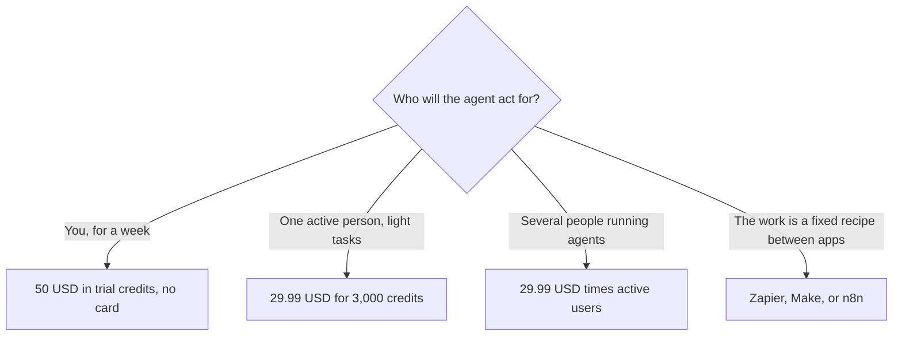

**[Lindy](/tools/lindy/) is an AI assistant you set up to do recurring work: email, research, follow-ups, and other tasks you would otherwise hand to a person or a brittle automation.** The bill follows active users and credits. On October 24, 2026 the pricing page said you can start with **$50 in credits** and no card, and that paid usage starts at **$29.99 per user per month for 3,000 credits**. Top-ups are **$10 per 1,000 credits**. Every active user in the workspace is billed.

We did not measure how often an agent finishes a task without a human. [How to create an AI agent without coding](/blog/how-to-create-an-ai-agent-without-coding/) is the category explainer. This page is so you do not quote an old team price for a product that now meters seats.

## The credit ladder

The page presents a slider rather than four named tiers. These are amounts it printed, in USD per month:

| Credits shown | Price shown |
|---|---|
| 3,000 | $29.99 |
| 4,000 | $39.99 |
| 5,000 | $49.99 |
| 8,000 | $79.99 |
| 15,000 | $99.99 |
| 20,000 | $149.99 |
| 35,000 | $199.99 |
| 70,000 | $399.98 |
| 105,000 | $599.97 |
| Larger packs | Up to figures in the thousands of dollars |

The important sentence is not the first row. Lindy says **each active user** is billed, from $29.99 for 3,000 credits each. A "team plan" in the old sense, one invoice that covers five people, is not what this page describes. Five active people on the smallest pack are **$149.95 a month** and 15,000 credits split as five pools of 3,000, not one shared 15,000, unless an admin has moved everyone onto a larger shared configuration. Read the workspace billing screen. The marketing slider and the per-user sentence can be true at the same time and still surprise a buyer who multiplies once.

Top-ups are $10 per 1,000 credits at any time. That is **1 cent a credit**. The $29.99 pack is 3,000 credits, which is about the same cent per credit. You are not getting a steep volume discount at the first step. Higher rows sometimes price a credit a little differently. Check the row you will sit on. The $49.99 row for 5,000 credits is also about a cent. The $99.99 row for 15,000 credits is well under a cent. Volume is where the rate moves. Do not buy the smallest pack and top up every week if a larger row is cheaper per credit.

## Trial, then the meter

The trial is $50 in credits, no card, and the FAQ says paid usage starts at $29.99 per user after that period. The page describes the free credit window in days. Spend the $50 on the real workflow, not on a demo agent that summarizes a Wikipedia page. Credits are the only way to learn whether your inbox rules fit the product. If the trial cannot see the tools you care about, the subscription will not fix a missing integration.

Canceling stops the renewal. Ask what happens to leftover credits before you assume they vanish or that they become a refund. The pricing FAQ is the place to read that policy on the day you cancel. We are not paraphrasing a refund promise we did not verify line by line.

## Agents versus automations

[Zapier](/tools/zapier/), [Make](/tools/make/), and [n8n](/tools/n8n/) move data when a trigger fires. Lindy is sold as an assistant that can decide a next step in language. Those are different failure modes. A Zapier task either ran or it did not. An agent can sound finished and still have emailed the wrong person. The oversight cost belongs in the budget next to the $29.99. [Zapier vs Make vs n8n](/blog/zapier-vs-make-vs-n8n/) is the comparison when the job is a stable recipe. [How to automate work with Zapier and Make](/blog/how-to-automate-work-with-zapier-and-make/) is the practical version. Use Lindy when the work needs judgment you are willing to review. Use a classic automation when the work must be the same every time.

Stacking both is normal: n8n or Make for the system of record, Lindy for the inbox you still want a draft for. Stacking both for the same inbox is how you get two emails.

## Who should pay

**Use the $50 trial** on one painful weekly task. **Pay $29.99** when that task clearly fits inside 3,000 credits and only one person is active. **Raise the slider** when top-ups at $10 per 1,000 would cost more than the next row. **Multiply by active users** before you tell a manager the team price is $29.99. **Skip Lindy** when a five-step Zap is the whole job. An agent subscription is the wrong tool for a webhook.

Model choice is per task, and the page says you can pick the model. Heavier models spend credits faster. The pack you chose under a cheap model will not survive a week of a frontier model. Look at the credit debit on the first real runs, then move the slider. That is the whole review.

## FAQ

### How much does Lindy cost?

Paid usage starts at $29.99 per active user per month for 3,000 credits. Larger credit amounts are on a slider, from $39.99 upward. Top-ups are $10 per 1,000 credits. A $50 credit trial does not require a card. Checked October 24, 2026.

### Is $29.99 the team price?

It is the starting per-user price. Lindy says every active user in the workspace is billed. Five active users are five charges unless you are on a different agreement.

### Do I need a credit card to try it?

The pricing page says no. You start with $50 in credits. Paid rates apply after the trial window.

### What if we run out mid-month?

Admins can top up at $10 per 1,000 credits or move to a larger monthly amount. Top-ups are the expensive path if you need them every week.

### Is this the same as Zapier?

No. Zapier prices task automations between apps. Lindy prices agent credits per active user. Some workflows want one, some want both, and some want neither.

## Last verified

October 24, 2026, from Lindy's pricing page. Slider steps can change. The per-active-user sentence and the $29.99 / 3,000-credit floor are the lines to recheck, because older writeups may still quote a single team bundle.

**Sources:** [Lindy pricing](https://www.lindy.ai/pricing), [Lindy](https://www.lindy.ai).

[Lindy](/tools/lindy/) is in the [automation and agents directory](/tools/category/automation-agents/). Directory pages may use affiliate links. A purchase through them may earn us a commission at no extra cost to you.
