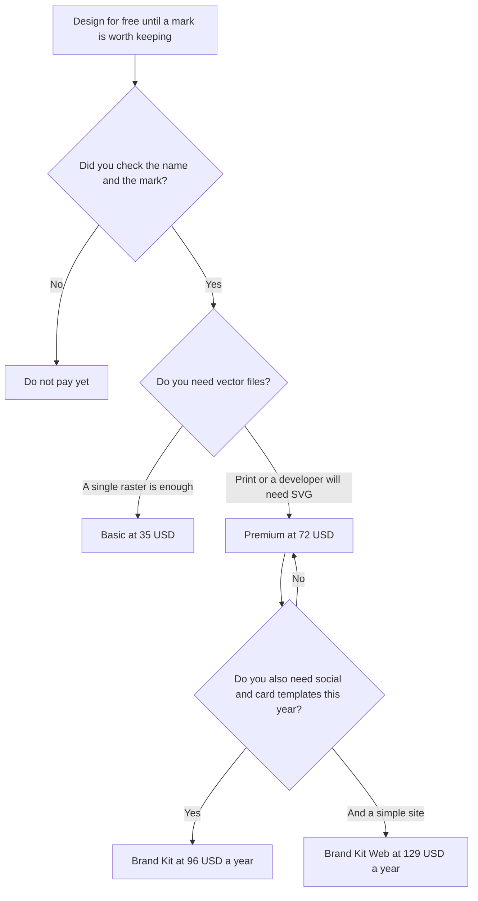

**Looka pricing is free until you download, then either a one-time logo package or a yearly brand kit.** You can create and browse logos without paying. Basic Logo Package is $35 once, for one low-resolution PNG. Premium Logo Package is $72 once, for PNG, EPS, SVG, and PDF, color variations, and unlimited changes. Brand Kit is $96 a year, with unlimited logo changes, vector files, and 300+ branded assets such as social profiles, posts, and business cards. Brand Kit Web is $129 a year and adds an AI-generated website. The directory says you keep logo ownership after a subscription ends.

The brand-team shelf, if the logo is one piece of a larger system, is [best AI tools for brand teams](/blog/best-ai-tools-for-brand-teams-2026/). A voice document that should match the mark is [how to create a brand voice with AI](/blog/how-to-create-a-brand-voice-with-ai-2026/). Ongoing social templates live in a different product.

Prices are US list prices excluding tax from Looka's pricing page as recorded in the directory on October 16, 2026. Published October 24, 2026. We did not score logo quality. A generated mark can collide with someone else's trademark. This page does not clear that.

## What you are buying

| Option | Price | What you can take with you | What you do not get |
|---|---|---|---|
| Design and browse | $0 | A preview | A download |
| Basic Logo Package | $35 once | One low-resolution PNG | Vector files, and the sizes a printer will ask for |
| Premium Logo Package | $72 once | PNG, EPS, SVG, and PDF, color variations, unlimited changes | The 300+ asset kit |
| Brand Kit | $96 a year | Unlimited changes, vector files, 300+ branded assets, partner offers on the card | A website |
| Brand Kit Web | $129 a year | Brand Kit plus an AI-generated website | A custom product or a designed brand system |

Premium at $72 is the smallest package most businesses should buy if anyone will print the mark or place it in a site header. Basic at $35 is one low-resolution PNG. That file is a placeholder, not a logo system. The gap between $35 and $72 is the file format, not a fancier drawing.

Brand Kit at $96 a year is $8 a month if you spread it, and the bill is annual. Brand Kit Web at $129 a year is $33 more than Brand Kit. Buy Web when you want the generated site. Do not buy Web to get the vectors. Premium or Brand Kit already covers files. The directory says you keep full ownership of the logo after the subscription ends. Confirm that sentence in the terms you accept. A blog recap is not the contract.

## Four buyers

**A side project that needs a temporary mark on a slide.** Browse free. Pay $35 only if a single PNG is truly enough. If you might print it next month, skip Basic.

**A new business that needs files a printer and a developer can use.** Premium at $72. Then stop, unless you also want the template pile. Unlimited changes on Premium are about the logo, on the card. They are not 300 social posts.

**A founder who wants matching posts and a business card this year.** Brand Kit at $96 a year. Count it as a year, because it renews yearly on the directory's description of subscriptions. Put a reminder on the renewal date.

**Someone who also wants a simple site in the same brand.** Brand Kit Web at $129 a year. If the site needs to take payments, book customers, or match a real product, this is the wrong invoice. Use the logo files somewhere else.

## When Looka is the wrong invoice

[Canva](/tools/canva/) Pro is $18 a month, or $180 a year, for one person, when you will keep making marketing materials after the logo exists. The free plan lists a large template library. Canva does not replace a vector logo you already bought. It is the ongoing editor.

[Adobe Express](/tools/adobe-express/) Premium is $9.99 a month when you want quick edits and you already live in Adobe's tools. The free plan has limited daily AI generations on the card.

[Figma](/tools/figma/) Professional is $16 a month per Full seat billed annually when the job is product or interface design, not a logo package. Starter is free, with a monthly AI credit allotment on the card. The invoice is [Figma AI pricing explained](/blog/figma-ai-pricing-explained-2026/).

A human designer is the right invoice when the brand has to survive a trademark review, a wordmark in three scripts, or a system of sub-brands. Looka's own directory verdict says established brands will want that person. This page agrees, and it does not price the designer.

## FAQ

### Is Looka free?

Designing and browsing is free. Downloading is not. The $0 state is a preview. Budget $72 if you expect to use the mark in print or on a site, or $96 a year if you want the asset kit.

### Do I own the logo?

The directory says yes, including after a subscription ends. Read the terms at purchase. Ownership of a file is not a trademark registration. Search existing marks before you commit the name.

### Does Brand Kit include the Premium files?

Brand Kit includes hi-res and vector files and unlimited logo changes, on the card. You do not need to buy Premium and Brand Kit to get vectors. Pick one path.

### Will the subscription keep charging?

The directory says subscriptions renew yearly. Basic and Premium are one-time packages. If you only needed files, Premium avoids a renewal. If you want the template library to keep updating, Brand Kit is the yearly bill, and you should know the date.

## Last verified

October 16, 2026, from the directory record of Looka's pricing page. Canva, Adobe Express, and Figma use the same October 16 directory check. Published October 24, 2026.

**Sources:** [Looka pricing](https://looka.com/pricing/), [Canva pricing](https://www.canva.com/pricing/), [Figma pricing](https://www.figma.com/pricing/).

*Published by Andrew for [AI Tools Optimizer](https://aitoolsoptimizer.com).*

[Looka](/tools/looka/) is in the [design directory](/tools/category/design/). Directory pages may use affiliate links. A purchase through them may earn us a commission at no extra cost to you.
