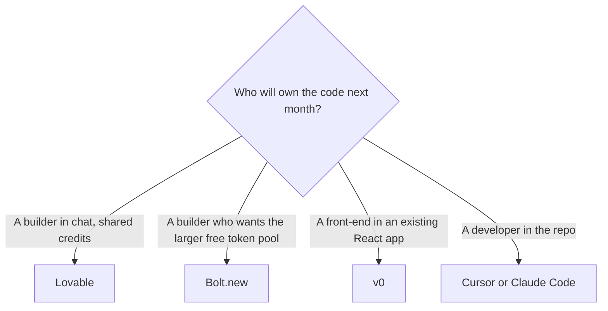

**Leave Lovable when you want Bolt's larger free token pool, v0 for an interface rather than a whole app, Replit's cloud IDE, or a code editor a developer will own.** Stay when a small team should share one credit pool with unlimited members and the app is still a chat-built web project. Lovable prices credits, and it does not price seats.

[Lovable](/tools/lovable/) Free includes 5 build credits a day, up to 30 a month, plus 20 Cloud credits. Pro starts at $25 a month, or $250 a year, for 100 credits. The annual figure is $21 a month if you divide $250 by 12. Business starts at $50 a month, or $500 a year, for 100 credits. The three-builder comparison is [Lovable vs Bolt vs Replit](/blog/lovable-vs-bolt-vs-replit/). The product page is [Lovable review](/blog/lovable-review-2026/).

Lovable, Bolt, and v0 prices below mix an October 16, 2026 directory check with pricing pages read October 24, 2026 for Bolt and Replit. Published October 24, 2026. We did not score generated apps.

## Switch when the constraint changes

| The constraint | Open this | Price that matters |
|---|---|---|
| A shared credit pool, unlimited members, chat to a web app | Stay on [Lovable](/tools/lovable/) | Pro from $25/month for 100 credits. A simple style change is about 0.50 credits on Lovable's own examples. A landing page with images is about 1.70 |
| A bigger free month and hosting in the same tab | [Bolt.new](/tools/bolt-new/) | Free is 1 million tokens a month, with a 300,000 daily cap. Pro is $25 billed monthly, or $18 a month billed annually ($216 a year) on the October 24 card |
| A React or Next.js interface, deployed on Vercel | [v0](/tools/v0/) | Plus is $30/user/month. Free includes $5 in one-time credits and a 7-message daily limit |
| A cloud IDE, a database, and a publish button | [Replit](/tools/replit/) | Starter is free. The October 24 pricing page showed $20 ($18 billed annually) and $100 ($90 billed annually). See [Replit Agent pricing explained](/blog/replit-agent-pricing-explained-2026/) |
| A repository a developer will maintain | [Cursor](/tools/cursor/) or [Claude Code](/tools/claude-code/) | Cursor Plus is $8/month, or $80 a year. Claude Code rides on Claude Pro at $20, or $17 billed annually |

Bolt's token card is [Bolt.new pricing explained](/blog/bolt-new-pricing-explained-2026/). Cursor's ladder, including the legacy plans, is [Cursor pricing explained](/blog/cursor-pricing-explained-2026/). The editor comparison is [Cursor vs Claude Code vs Codex](/blog/cursor-vs-claude-code-vs-codex-2026/).

## What you are leaving behind

Lovable's unusual term is unlimited members on every plan, with the owner able to cap credits per member. A classroom or a startup where five people prompt and one person pays is the case Pro is built for. Credits expire: unused monthly credits expire two months after they are issued, and annual credits expire one month after the annual period ends, on the October 16 card. Business is about twice Pro at the 100-credit tier ($50 versus $25). Buy Business when you need the team and security controls on that card, and the credit math still works.

Bolt's October 24 pricing page shows the annual Pro rate explicitly: $18 a month, $216 a year, beside a $300 yearly figure that matches $25 month to month. Free still includes 1 million tokens, which is the practical reason to try Bolt before you buy Lovable Pro. Teams on that page is $27 a month billed annually ($324 a year) or $30 month to month ($360), with tokens listed per member. If your team is one person and a domain, Bolt Pro and Lovable Pro are both $25 at the monthly list. Pick Bolt for the token pool and the rollover. Pick Lovable for unlimited members on the credit pool.

v0 Plus at $30 per user is a seat, which Lovable refuses to be. Use v0 when the output is UI in a codebase you deploy on Vercel. The free plan's 7-message daily limit is a sketch. The review is [v0 review](/blog/v0-review-2026/).

Replit Starter remains free: daily Agent credits, Lite build, and one published app that comes down after 30 days with a badge. Core is the plan for connectors, Plan Mode, and badge removal, with up to five collaborators in the docs read October 24, 2026. Pro is the plan for up to 15 builders and credit rollover. The dollar pairs on the pricing page that day are explained in the Replit article linked above. We do not treat a Lovable credit and a Replit credit as the same unit.

## When the alternative is an editor

A generated app that real customers will pay on needs someone who can read the diff. Cursor Plus at $8 is the new-customer entry on The X Subscription, read October 24, 2026. Claude Code is included with Claude Pro. The side-project path into the editor is [how to use Cursor for a side project](/blog/how-to-use-cursor-for-a-side-project-2026/). Leaving Lovable for Cursor is a change of job, from "describe the app" to "own the repository."

Founders choosing the first build tool, before a repo exists, can start from [best AI tools for founders](/blog/best-ai-tools-for-founders-2026/).

## FAQ

### Is Bolt cheaper than Lovable?

At the monthly Pro list, both start at $25. Bolt's October 24 card shows an annual rate of $18 a month ($216 a year). Lovable's annual Pro is $250 a year for the 100-credit tier, which is $21 a month if you spread it. The units differ: Bolt meters tokens, Lovable meters credits. Compare them on one real prompt, and the free tiers, before you call either one cheaper.

### Does Lovable charge per teammate?

No. Members are unlimited. They share the credit pool. v0 and Cursor charge per user. Replit Pro's docs say the builders share the plan without per-user fees, up to 15.

### When is v0 the wrong alternative?

When you need the database, the login, and the hosted app from one chat. v0 is the interface. Lovable, Bolt, and Replit are the closer "whole app" products, with different meters.

### Can I export and leave?

Yes, you should be able to read the code before you depend on the host. Do that while the project is small. A host lock-in is a reason to keep the repository in git, and a reason to move to Cursor once a developer is responsible for it.

## Last verified

October 16, 2026 for Lovable and v0 plan structure. October 24, 2026 for Bolt's pricing page and for the Replit price pairs and plan docs. Cursor's $8 Plus price was on the help page read October 24, 2026. Published October 24, 2026.

**Sources:** [Lovable pricing](https://lovable.dev/pricing), [Bolt.new pricing](https://bolt.new/pricing), [v0 pricing](https://v0.app/pricing), [Replit pricing](https://replit.com/pricing).

*Published by Andrew for [AI Tools Optimizer](https://aitoolsoptimizer.com).*

[Lovable](/tools/lovable/) and [Bolt.new](/tools/bolt-new/) are in the [coding directory](/tools/category/coding/). Directory pages may use affiliate links. A purchase through them may earn us a commission at no extra cost to you.
