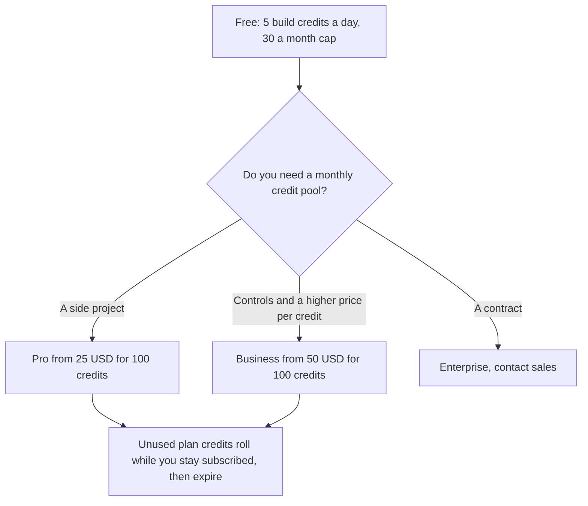

**Lovable Pro starts at $25 a month, or $250 a year ($21 a month), for 100 monthly credits.** Business starts at $50 a month, or $500 a year ($42 a month), for 100 credits. Free includes 5 build credits a day, capped at 30 a month, plus a 20-credit Cloud grant and a 4-credit AI grant. Enterprise is sales-led. The top published tier on both Pro and Business is 10,000 credits a month.

The product page is [Lovable review](/blog/lovable-review-2026/). The landing-page pair is [Lovable vs v0](/blog/lovable-vs-v0-for-landing-pages-2026/). A code editor, if a developer will keep the repo, is [Cursor pricing explained](/blog/cursor-pricing-explained-2026/).

Prices are US dollars from Lovable's subscription-plan docs, fetched October 24, 2026. The public pricing page HTML did not include the table that day. Credit expiry is from the credits docs the same day. Published October 24, 2026. We did not score app quality.

## The tiers worth memorizing

| Plan | Monthly credits | Monthly price | Annual price |
|---|---|---|---|
| Free | 5 build credits a day, max 30 a month, plus 20 Cloud and 4 AI | $0 | $0 |
| Pro, entry | 100 | $25 | $250 ($21 a month) |
| Pro, top published | 10,000 | $2,250 | $22,500 ($1,875 a month) |
| Business, entry | 100 | $50 | $500 ($42 a month) |
| Business, top published | 10,000 | $4,300 | $43,000 ($3,584 a month) |
| Enterprise | Volume | Custom, contact sales | Custom |

Intermediate Pro tiers exist between 100 and 10,000 credits: 200 at $50 a month, 400 at $100, 800 at $200, 1,200 at $294, 2,000 at $480, 3,000 at $705, 4,000 at $920, 5,000 at $1,125, and 7,500 at $1,688. Business uses the same credit steps at its own prices, from $50 for 100 credits up to $4,300 for 10,000. The 100-credit row is twice Pro. The 10,000-credit row is not a neat multiple, so read that line on its own. Annual billing charges the year up front and shows a lower equivalent month. The docs say annual credits are still issued monthly.

Students and teachers, on the same docs page, get 50 percent off for up to 12 months on the Pro plan with 100 credits, billed monthly. That discount is not a Business discount. Read the eligibility before you quote it.

## How credits expire

Lovable's credits doc, read October 24, 2026, says one balance covers building, chat, Cloud, and AI features in the deployed app. Monthly plan credits expire 2 months after they are issued on monthly plans, and 1 month after the annual period ends on annual plans. Unused monthly credits roll over while the subscription stays active, and they keep that original expiry. Top-up credits on Pro and Business expire 12 months after purchase.

Daily build credits expire at the end of the day. On Free, the 30-a-month cap means the daily 5 stops after six days until the next month, which the docs state as 6 times 5. Pro and Business also include 5 daily build credits. A daily chat allowance resets at 00:00 UTC and does not roll. The October 16 directory card said workspaces have unlimited members and gave example costs (a button about 0.50 credits, a landing page with images about 1.70). The October 24 docs describe per-member credit limits on Pro and Business and do not reprint those example costs, so this page does not treat the examples as current. There is still no per-seat sticker in the tier table.

## When a different builder is the bill

**[Cursor](/tools/cursor/) Plus is $8 a month, or $80 a year,** on the directory card checked October 16, 2026. Buy Cursor when a developer is editing a repo. Buy Lovable when the workspace is the builder and the credit is the meter. A developer should still review auth and data access before a Lovable app is public. The review habit is [how to use Cursor for a side project](/blog/how-to-use-cursor-for-a-side-project-2026/).

**[v0](/tools/v0/)** and **[Bolt](/tools/bolt-new/)** are the other app builders in [Bolt vs Lovable vs v0](/blog/bolt-vs-lovable-vs-v0-2026/). Compare their meters on their own pricing pages. Do not convert Lovable credits into their units.

A prompt that holds the spend down:

"Change only the button label I named. Do not regenerate the page. If the change needs a new screen, stop and say so."

Small requests cost fewer credits, which is Lovable's own guidance on the tool page. The person who accepts the diff is [what human-in-the-loop AI is](/blog/what-is-human-in-the-loop-ai-2026/).

## FAQ

### Is Lovable free?

Yes, with the daily cap. 5 build credits a day, up to 30 a month, 20 Cloud credits, and 4 AI credits. Paid plans add a monthly pool that starts at 100 credits.

### Do credits roll over?

Yes, while the subscription stays active, and they still expire: 2 months from issue on monthly plans, 1 month after the annual period ends on annual plans. A cancelled plan does not keep the pool forever. The docs describe the move back to Free at the end of the billing period.

### Why is Business twice Pro at the same 100 credits?

That is the published table. Business is the row with the governance controls the docs associate with departments. If you do not need those controls, Pro is the cheaper credit. Enterprise is the sales conversation, not a third self-serve sticker.

### Is there a per-seat fee?

The tier table is credits, not seats. Pro and Business include per-member credit limits. The older directory card said members are unlimited. We did not find a per-seat price in the October 24 docs, so we do not print one.

## Last verified

October 24, 2026, from Lovable's subscription-plan and credits docs. Cursor's price is from a directory page checked October 16, 2026. Published October 24, 2026.

**Sources:** [Lovable subscription plans](https://docs.lovable.dev/introduction/subscription-plans), [Lovable plans and credits](https://docs.lovable.dev/introduction/plans-and-credits), [Cursor pricing](https://cursor.com/pricing).

*Published by Andrew for [AI Tools Optimizer](https://aitoolsoptimizer.com).*

[Lovable](/tools/lovable/) is in the [coding directory](/tools/category/coding/). Directory pages may use affiliate links. A purchase through them may earn us a commission at no extra cost to you.
