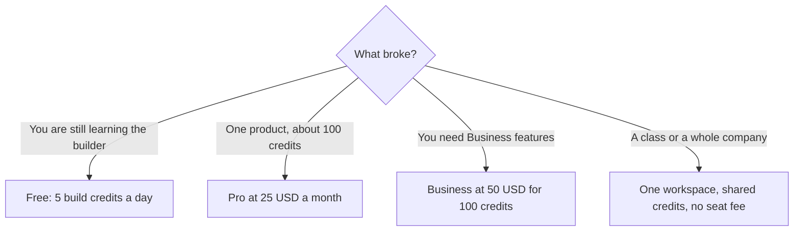

**[Lovable](/tools/lovable/) is a chat interface that builds web apps.** You describe a product, it edits a project, and you can publish it on Lovable's hosting. The pricing question is credits, not seats. Lovable's subscription docs, read October 24, 2026, price Pro from **$25 a month** for 100 credits, or **$250 a year ($21 a month)**. The same 100 credits on Business are **$50 a month**, or **$500 a year ($42 a month)**. Workspaces can hold unlimited members on every plan.

We did not grade the apps it generates. The comparison with other builders is [Lovable vs Bolt vs Replit](/blog/lovable-vs-bolt-vs-replit/). This page is the bill.

## Credits, then the plan name

A credit is Lovable's usage unit for building, for Cloud hosting, and for AI features inside the app you ship. Lovable says a credit's value is not identical across plans. Business credits cost more, so the same run can show fewer credits used after you switch from Pro to Business. That sentence matters. Do not compare "100 credits" on Pro with "100 credits" on Business as if they were the same fuel at the same price. You are comparing invoices.

Message costs vary. The docs give examples, not a promise that your prompt will match:

| Example prompt | Credits in the docs |
|---|---|
| Make the button gray | 0.50 |
| Remove the footer | 0.90 |
| Add authentication with sign-up and login | 1.20 |
| Build a landing page with images | 1.70 |

Plan mode is listed at 1 credit per message. Default mode varies with the task. Hover a message to see what it cost. That history is the only estimate that matches your project.

Free includes a daily grant of **5 build credits, capped at 30 a month**, plus **20 Cloud credits** a month, plus **4 credits** so you can try AI features inside an app. Paid plans add a monthly credit balance and still include the daily 5 build credits and 20 Cloud credits. Some regions cap the daily grant at 30 a month. Daily grants expire at the end of the day. Monthly plan credits expire two months after they are issued. Annual plan credits expire one month after the annual period ends. Top-ups last twelve months. Credits are not refundable.

## The ladders

Prices below are USD from Lovable's subscription-plan docs. The annual column is the yearly charge, with the equivalent monthly rate in parentheses.

| Monthly credits | Pro monthly | Pro annual | Business monthly | Business annual |
|---|---|---|---|---|
| 100 | $25 | $250 ($21/mo) | $50 | $500 ($42/mo) |
| 200 | $50 | $500 ($42/mo) | $100 | $1,000 ($84/mo) |
| 400 | $100 | $1,000 ($84/mo) | $200 | $2,000 ($167/mo) |
| 800 | $200 | $2,000 ($167/mo) | $400 | $4,000 ($334/mo) |
| 1,200 | $294 | $2,940 ($245/mo) | $588 | $5,880 ($490/mo) |
| 2,000 | $480 | $4,800 ($400/mo) | $960 | $9,600 ($800/mo) |
| 3,000 | $705 | $7,050 ($588/mo) | $1,410 | $14,100 ($1,175/mo) |
| 4,000 | $920 | $9,200 ($767/mo) | $1,840 | $18,400 ($1,534/mo) |
| 5,000 | $1,125 | $11,250 ($938/mo) | $2,250 | $22,500 ($1,875/mo) |
| 7,500 | $1,688 | $16,880 ($1,407/mo) | $3,300 | $33,000 ($2,750/mo) |
| 10,000 | $2,250 | $22,500 ($1,875/mo) | $4,300 | $43,000 ($3,584/mo) |

Business is not "Pro plus a few admin buttons" at a small premium. At 100 credits it is twice the Pro price. Lovable says the higher price is for team and organization features, and that run-cost and in-app AI cost are not themselves higher on Business. Read that again before you upgrade a solo workspace "for later."

## Seats are the wrong question

Lovable does not charge per member. Everyone in the workspace spends the same pool. Owners can set a default monthly limit and per-member overrides. A company, a class, and a community use the same shape: one plan sized for the group's credits, then invites. Enterprise is the volume conversation after the public ladder.

Students and teachers with an academic email can get 50% off Pro at 100 credits a month, billed monthly, for up to 12 months. Verification starts from a free workspace, once per person, at lovable.dev/students. The discount does not return after you cancel. It does not apply to the 200-credit step or to Business.

You own the projects and the code you build, subject to third-party rights in the models. That is Lovable's statement, and it is the reason some teams export to Git instead of treating the hosted project as the only copy. Hosting for a small app is described as covered by the included grant. Traffic or size past that grant spends the credit balance. "Free hosting" is true until the grant is the thing you used up.

## Who it is for

Lovable is for someone who wants a working web interface without staffing a front-end hire first. Founders prototyping, designers who need a clickable version, and operators automating an internal page are the fit. It is a weak fit if the real work is a large existing codebase, a pull-request review culture, or a language your team already maintains by hand. Those jobs are closer to the editors in [best AI coding assistants](/blog/best-ai-coding-assistants-2026/).

[Bolt](/tools/bolt-new/) and [Replit](/tools/replit/) are the other prompt-to-app names in that comparison. [v0](/tools/v0/) is the Vercel-shaped UI generator, priced per user rather than per shared credit pool. If you already pay for v0 and Lovable, you are paying two builders to do one job unless the outputs go to different codebases.

## Who should pay

**Stay on free** while 30 build credits a month answer the question "is this the right builder?" **Buy Pro at 100 credits** when you are shipping a real project and $25 is cheaper than another week of stalling. **Step up the ladder** when the usage page, not a feeling, shows the smaller pack running out. **Buy Business** when you need the team features, knowing the 100-credit invoice doubles. **Do not buy a higher pack** to invite a cofounder. The invite is free. The credits they spend are not.

A 100-credit Pro year is $250. A 100-credit Business year is $500. A 1,000-credit-class month does not exist as a single row. Two hundred credits on Pro are already $50 a month. Price the row you will actually sit on.

## FAQ

### How much does Lovable cost?

Pro starts at $25 a month or $250 a year for 100 credits. Business starts at $50 a month or $500 a year for 100 credits. Larger packs are on the same docs page, up to 10,000 credits.

### Does Lovable charge per seat?

No. Members share one credit pool. The plan price does not rise when you send an invite. Usage does.

### Is there a free plan?

Yes. Five build credits a day, up to 30 a month, plus 20 Cloud credits a month. Paid plans keep a version of those grants on top of the monthly balance.

### Do unused credits roll over forever?

No. Monthly credits last two months from issue. Annual credits last until a month after the annual period. Daily grants die the same day. Top-ups last a year.

### Is the student price half of every plan?

No. The published student and teacher offer is 50% off Pro with 100 credits, billed monthly, for up to 12 months, after email-domain verification.

## Last verified

October 24, 2026, from Lovable's subscription-plan documentation and the pricing page FAQ. Example prompt costs are illustrations from that doc, not a rate card for every message.

**Sources:** [Lovable subscription plans](https://docs.lovable.dev/introduction/subscription-plans), [Lovable pricing](https://lovable.dev/pricing).

[Lovable](/tools/lovable/) is in the [coding directory](/tools/category/coding/). Directory pages may use affiliate links. A purchase through them may earn us a commission at no extra cost to you.
