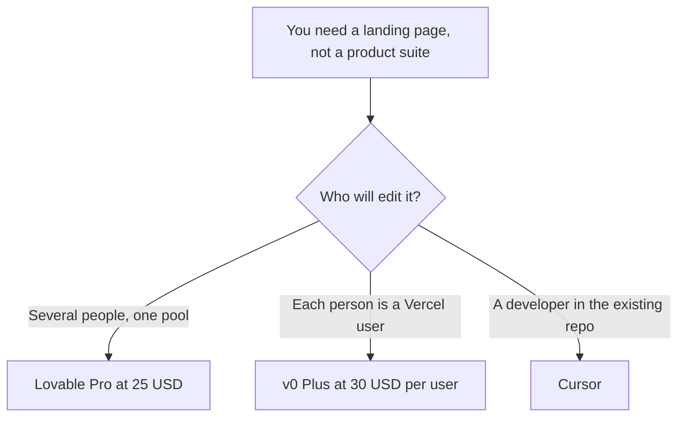

**Use Lovable Pro, from $25 a month for 100 credits, when a few people should share one credit pool and publish a marketing page without a per-seat fee. Use v0 Plus at $30 per user per month when the page should deploy on Vercel and each editor has their own seat.** Both can turn a prompt into a page. This article is only that page. A full app, with Bolt in the mix, is a different comparison.

The three-way is [Bolt vs Lovable vs v0](/blog/bolt-vs-lovable-vs-v0-2026/). v0's invoice is [v0 pricing explained](/blog/v0-pricing-explained-2026/). Lovable's product page is [Lovable review](/blog/lovable-review-2026/). The design file, if you are still clicking frames, is [Figma vs Canva for AI prototypes](/blog/figma-vs-canva-for-ai-prototypes-2026/).

Lovable's plan figures below are from Lovable's subscription docs as used in the October 24, 2026 review, and they match the directory's starting price checked October 16, 2026. v0's figures are from v0's pricing page as used in the October 24 pricing article. Published October 24, 2026. We did not score the pages these tools generate.

## The landing-page bill

| | [Lovable](/tools/lovable/) | [v0](/tools/v0/) |
|---|---|---|
| Free | 5 build credits a day, up to 30 a month, plus 20 Cloud credits | $5 of one-time credits for new users, and 7 messages a day, on the directory note |
| First paid step | Pro from $25 a month for 100 credits, or $250 a year ($21 a month) | Plus, $30 per user per month, with $30 of monthly credits and $2 of daily credits on login |
| How people are billed | Unlimited members on every plan. The pool is shared | Per user |
| A heavier plan | The same 100 credits on Business are $50 a month, or $500 a year | Business, $100 per user per month, with training opt-out by default |
| Where it lives | Lovable hosting, and you can take the code to an editor | Deploy to Vercel. GitHub sync is on the free card |
| A documented small edit | The docs cited in the review list "build a landing page with images" at 1.70 credits. That is an example, not your receipt | The pricing page does not promise a landing page will cost a fixed dollar of the $30 grant |

Two marketers on Lovable Pro at $25 share the 100-credit month. Two marketers on v0 Plus are 2 × $30 = $60 before either of them spends the included credits. Business on v0 is 2 × $100 = $200 if you need training opt-out. Lovable Business at the 100-credit tier is $50 for the workspace, not $50 per person, on the docs the review quotes.

Lovable also says a credit's value is not identical across plans. Do not compare "100 credits" on Pro with "100 credits" on Business as the same fuel. Hover a message and read what it cost.

## What the page still needs from you

**The offer, in words you can defend.** Paste the headline, the price, and the proof. The tools will design around them. They may not invent a testimonial. The writing version of that discipline is [how to write a sales one-pager with AI](/blog/how-to-write-a-sales-one-pager-with-ai-2026/). The fact pass is [how to fact-check AI writing](/blog/how-to-fact-check-ai-writing-2026/).

**A slide, if you do not need a URL.** [Gamma](/tools/gamma/) Plus is $9 a seat a month. A landing page is the wrong tool for a leave-behind deck. The invoice is [Gamma pricing explained](/blog/gamma-pricing-explained-2026/).

**A developer who will own the code next month.** [Cursor](/tools/cursor/) Plus is $8 a month for new customers, with the feature fence described in [Cursor pricing explained](/blog/cursor-pricing-explained-2026/). Generate the first layout in Lovable or v0, then move the code. [Bolt.new](/tools/bolt-new/) Pro is $25 a month if you wanted the third builder. It is in the three-way, not the default here.

**A credit surprise.** v0 publishes token rates, and a large project resent as context spends the grant. The unit is [what AI tokens are](/blog/what-are-ai-tokens-explained-2026/). Lovable's 1.70-credit example is one prompt in the docs. Your images and your copy will differ. Read the history before you buy a higher tier.

## FAQ

### Is free enough to ship a campaign?

Enough to see a draft. Lovable's daily credits expire, and the monthly cap is 30 build credits on the recorded free plan. v0 Free stops at 7 messages a day. Ship on a paid plan once the page is the one customers will open.

### Do I pay per editor on Lovable?

The subscription docs say workspaces can hold unlimited members on every plan, and they share credits. v0 charges per user. That is the decision if more than one person will prompt.

### Can I move the page to our repo?

Both products are described as letting you take the code further. v0 lists GitHub sync on the free card and deploys to Vercel. Plan on a developer review before the page is the production homepage. A generated page can omit analytics, consent, and the real form endpoint.

### Which one looks better?

We did not score design. Use each free path on the same brief, then judge the code you are willing to maintain. A prettier first screenshot can still be the wrong host.

## Last verified

October 16, 2026 for directory starting prices. October 24, 2026 for the Lovable subscription-doc figures in the review and the v0 pricing article. Cursor, Bolt, and Gamma match October 16 directory cards. Published October 24, 2026.

**Sources:** [Lovable pricing](https://lovable.dev/pricing), [v0 pricing](https://v0.app/docs/pricing), [Bolt.new pricing](https://bolt.new/pricing).

*Published by Andrew for [AI Tools Optimizer](https://aitoolsoptimizer.com).*

[Lovable](/tools/lovable/) is in the [coding directory](/tools/category/coding/). Directory pages may use affiliate links. A purchase through them may earn us a commission at no extra cost to you.
