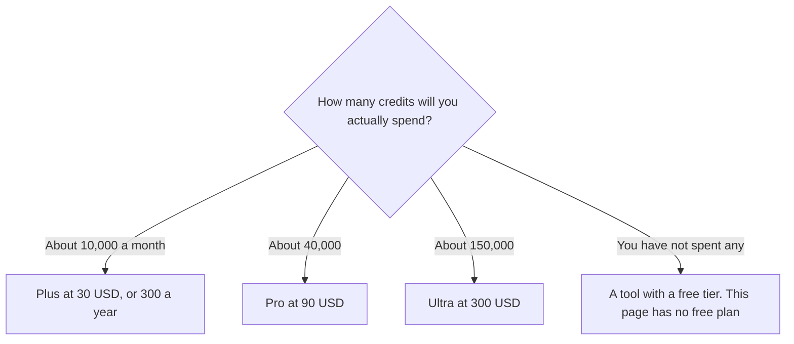

**Luma AI pricing is a monthly credit grant, and each paid step is a multiple of that grant.** Plus is $30 a month, or $300 billed yearly, for 10,000 credits. Pro is $90, or $900, for 40,000 credits. Ultra is $300, or $3,000, for 150,000 credits. Team and Enterprise say contact us. The page read on October 24, 2026 does not list a free plan.

A refetch for this article returned 401, so the table stays on that read, which is also the [Luma AI review](/blog/luma-ai-review-2026/). The page says you can save up to 20% with yearly billing. On these three cards the yearly charge is ten times the monthly price, which is about 17% off, or two months. Quote the charge. The slogan can refer to a discount that was not applied evenly on the cards we saw. Published October 24, 2026. We did not compare shots.

## The individual plans

| Plan | Monthly | Yearly charge | Credits a month | What the card adds |
|---|---|---|---|---|
| Plus | $30 | $300 | 10,000 | Luma and third-party image and video models, guest collaborators, commercial use |
| Pro | $90 | $900 | 40,000 | Everything in Plus. Labeled 4× Luma Agents usage |
| Ultra | $300 | $3,000 | 150,000 | Everything in Pro. Labeled 15× Luma Agents usage |
| Team | Contact | — | Shared | Members, projects, usage analytics |
| Enterprise | Contact | — | Custom | SSO, custom training, on the contact path |

Yearly Plus is $300, which is $25 a month if you spread it. Pro and Ultra match the pattern: $900 is ten times $90, and $3,000 is ten times $300. Pay yearly after a monthly cycle has already fit the grant. The discount is two months on these cards, not a mystery coupon.

## Credits per dollar, if the grant does not shrink

| Plan | Yearly charge | Credits if the monthly grant is paid 12 times | Credits per dollar that year |
|---|---|---|---|
| Plus | $300 | 120,000 | 400 |
| Pro | $900 | 480,000 | 533 |
| Ultra | $3,000 | 1,800,000 | 600 |

That table assumes yearly billing does not shrink the monthly grant. Confirm it on the yearly card. If it holds, Ultra buys more credits per dollar than Plus. You still should not buy Ultra to "be efficient" if you will not spend 150,000 credits a month. Unused efficiency is a more expensive plan.

Pro's "4×" and Ultra's "15×" sit next to grants that are exactly 4× and 15× Plus's 10,000. Treat the multiple as the credit pool. It is not a quality measurement. If an agent run spends credits faster than a manual generation, the multiple can disappear into a few automated passes. Watch the first week of debits before you annualize Ultra.

## What Plus already includes

Commercial use is on Plus. Read the current terms before a broadcast or a paid ad, especially when a third-party model is in the render. The plan name is not the model's license.

Guest collaborators who can edit are also on Plus. You may not need a second paid seat to let a client mark up a cut. You need Team when you need members, projects, shared credits, and analytics as an organization. SSO is on the enterprise contact path, not on the $30 card.

A handful of clips a year may be cheaper as packs on [Pika](/tools/pika/). Starter is $10 for 900 credits. The commercial license starts at Creator for $35. That invoice is [Pika pricing explained](/blog/pika-pricing-explained-2026/). [Runway](/tools/runway/) Standard is $12 a month billed annually for 625 credits. [Kling AI](/tools/kling-ai/) Standard renews at $8.80. Owning Luma Plus and a Runway seat is reasonable only when the models do different jobs you can name. The shelf is [best AI video generators](/blog/best-ai-video-generators-2026/) and [Runway vs Kling vs Veo](/blog/runway-vs-kling-vs-veo-2026/).

[HeyGen](/tools/heygen/) is not this meter. Creator at $29 is a presenter. Luma is generated shots. The avatar bill is [HeyGen pricing explained](/blog/heygen-pricing-explained-2026/).

## FAQ

### Is there a free Luma plan?

Not on the pricing page read October 24, 2026. Budget a month of Plus at $30, or use another tool's free tier, if you are still deciding whether generated video belongs in the work.

### How much is Luma Pro?

$90 a month, or $900 a year, for 40,000 credits. That is 4× the Plus grant. The "4× Luma Agents" label matches the credit multiple. It is not a separate product we measured.

### Does yearly billing save 20%?

The page says up to 20%. On Plus, Pro, and Ultra the yearly charge we read is ten times the monthly price, about 17% off. Quote $300, $900, or $3,000.

### Do guests need their own subscription?

Plus lists guest collaborators who can edit. Team is the shared-credit and analytics step. If a guest can mark up a cut, do not buy a second Plus seat for them out of habit.

## Last verified

October 24, 2026, from Luma's pricing page. A later fetch for this article returned 401. October 16, 2026 for Pika, Runway, Kling, and HeyGen comparison prices. Third-party model names change faster than these three prices. Published October 24, 2026.

**Sources:** [Luma pricing](https://lumalabs.ai/pricing), [Pika pricing](https://pika.art/pricing).

*Published by Andrew for [AI Tools Optimizer](https://aitoolsoptimizer.com).*

[Luma AI](/tools/luma-ai/) is in the [video directory](/tools/category/video/). Directory pages may use affiliate links. A purchase through them may earn us a commission at no extra cost to you.
