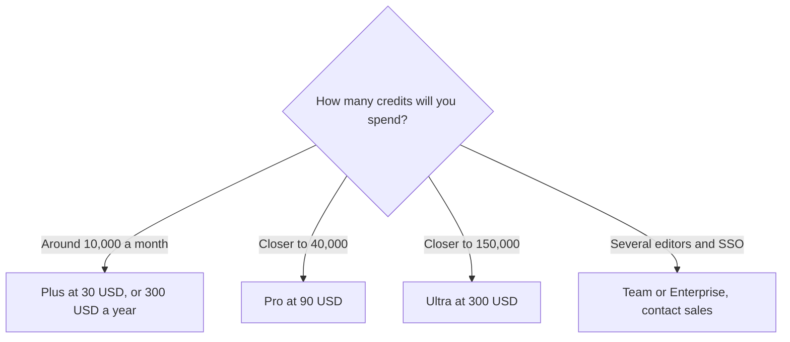

**[Luma AI](/tools/luma-ai/) is a video generation product sold as monthly credits, with access to Luma's own models and third-party models on the same plans.** On October 24, 2026 the individual plans were Plus at **$30 a month or $300 billed yearly** for **10,000 credits**, Pro at **$90 or $900** for **40,000 credits**, and Ultra at **$300 or $3,000** for **150,000 credits**. Team and Enterprise say contact us. The page also says you can save up to 20% with yearly billing.

We did not compare shots with Runway or [Kling](/tools/kling-ai/). Those comparisons live in [Runway vs Kling vs Veo](/blog/runway-vs-kling-vs-veo-2026/) and [best AI video generators](/blog/best-ai-video-generators-2026/). Luma's decision is mostly arithmetic: each paid step is a credit multiple, and the yearly charge is ten times the monthly price.

## The individual plans

| Plan | Monthly | Yearly charge | Credits | What the card adds |
|---|---|---|---|---|
| Plus | $30 | $300 | 10,000 | Luma and third-party image and video models, guest collaborators can edit, commercial use |
| Pro | $90 | $900 | 40,000 | Everything in Plus, described as 4× usage with Luma Agents |
| Ultra | $300 | $3,000 | 150,000 | Everything in Pro, described as 15× usage with Luma Agents |
| Team | Contact | Contact | Shared team credits | Members, projects, usage analytics, SSO on the enterprise side |

The invoice is [Luma AI pricing explained](/blog/luma-ai-pricing-explained-2026/).

There is no free plan on the pricing page we read. A yearly Plus purchase is $300, which is ten months at the $30 rate, or **$25 a month** if you spread it. That is about 17% off, not 20%. Pro and Ultra match the same pattern: $900 is ten times $90, and $3,000 is ten times $300. The "up to 20%" line may refer to a discount we did not see applied evenly on these three cards. Quote the charge printed for the plan, not the slogan.

Credit density improves as you step up, which is the real reason to leave Plus:

| Plan | Yearly cost | Credits a year if the monthly grant repeats | Credits per dollar, yearly |
|---|---|---|---|
| Plus | $300 | 120,000 | 400 |
| Pro | $900 | 480,000 | 533 |
| Ultra | $3,000 | 1,800,000 | 600 |

The "credits a year" column assumes the monthly grant is paid twelve times and yearly billing does not shrink the grant. Confirm that on the yearly card. If it holds, Ultra buys more credits per dollar than Plus. You still should not buy Ultra to "be efficient" if you will not spend 150,000 credits a month. Unused efficiency is a more expensive plan.

## What the credits are for

Plus includes Luma's models and third-party image and video models, commercial use, and guest collaborators who can edit. That guest line matters for a client review. You may not need a second paid seat to let someone mark up a cut. You do need a Team plan when you need members, projects, shared credits, and analytics as an organization. SSO is on the enterprise contact path, not on the $30 card.

Pro's "4× usage with the Luma Agents" and Ultra's "15×" are Luma's labels next to credit grants that are exactly 4× and 15× Plus's 10,000. The multiple is the credit pool. It is not a claim we measured about agent quality. If an agent run spends credits faster than a manual generation, the multiple can disappear into a few automated passes. Watch the first week of debits before you annualize Ultra.

Commercial use is on Plus. Read the current terms before a broadcast or a paid ad, especially when a third-party model is in the render. The plan name is not the model's license.

## Who it is for

Luma fits a person or a small crew that wants a credit pool and a commercial-use line without talking to sales. Filmmakers testing shots, marketing teams making product motion, and creators who want a monthly allowance rather than a pack shop are the audience. It is a poor fit if you need a free tier to learn, if your volume is a handful of clips a year, or if the team requires SSO before anyone pastes a prompt. A handful of clips may be cheaper as packs on [Pika](/tools/pika/), whose Starter plan is $10 and whose commercial license starts at $35. [Runway](/tools/runway/) remains the other subscription people already have. Owning both Plus and a Runway seat is reasonable only when the models do different jobs you can name.

YouTube workflows that need edits, captions, and thumbnails after the generation are covered in [best AI tools for YouTubers](/blog/best-ai-tools-for-youtubers-2026/). Luma does not replace that stack. It supplies the generated shot.

## Who should pay

**Pay for Plus** when 10,000 credits a month and commercial use match a real production calendar, and guests can cover the extra eyes. **Pay yearly** when you have already burned a monthly cycle and you know the grant fits. The discount is two months, not a mystery coupon. **Move to Pro** when you are buying extra credits in a way that costs more than the $60 gap between $30 and $90. **Move to Ultra** only when 40,000 credits are the bottleneck. **Talk to sales** for shared team credits and SSO. **Skip Luma** if you wanted a free experiment. The page we read does not offer one.

## FAQ

### How much does Luma AI cost?

Plus is $30 a month or $300 a year for 10,000 credits. Pro is $90 or $900 for 40,000. Ultra is $300 or $3,000 for 150,000. Team and Enterprise are contact sales. Checked October 24, 2026.

### Is there a free plan?

Not on the pricing page we read. Budget a month of Plus, or use a different tool's free tier, if you are still deciding whether generated video belongs in the work.

### Does yearly billing save 20%?

The page says save up to 20%. The three individual yearly charges are exactly ten times the monthly price, which is about 17% off a twelve-month bill. Use the printed yearly charge.

### Is commercial use included?

Plus lists commercial use. Confirm the clause for any third-party model you invoke. Team features are separate from that license line.

### What is the agent multiple?

Pro is marked 4× Luma Agent usage and Ultra 15×, next to credit grants that are 4× and 15× the Plus grant. Treat it as a credit multiple until your own usage says otherwise.

## Last verified

October 24, 2026, from Luma's pricing page. Third-party model names on the product change faster than these three prices. Recheck credits if a launch email announces a new default model.

**Sources:** [Luma pricing](https://lumalabs.ai/pricing), [Luma](https://lumalabs.ai).

[Luma AI](/tools/luma-ai/) is in the [video directory](/tools/category/video/). Directory pages may use affiliate links. A purchase through them may earn us a commission at no extra cost to you.
