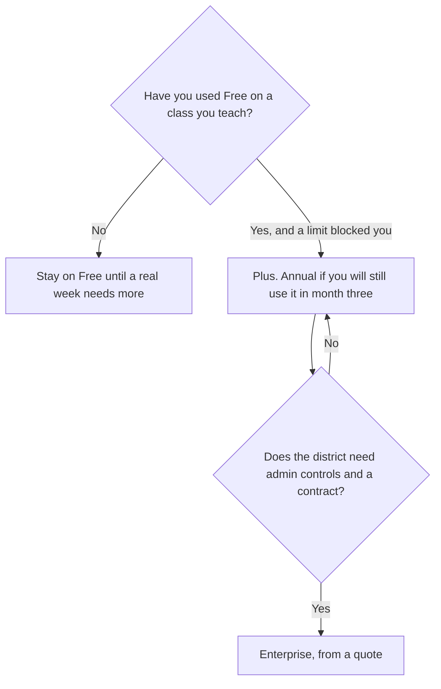

**MagicSchool Plus is $8.33 per user per month billed annually, or $12.99 billed monthly, in USD.** The free plan is described as forever free for an individual teacher. Enterprise is custom for schools and districts that need customization and oversight, and this page does not invent that quote. A year of Plus at the annual rate is 12 × $8.33 = $99.96. A year of monthly Plus is 12 × $12.99 = $155.88. The difference is $55.92. That is the discount for paying annually. It is not a second product.

There is no separate MagicSchool review on this site yet. The classroom shelf is [best AI tools for teachers](/blog/best-ai-tools-for-teachers-2026/). The extension with no published school price is [Brisk Teaching pricing explained](/blog/brisk-teaching-pricing-explained-2026/).

Prices are US list prices excluding tax from MagicSchool's pricing page as recorded in the directory on October 16, 2026. Published October 24, 2026. We did not score lesson plans. Compliance claims below are MagicSchool's statements, not an audit this site performed.

## The plans

| Plan | Price | Who the card names |
|---|---|---|
| Free | $0, described as forever | Individual teachers exploring AI |
| Plus | $8.33 per user a month billed annually, or $12.99 monthly | Teachers ready to go further |
| Enterprise | Custom | Schools and districts that need customization and oversight, with white-glove onboarding |

Plus is an individual upgrade on a published card. Enterprise is the rollout. Do not buy a personal Plus seat for every teacher and call it a district deployment. Do not wait for Enterprise to let one teacher try the free tools.

## What the card says you are buying

The product is a K-12 platform: teacher tools for lessons, differentiation, and report-card comments, a Presentation Generator, an assistant named Raina, student tools with guardrails, and district oversight on Enterprise. MagicSchool says it is SOC 2-certified and FERPA- and COPPA-compliant, and that it does not use student or teacher data to train AI. Ask for the current documents if you are the school signing. A sentence on a pricing page is the start of that file, not the end.

Free is the right plan for a teacher who is still finding two tools they will reuse. The directory's con list says the tool count can feel large. Pick a lesson planner and the comment tool. Ignore the rest until a week needs them.

Plus is the published step when Free is no longer enough for that teacher. The card does not itemize a feature-by-feature fence between Free and Plus on the lines this directory recorded, beyond "teachers ready to go further." Read the live comparison before you charge a card. If the only gap is a feature you have not used, stay on Free.

Enterprise is the quote for customization, oversight, and onboarding. Ask what is included per school, whether student tools are on by default, and who can turn them off. A teacher Plus receipt does not answer those questions.

## Nearby bills with public numbers

**[Brisk Teaching](/tools/brisk-teaching/)** is $0 for an individual teacher. School Premium and district Intelligence are custom, with no USD figure on the card. Brisk lives in the browser extension. MagicSchool is its own platform. A school can want both. Budget them separately. The Brisk article is linked above.

**Khanmigo** is free for teachers, and $4 a month or $44 a year for learners and families. That is a tutor on Khan Academy's content. It is the student-at-home product, not a staff rollout. The tool page is [Khanmigo](/tools/khanmigo/).

**[Quizlet](/tools/quizlet/)** is free for flashcards and practice. The Plus price was not confirmed in the directory, so it is omitted here. Use it when the job is memorization, not a unit plan.

Report-card comments and a leveled reading still need the teacher who knows the student. A fluent comment that invents a trait is a parent meeting you did not schedule. The check is [how to fact-check AI writing](/blog/how-to-fact-check-ai-writing-2026/).

## FAQ

### Is MagicSchool free?

Yes, for an individual teacher, on the card recorded October 16, 2026. Plus is the paid individual plan. Enterprise is the school contract. Free does not include a promise about district admin.

### Is $8.33 the monthly price?

It is the per-user monthly equivalent when you bill annually. The month-to-month price on the card is $12.99. If you cancel before the year you paid for, read the refund terms at checkout. This page does not restate a refund policy it did not record.

### Does Plus include every student in the school?

The Plus line is priced per user for teachers ready to go further. Student tools and district oversight are described as platform capabilities, with Enterprise named for schools that need customization and oversight. Confirm, on the quote, whether a student seat is included. Do not assume a $8.33 teacher row covers a roster.

### Can a teacher paste student work into a personal chatbot instead?

That is a school-policy question. MagicSchool's pitch is that student and teacher data is not used to train its models, and that the product is built for K-12 rules. A personal account on a general chatbot is a different promise. If policy forbids it, do not route around the free teacher plan by pasting the same essay elsewhere.

## Last verified

October 16, 2026, from magicschool.ai/pricing as recorded in the directory. Enterprise had no public dollar. Published October 24, 2026.

**Sources:** [MagicSchool pricing](https://www.magicschool.ai/pricing), [Brisk plans](https://www.briskteaching.com/plans), [Khanmigo pricing](https://www.khanmigo.ai/pricing).

*Published by Andrew for [AI Tools Optimizer](https://aitoolsoptimizer.com).*

[MagicSchool](/tools/magicschool/) is in the [education directory](/tools/category/education/). Directory pages may use affiliate links. A purchase through them may earn us a commission at no extra cost to you.
