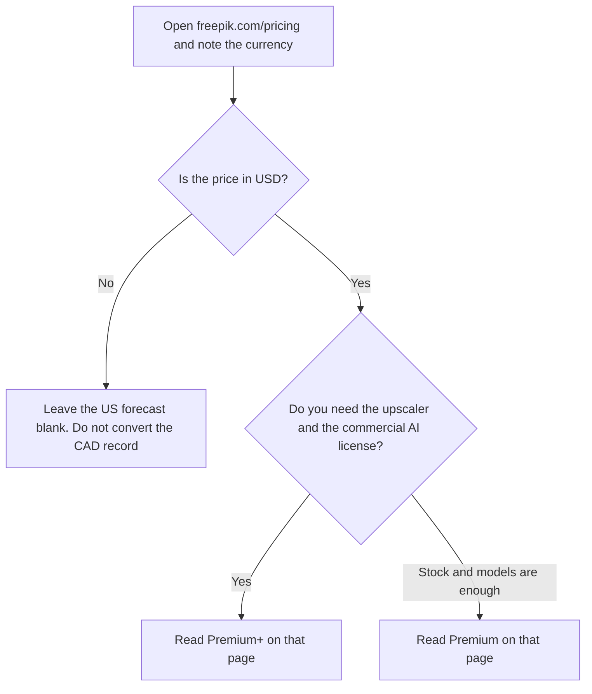

**Do not put a US dollar figure for Magnific in a forecast until you read freepik.com/pricing in USD.** Magnific is the name on Freepik's AI suite. The directory check on October 16, 2026 saw prices in Canadian dollars, excluding VAT and local taxes: Premium at CA$20 a month billed annually, Premium+ at CA$45, and Pro at CA$109.50. This article does not convert those amounts. A visitor who should see USD needs the same page in USD. The recorded currency is a property of that check, not a recommendation to buy in any one country.

The design stack that skipped Magnific for this reason is [best AI tools for designers](/blog/best-ai-tools-for-designers-2026/). A stills plan with a confirmed US price is [Adobe Firefly pricing explained](/blog/adobe-firefly-pricing-explained-2026/). The seat most teams already know is [Canva pricing explained](/blog/canva-pricing-explained-2026/). Midjourney's ladder is [Midjourney pricing explained](/blog/midjourney-pricing-explained-2026/).

Published October 24, 2026. We did not score upscales. A later read of the pricing page on October 24, 2026 did not return a USD table, so the October 16 CAD record stands as the only figure this article will print, clearly labeled.

## What the check recorded

| Plan | Shown on October 16, billed annually | Credits | What the card highlights |
|---|---|---|---|
| Premium | CA$20 a month | 240,000 a year | Spaces, 250 million-plus Premium assets, image, video, and audio models |
| Premium+ | CA$45 a month | 600,000 a year | Unlimited generations on selected models, a commercial AI license with music rights, Magnific and Topaz upscalers |
| Pro | CA$109.50 a month | 1.5 million or 4 million a year | Everything in Premium+, more credits, and Nano Banana Pro unlimited options on the card |

Annual plans, on the card, keep credits for a year with no monthly reset. You can top up. The card says paid plans include no model training on your data. Generation cost varies by model. One example on the card is Kling 2.5 at 720p for 140 credits per 5 seconds. That is a credit cost, not a dollar cost.

## How to read Premium+

Premium+ is the row the card ties to unlimited generations on selected models, the commercial AI license, and the Magnific and Topaz upscalers. "Selected" matters. Unlimited does not mean every model. If the job is an upscale of a still you already have, confirm the upscaler sits on the plan you will pay for, in the currency you will pay.

The original magnific.ai upscaler remains available as a legacy service, on the directory card. That card does not print a legacy price. This article will not invent one. If you are renewing an old magnific.ai account, read that account's invoice. It is not the Freepik table above.

Pro's credit choice, 1.5 million or 4 million a year, is two packs under one plan name on the card. Confirm which pack the price you see belongs to. CA$109.50 was the annual per-month figure shown for Pro at that check. It is not a USD price.

## What a US team can cite today

Until the USD page is in front of you, cite a tool whose October 16 card is in dollars. [Midjourney](/tools/midjourney/) Basic is $10 a month, or $8 billed annually, with no free plan. [Adobe Firefly](/tools/adobe-firefly/) Standard is $9.99 a month with 2,000 monthly credits. [Canva](/tools/canva/) Pro is $18 a month or $180 a year for one person. Those are different products. They are useful as the known bill while Magnific's USD line is unread. They are not substitutes you should pretend are the same upscaler.

The designer page omitted Magnific from its price table for this reason. This article is the explanation of that omission.

## FAQ

### How much does Magnific cost in USD?

Not confirmed here. The October 16 check showed Canadian dollars. Do not multiply CA$20, CA$45, or CA$109.50 by an exchange rate and call the result the US price. Open the pricing page and read the currency it shows you.

### Is Magnific the same as Freepik?

Magnific is the name Freepik uses for this AI suite, on the directory card. Pricing lives on freepik.com. The older magnific.ai upscaler is described as a legacy service with no price on that card.

### Do credits reset every month?

On annual plans, the card says credits last a year and do not reset monthly. Confirm the toggle you are about to buy. A monthly plan can be a different rule, and this page does not describe a monthly USD price.

### Which plan has the upscaler?

The card puts the Magnific and Topaz upscalers on Premium+, along with the commercial AI license. Premium is the assets-and-models row beneath that. Read the current page before you assume an upscale is included in the cheaper tier.

## Last verified

October 16, 2026 for the CAD figures and plan contents, from the Freepik pricing page as recorded in the directory. October 24, 2026 for a pricing-page read that did not return a USD table. Midjourney, Firefly, and Canva comparisons use the October 16 directory check. Published October 24, 2026.

**Sources:** [Freepik pricing](https://www.freepik.com/pricing).

*Published by Andrew for [AI Tools Optimizer](https://aitoolsoptimizer.com).*

[Magnific](/tools/magnific/) is in the [image generation directory](/tools/category/image-generation/). Directory pages may use affiliate links. A purchase through them may earn us a commission at no extra cost to you.
