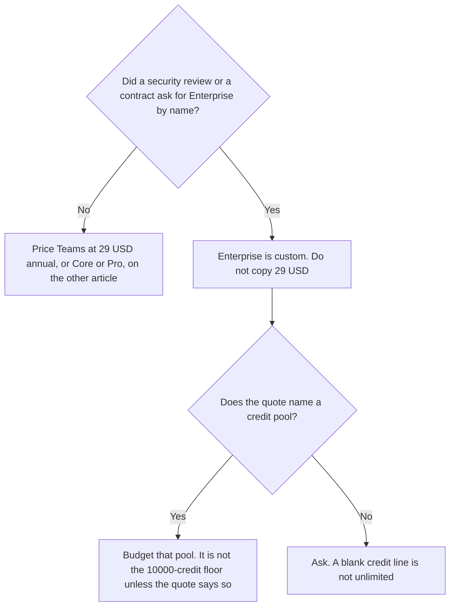

**Make Enterprise does not have a public dollar on the directory card checked October 16, 2026.** The card says Enterprise is custom, with custom credits. Teams, the priced plan under it, starts at $29 a month billed annually for a 10,000-credit floor. Copying $29 onto an Enterprise quote is how a budget lies. The credit ladder for Free, Core, Pro, and Teams is [Make pricing explained](/blog/make-pricing-explained-2026/). This page is only the Enterprise row.

A live fetch of make.com/en/pricing returned HTTP 401 on October 24, 2026. The figures stay on the October 16 card, which was taken from Make's comparison page and Help Center because the pricing page did not fully render. Published October 24, 2026. We did not score scenarios. We do not invent an Enterprise discount.

## What you can quote, and what you cannot

| Plan | Price on the October 16 card | Credits | What this page is allowed to say |
|---|---|---|---|
| Free | $0 | 1,000 a month | Not Enterprise |
| Core | From $9 a month, annual | From 10,000 | Not Enterprise |
| Pro | From $16 a month, annual | From 10,000 | Not Enterprise |
| Teams | From $29 a month, annual | From 10,000 | The last public floor. Still not Enterprise |
| Enterprise | Custom | Custom | Get a quote. This page has no sticker |

A year of Teams at the $29 floor is 12 × $29 = $348. That arithmetic is for Teams at 10,000 credits. It is not a stand-in for Enterprise. Monthly billing costs more than the annual equivalents on the public plans, and the card does not print the monthly dollar. Enterprise's billing cycle is whatever the quote says. Do not assume annual, and do not assume monthly.

## What the card does not give Enterprise

**A list price.** Custom means the quote. A blog post that fills in a dollar is worse than a blank. If a seller shows a number, the number in that quote is the price. Write down the credit pool next to it.

**The Teams feature set at a larger size.** The public card does not print an Enterprise feature matrix this page can copy. Do not promote Teams' $29 line into "Enterprise includes everything in Teams plus SSO" unless the quote says that. If the quote is silent, ask.

**The startup percent.** The directory notes that startups under 20 employees may qualify for 50% off a Business tier. The public ladder on the same card is Free, Core, Pro, Teams, and Enterprise. It does not list a Business plan between Teams and Enterprise. Confirm which plan that percent applies to. Do not apply it to Enterprise in a spreadsheet unless the quote says so.

**A self-hosted Make.** The card's product is the hosted canvas. Self-hosting is a reason to read [n8n pricing explained](/blog/n8n-pricing-explained-2026/), where Community Edition is free on your hardware and Cloud Starter was €20 a month annually. This page does not convert euros. n8n Cloud's invoice, if the question is hosting, is [n8n Cloud pricing explained](/blog/n8n-cloud-pricing-explained-2026/).

## The meters next to a custom quote

[Zapier](/tools/zapier/) Enterprise is also custom. Team, the priced shared-admin plan, is $69 a month billed annually on the October 16 card. That $69 is not a Make Enterprise proxy. The task ladder is [Zapier pricing explained](/blog/zapier-pricing-explained-2026/).

A model key is still a second invoice on any Make plan, including a custom one, unless the quote says the model is bundled. [Claude](/tools/claude/) Pro is $17 a month billed annually, or $20 monthly. It is not included in Teams' $29, and it is not included in an Enterprise quote that does not mention it.

Most module actions use 1 credit on the public plans. Some AI features use more. Routers and error handlers do not consume credits, on the card. An Enterprise quote that uses a different unit should say so. Until it does, do not assume the public credit definition vanished, and do not assume it stayed. Read the quote.

## FAQ

### How much does Make Enterprise cost?

The October 16 card says custom. This page will not print a dollar. Teams at $29 a month billed annually is the public floor under it, at 10,000 credits. A year of that Teams floor is $348. Enterprise is a separate conversation.

### Is Enterprise the same as Teams with more credits?

The card does not say that. Teams has a credit tier you can scale, from the 10,000 floor. Enterprise is custom credits. A larger Teams tier can be the right buy when the only gap is credits. Ask for the Teams tier price before you open an Enterprise conversation you do not need.

### Does the 50% startup discount apply?

The directory mentions 50% off a Business tier for startups under 20 employees. The priced plans we can name are Free, Core, Pro, and Teams. Confirm the plan name on the current offer. Do not subtract 50% from a number Enterprise never published.

### Can I compare it with n8n Business at €667?

Only after you know both hosting models and both units. n8n's €667 row is self-hosted executions, in euros. Make Enterprise is a custom quote. This page does not convert currencies and does not declare a winner. Put the quote next to the euro line and read the units.

## Last verified

October 16, 2026, from Make's comparison page and Help Center, as recorded on the directory card. A live fetch of make.com/en/pricing returned HTTP 401 on October 24, 2026. n8n's euro figures and Zapier's Team price are from the same directory date. Claude's $17 annual figure is from the October 24 pricing article. Published October 24, 2026.

**Sources:** [Make pricing](https://www.make.com/en/pricing), [Make vs Zapier](https://www.make.com/en/compare/make-vs-zapier), [n8n pricing](https://n8n.io/pricing/).

*Published by Andrew for [AI Tools Optimizer](https://aitoolsoptimizer.com).*

[Make](/tools/make/) is in the [automation and agents directory](/tools/category/automation-agents/). Directory pages may use affiliate links. A purchase through them may earn us a commission at no extra cost to you.
