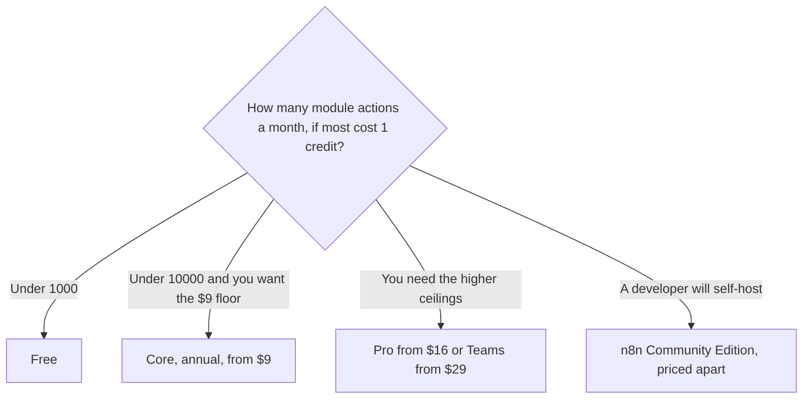

**Make pricing is a monthly credit pool.** Free is $0 with 1,000 credits a month, no time limit, and no card. Core starts at $9 a month billed annually for 10,000 credits. Pro starts at $16 and Teams at $29, on that same 10,000-credit floor, with annual billing. Higher credit tiers cost more. Enterprise is custom. Monthly billing costs more than these annual equivalents. The directory does not print the monthly dollar, so this page does not invent one.

The two-way against n8n is [Make vs n8n for AI](/blog/make-vs-n8n-for-ai-2026/). The three-way is [Zapier vs Make vs n8n](/blog/zapier-vs-make-vs-n8n/). The drawn-path how-to is [how to automate work with Zapier and Make](/blog/how-to-automate-work-with-zapier-and-make/).

Make's own pricing page did not fully render for the directory pass, so these figures come from Make's comparison page and Help Center, as recorded October 16, 2026. Published October 24, 2026. We did not score scenario uptime.

## The ladder at the 10,000-credit floor

| Plan | Annual price at the base tier | Credits | What changes the bill |
|---|---|---|---|
| Free | $0 | 1,000 a month | The cap. Scenarios pause when credits run out |
| Core | From $9 a month | From 10,000, up to 300,000 | The tier you pick, and monthly billing |
| Pro | From $16 a month | From 10,000, up to 8 million | Same. A larger ceiling, not a free AI model |
| Teams | From $29 a month | From 10,000 | Team features at that floor. The credit tier still scales |
| Enterprise | Custom | Custom | A sales conversation |

One year of Core at the $9 floor is 12 × $9 = $108. Pro at $16 is 12 × $16 = $192. Teams at $29 is 12 × $29 = $348. Those are the base 10,000-credit annual equivalents. A larger credit pack is a different invoice. Quote the tier with the price.

## What a credit is

Most module actions use 1 credit. Some AI features use more. Routers and error handlers do not consume credits, on the directory card. A scenario with five billable modules, run 100 times, is 500 credits if each of those modules costs one. Free, at 1,000 credits, covers that twice. The same scenario run 2,000 times is 10,000 credits, which is the Core floor and the entire Free plan ten times over. Filter early so later modules do not run. The directory also records, per 10,000 credits, 5 GB of data transfer, 10 MB of data storage, and a 667-item webhook queue.

Extra credits can be bought in bundles of 1,000 or 10,000. Core, Pro, and Teams can turn on auto-purchasing. Scenarios pause when the pool is empty. Make notifies you at 75% and 90%, on the recorded FAQ. A paused webhook is an incident, not a rounding error.

The notes also say startups under 20 employees may qualify for 50% off a Business tier. The public ladder recorded here is Free, Core, Pro, Teams, and Enterprise. Confirm which plan that discount applies to before you put 50% in a budget.

## The other bills in the same scenario

[n8n](/tools/n8n/) charges an execution, not a module. Community Edition is free to self-host. Cloud Starter was €20 a month billed annually for 2,500 executions. This page does not convert euros. The invoice is [n8n pricing explained](/blog/n8n-pricing-explained-2026/).

[Zapier](/tools/zapier/) Professional is $19.99 a month billed annually for 750 tasks. Filters, Paths, and Formatter steps do not count. A five-step Zap is a different meter from five Make credits. Read the line you will hit.

[Lindy](/tools/lindy/) Team starts at $49.99 a month for 5,000 credits. Use it when the product is an agent watching an inbox. Use Make when you need to point at every branch.

A model key is a second invoice. [Claude](/tools/claude/) Pro at $20 is a person in chat. It is not included in Make's $9. The split is [what an API for AI tools is](/blog/what-is-an-api-for-ai-tools-2026/). The review of the hosted n8n product, if you are still choosing, is [n8n cloud review](/blog/n8n-cloud-review-2026/).

## FAQ

### Is $9 the monthly price?

$9 is the annual equivalent at the 10,000-credit Core floor. Month-to-month costs more, and the directory does not print that higher number. A quote that says "$9" without "billed annually, 10,000 credits" is incomplete.

### What happens at zero credits?

Scenarios pause. Webhooks can queue. You can buy a bundle or wait for the next month's grant. Build the alert at 75% before you discover the pause from a customer.

### Do AI modules cost one credit?

Some AI features use more than one credit. Read the module before you multiply a 10,000-credit plan by "one credit per step" and call it a capacity plan. The one-credit rule is the usual action, not a promise about every AI step.

### Is Make included with a chat subscription?

No. The credits are Make's. Your model vendor bills separately unless the module says the model is bundled.

## Last verified

October 16, 2026, from Make's comparison page and Help Center, because the pricing page did not fully render. n8n's euro price, Zapier, Lindy, and Claude are from the same directory pass. Published October 24, 2026.

**Sources:** [Make pricing](https://www.make.com/en/pricing), [Make vs Zapier](https://www.make.com/en/compare/make-vs-zapier), [n8n pricing](https://n8n.io/pricing/).

*Published by Andrew for [AI Tools Optimizer](https://aitoolsoptimizer.com).*

[Make](/tools/make/) is in the [automation and agents directory](/tools/category/automation-agents/). Directory pages may use affiliate links. A purchase through them may earn us a commission at no extra cost to you.
