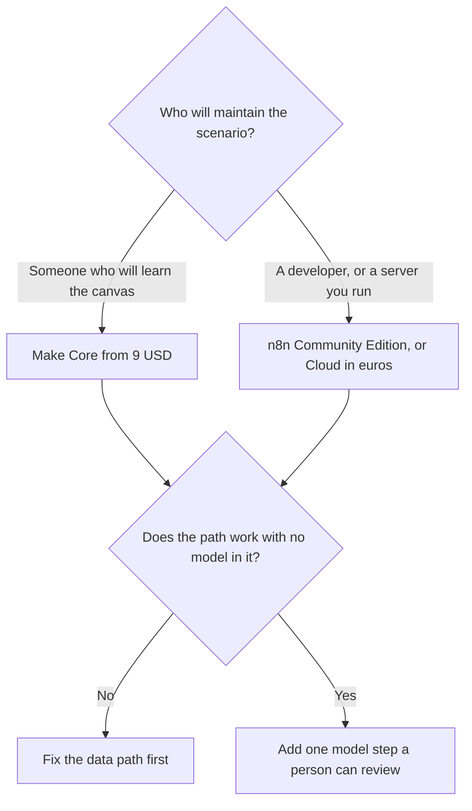

**Use Make when a visual scenario should branch and you want a USD credit price you can read. Use n8n when a developer will own the workflow, especially if you can self-host, because one execution can contain many AI steps.** [Zapier](/tools/zapier/) is the third product, for a non-technical owner who wants the common apps this week. That three-way, including the AI step, is already [Zapier vs Make vs n8n](/blog/zapier-vs-make-vs-n8n/). This page is the two-way decision after Zapier is off the table.

The how-to for the drawn path is [how to automate work with Zapier and Make](/blog/how-to-automate-work-with-zapier-and-make/). The split between a diagram and an agent is [AI orchestration vs automation](/blog/what-is-ai-orchestration-vs-automation-2026/).

Prices: Make figures are USD from Make's comparison and help center, as recorded October 16, 2026, because the pricing page did not fully render. n8n's cloud price was shown in euros on the same date. This page does not convert euros. Published October 24, 2026. We did not score reliability.

## The meter is the decision

| You are | Open this | First paid step we could price | What an AI step costs on that meter |
|---|---|---|---|
| Comfortable on a canvas, and you want USD | [Make](/tools/make/) | Core from $9 a month billed annually for 10,000 credits | Each module spends credits. An AI module spends them too |
| A developer, or the data must stay on your server | [n8n](/tools/n8n/) | Community Edition is free to self-host. Cloud Starter was €20 a month annually for 2,500 executions | The execution counts once, however many AI nodes sit inside it |
| You want an employee, not a diagram | [Lindy](/tools/lindy/) | Team from $49.99 a month for 5,000 credits | A different shape. See the three-way |
| The model is the bill you can see per million tokens | Your own API key | Separate from Make or n8n | The seat is not included in the $9 |

## How the AI step hits the invoice

On **Make**, modules spend credits. Free is 1,000 credits a month. Core starts at $9 a month on annual billing for 10,000 credits. Pro starts at $16 and Teams at $29, at that same 10,000-credit floor. Higher credit tiers cost more. The directory also records 5 GB of data transfer per 10,000 credits. A scenario that calls a model on every row will burn the pool even when the sticker looks small. Extra credits come in bundles of 1,000 or 10,000. Monthly billing costs more than these annual equivalents. Error handlers, the directory says, do not consume credits.

On **n8n**, you pay for a workflow execution, not for each node. That is why a fat scenario with several model calls is often cheaper to reason about here, if you can staff it. Community Edition is free if you self-host. You pay in Docker, upgrades, and backups. Cloud Starter was €20 a month billed annually for 2,500 executions, 5 concurrent executions, and 1,600 Assistant credits. Pro was €50 a month annually for 10,000 executions. Business was €667 a month annually for 40,000 executions on the self-hosted commercial tier the directory recorded. Annual billing saves 17% off the monthly euro price. Do not "upgrade to be safe." Forecast executions.

The model is a second invoice if you bring an API key. [Claude](/tools/claude/) Pro at $20 a month is a person using chat. It is not an API allowance inside Make's $9. The split is [what an API for AI tools is](/blog/what-is-an-api-for-ai-tools-2026/). A scheduled pile of calls that can wait is [what batch inference is](/blog/what-is-ai-batch-inference-2026/).

n8n's review of the hosted product is [n8n cloud review](/blog/n8n-cloud-review-2026/).

## When the diagram is the wrong shape

[Lindy](/tools/lindy/) Team starts at $49.99 a month for 5,000 credits, with a 7-day credit grant and no card, on the directory card. Use it when the work is "watch this inbox and do the task," and you accept an agent product. Use Make or n8n when a client will ask you to point at every branch.

Add the model after the non-AI path moves the right row to the right place. Then keep the model on a draft, a label, or a summary. A person sends the customer mail. That person is [what human-in-the-loop AI is](/blog/what-is-human-in-the-loop-ai-2026/). The permissions around the action are [what AI guardrails are](/blog/what-is-ai-guardrails-2026/).

DevOps teams picking glue for alerts have a wider shelf: [best AI tools for DevOps teams](/blog/best-ai-tools-for-devops-teams-2026/). SRE teams who need the write-up after the alert have another: [best AI tools for SRE teams](/blog/best-ai-tools-for-sre-teams-2026/).

## FAQ

### Is n8n the cheaper Make?

It can be, for a scenario with many modules, because the execution is the unit. It is not cheaper if you will not run it. Community Edition's price is the labor. Cloud Starter's price was in euros. Compare the runs you will actually make.

### Does Make include a chat model?

The credits pay for Make's modules, including AI steps. They do not include a separate vendor's API usage unless the module says the model is bundled. Read the module. Budget the key.

### Can we start on Free?

Make Free, at 1,000 credits, is enough to prove one scenario. n8n's free path is self-hosting, not a permanent free cloud plan in the price table. Cloud has a trial. Run the real volume for a week before you pick a tier.

### Should the agent write back to the CRM on its own?

Only for a field you named, after a test on fake rows. The place a fact is allowed to live is [what a system of record for AI is](/blog/what-is-a-system-of-record-for-ai-2026/).

## Last verified

October 16, 2026 for Make's USD prices, n8n's euro prices, Lindy, and Claude. Published October 24, 2026.

**Sources:** [Make](https://www.make.com), [n8n](https://n8n.io), [Lindy](https://www.lindy.ai).

*Published by Andrew for [AI Tools Optimizer](https://aitoolsoptimizer.com).*

[Make](/tools/make/) is in the [automation and agents directory](/tools/category/automation-agents/). Directory pages may use affiliate links. A purchase through them may earn us a commission at no extra cost to you.
