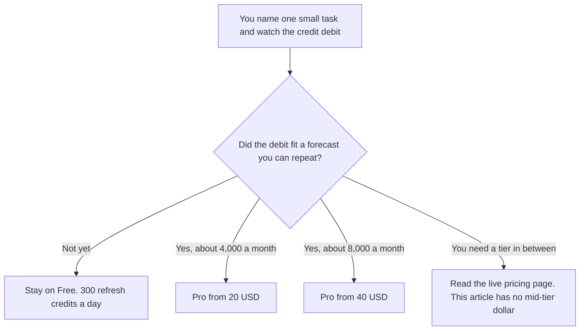

**Manus Pro starts at $20 a month for 4,000 credits, plus the daily refresh.** A second published step is $40 a month for 8,000 credits, with a 7-day free trial on that step. Annual billing saves 17% on the card we recorded. Free is 300 refresh credits a day and includes Chat Mode. Team starts at $20 per seat a month. The highest Pro tier on the card is 40,000 credits a month. This page does not print a dollar for the tiers between 8,000 and 40,000 credits, because the directory does not list those prices.

The product page is [Manus AI review](/blog/manus-ai-review-2026/). A different agent meter is [Lindy pricing explained](/blog/lindy-pricing-explained-2026/). Work that has to follow a diagram you drew is [what AI orchestration versus automation is](/blog/what-is-ai-orchestration-vs-automation-2026/).

Prices are US dollars from Manus's help center and pricing page as recorded in the directory on October 16, 2026. A fetch of manus.im/pricing on October 24, 2026 returned 401, so the gaps stay gaps. Published October 24, 2026. We did not score task quality. Outputs still need a person to check facts.

## The rows we can print

| Plan | Price we can quote | Credits we can quote |
|---|---|---|
| Free | $0 | 300 refresh credits daily, plus Chat Mode |
| Pro | From $20 a month | 4,000 a month, plus the daily refresh |
| Pro | From $40 a month, with a 7-day trial | 8,000 a month |
| Pro, highest listed | Dollar not recorded | Up to 40,000 a month |
| Team | From $20 per seat a month | Pro features plus usage analytics |

Pro, on the card, includes Manus 2.0, 2.0 Max, and 2.0 Lite, Wide Research, and up to 20 concurrent tasks and 20 scheduled tasks. Free includes Chat Mode. Scheduled work is a reason to pay. A one-off question is a reason to stay on the daily refresh.

## How to read the $20

Four thousand credits at $20 is half a cent per credit if you use the whole allowance. That division is a sketch. Manus tasks do not advertise a stable credit cost in the directory. A research job and a slide job will not debit the same way. Run one task you care about, read the debit, and multiply that debit. Do not multiply $20 by a guess.

The $40 tier is the other number we can budget. Annual billing at 17% off changes both, if the discount applies to the tier you pick. This page does not recompute a secret annual sticker. Take 17% off the monthly price you see at checkout and confirm the invoice.

Team at $20 a seat adds usage analytics and the Pro feature set, on the card. It does not, by itself, tell you how many credits the seat includes. Ask that question before you multiply seats. A seat without a credit pool is a collaboration fee. The pool is the usage.

The daily 300 on Free can coexist with a monthly Pro allowance. The directory says the $20 plan is "4,000 a month, plus daily refresh." Confirm whether the daily credits are inside the 4,000 or beside them on the plan you are shown. This article keeps both phrases and does not collapse them.

## What not to compare blindly

**[Lindy](/tools/lindy/)** starts at $49.99 a month for 5,000 credits, with top-ups at $10 per 1,000. Anything with outside impact waits for approval, on the pricing page read October 24, 2026. Lindy credits are not Manus credits.

**[ChatGPT](/tools/chatgpt/)** Plus is $20 a month for a chat seat, not an autonomous task runner with a credit meter. [ChatGPT review](/blog/chatgpt-review-2026/) is the seat. Use it when you want a draft you steer turn by turn.

**[Perplexity](/tools/perplexity/)** Pro is $17 a month billed annually when the job is a cited answer. [Perplexity review](/blog/perplexity-review-2026/). A Manus report still needs those links opened.

**[Zapier](/tools/zapier/)** Professional is $19.99 a month billed annually for 750 tasks. A Zap is a workflow you drew. Manus is a goal you delegate. If the steps must be identical every time, draw them. The difference is [what an AI agent is](/blog/what-is-an-ai-agent-2026/).

## FAQ

### Is Manus free?

Yes. Free includes 300 refresh credits a day and Chat Mode. It is enough to time one small task. It is a poor forecast for a weekly research job until you have seen the debit.

### How much is the 40,000-credit tier?

The directory lists the credit amount and does not list the price. Open the pricing page or the help center and read it. This article will not invent the dollar.

### Do annual plans change the credits?

The card says annual billing saves 17%. It does not say the credit counts change. Assume the same credits at a lower dollar until checkout shows otherwise.

### Can I predict a Wide Research job?

Not from the price card. Wide Research spreads a job across parallel agents, on the product description. Parallel work can spend credits faster. Cap the first run, read the debit, then schedule it. Pro lists up to 20 concurrent and 20 scheduled tasks. The cap is yours to set inside that allowance.

## Last verified

October 16, 2026, from the directory's record of Manus help-center and pricing pages. A fetch on October 24, 2026 returned 401. Lindy's $49.99 line was read October 24, 2026. Other comparison prices are from the October 16 directory. Published October 24, 2026.

**Sources:** [Manus membership pricing](https://help.manus.im/en/articles/11711111-what-is-the-current-membership-pricing-for-manus), [Manus pricing](https://manus.im/pricing).

*Published by Andrew for [AI Tools Optimizer](https://aitoolsoptimizer.com).*

[Manus](/tools/manus/) is in the [automation and agents directory](/tools/category/automation-agents/). Directory pages may use affiliate links. A purchase through them may earn us a commission at no extra cost to you.
