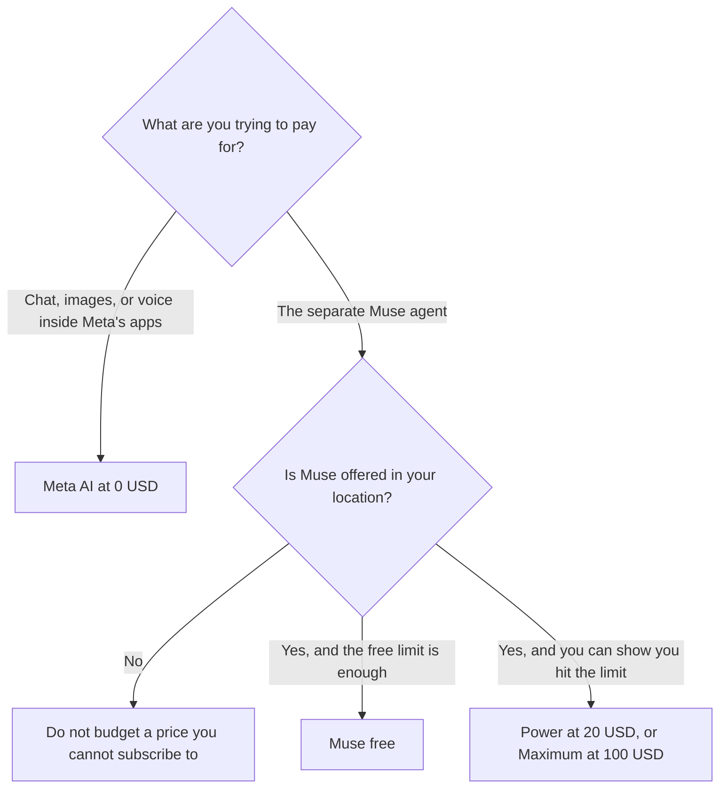

**Meta AI is free with a Meta account. Meta's separate personal agent, Muse, is free with a usage limit, then Power at $20 a month for 500 million Muse tokens a week, and Maximum at $100 a month for 3 billion tokens a week.** The assistant in the Meta AI app, on meta.ai, and inside WhatsApp, Instagram, Facebook, Messenger, and Threads is the free product. Muse is the paid agent. Buying Power does not "upgrade Meta AI" into a workplace suite. It subscribes you to Muse, where Muse is offered.

The product page is [the Meta AI directory entry](/tools/meta-ai/). A paid general assistant with a published seat is [ChatGPT review](/blog/chatgpt-review-2026/). The Google assistant, including the free tier, is [Gemini pricing explained](/blog/gemini-pricing-explained-2026/).

Prices are US list prices from Meta's Help Center as recorded in the directory on October 16, 2026. A live fetch of that help page returned HTTP 401 on October 24, 2026, so this page stays on the directory record. Published October 24, 2026. We did not score answers. Muse is in limited testing and is not available in every location. Benefits can vary by region and are shown before you subscribe.

## The two products

| Product | Price recorded | What the card ties to the price |
|---|---|---|
| Meta AI, in the app, on the web, and in Meta's apps | $0 | A Meta account |
| Muse, free | $0 | A usage limit that refreshes. The directory does not print the cap |
| Muse Power | $20 a month | 500 million Muse tokens a week |
| Muse Maximum | $100 a month | 3 billion Muse tokens a week |

A year of Power at the monthly rate is 12 × $20 = $240. A year of Maximum is 12 × $100 = $1,200. The directory does not print an annual Muse discount, so this page does not invent one. Subscriptions renew monthly. The help text recorded in the directory says you need to be 18, or the age of majority where you live.

## What you are choosing besides the dollar

**Meta AI at $0** is the assistant people open inside apps they already have. The directory says it runs on Muse Spark, with voice, image generation, and a camera feature that rolled out from Meta's glasses to the app. Contemplating mode, which runs several reasoning agents, was rolling out gradually on meta.ai. A gradual rollout is not a feature you can promise a teammate in every country.

**Muse** is a personal agent that can take actions, connect to other apps, set reminders, and keep a conversation going, on the directory description. The free Muse plan has a usage limit that refreshes. Because the card does not print that limit as a number, this page does not guess it. Power and Maximum are the two paid token budgets.

**Privacy** is a product decision, not a line item. The directory's own verdict says privacy-conscious people should review Meta's data settings before they rely on the assistant. This page does not audit those settings. Read them on your account.

[ChatGPT](/tools/chatgpt/) Plus is $20 a month if you want a general paid assistant with projects. [Claude](/tools/claude/) Pro is $20 a month, or $17 billed annually, if the work is a long document. [Gemini](/tools/gemini/) is free with a Google account, and Pro is $19.99 a month. Those are different companies and different data terms. A $0 Meta AI seat is cheaper. It is not those products.

## What not to assume

Do not quote a Meta AI Pro price. The directory does not list one. Do not quote a workplace admin tier for the free assistant. Do not treat 500 million tokens as a promise about answer quality. It is the Power allowance. Do not assume Maximum is available because a blog post mentioned it. The card says limited testing, and the subscribe screen is the source.

## FAQ

### Is Meta AI free?

Yes. Meta AI is free at meta.ai, in the Meta AI app, and in Meta's apps, with a Meta account. You can create that account with Facebook, Instagram, email, or a phone number, on the help text the directory recorded.

### What is Muse, if the assistant already uses Muse Spark?

Muse Spark is the model family the directory says now powers the free assistant. Muse is a separate personal agent with its own free limit and its own $20 and $100 plans. The names share a word. The invoices do not.

### Can a team buy Muse seats?

The October 16 directory card does not list a team price, a seat minimum, or an admin console for Muse. This page does not invent one. If you need admin controls, price a product that publishes them, and do not force a personal agent into that role.

### Why might I see no upgrade button?

Muse subscriptions are in limited testing and are not offered in every location. The help text says benefits may vary by region and are shown before you subscribe. Absence of the button means you are on the free assistant, not that a hidden plan is $20 everywhere.

## Last verified

October 16, 2026, from Meta's Help Center as recorded in the directory. Published October 24, 2026. A live fetch returned HTTP 401.

**Sources:** [About Muse subscriptions](https://www.meta.com/help/subscriptions/1021145227643680/), [Introducing Muse Spark](https://ai.meta.com/blog/introducing-muse-spark-msl/), [Meta AI](https://www.meta.ai).

*Published by Andrew for [AI Tools Optimizer](https://aitoolsoptimizer.com).*

[Meta AI](/tools/meta-ai/) is in the [chatbots and assistants directory](/tools/category/chatbots-assistants/). Directory pages may use affiliate links. A purchase through them may earn us a commission at no extra cost to you.
