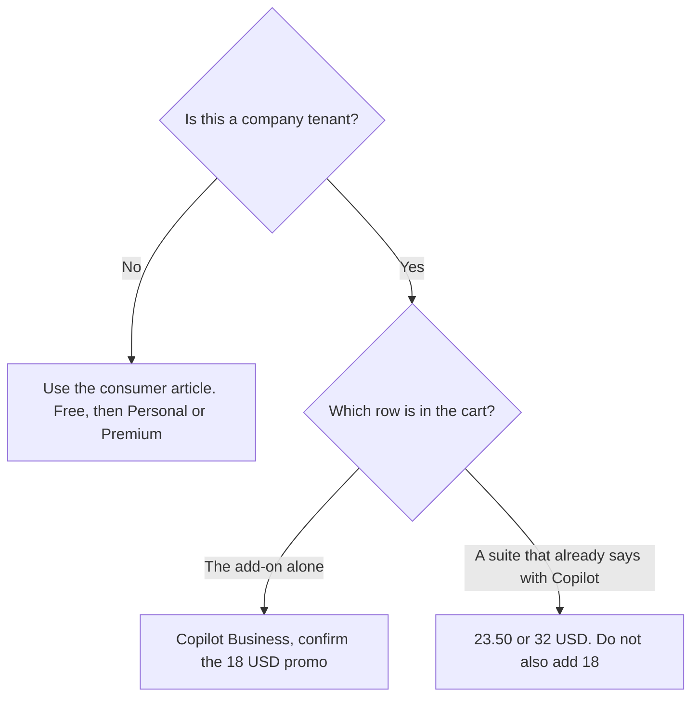

**Microsoft 365 Copilot Business was listed from $18 a user a month paid yearly, shown as reduced from $21, on the directory card checked October 16, 2026.** That is the work seat. It is not the free Copilot chat, and it is not GitHub Copilot. The consumer ladder, from free through Premium at $19.99, is [Microsoft Copilot pricing explained](/blog/microsoft-copilot-pricing-explained-2026/). This page is the company invoice: the add-on row and the two bundles, and the mistake of adding them together.

A refetch of the public pricing page on October 24, 2026 returned HTTP 403, so the dollars stay on the October 16 card. If checkout shows a different number, checkout wins. Published October 24, 2026. We did not score answers inside Word or Excel.

## The work rows on the October 16 card

| Plan | Price on that card | What it is |
|---|---|---|
| Microsoft 365 Copilot Business | From $18 a user a month, paid yearly | The add-on. The card showed it reduced from $21, and marked the figure promotional |
| Business Standard with Copilot | From $23.50 a user a month, paid yearly | A bundle. Not the add-on stacked on a suite you already pay for |
| Business Premium with Copilot | $32 a user a month, paid yearly | The higher bundle |

The directory says monthly business options cost more, and it does not print a monthly business dollar. This page does not invent one. It also does not treat $18 as a permanent list price. The card called it promotional. A purchase order that quotes $18 as the ongoing price is ahead of the card.

Free Copilot, Personal at $9.99, Family at $12.99, and Premium at $19.99 are real products. They are on the other article. Family's AI is for the subscription owner only, on that card. None of those rows is a company tenant.

## What the work seat is, and is not

**Not GitHub Copilot.** [GitHub Copilot](/tools/github-copilot/) Pro is $10 a user a month, and Business is $19 a user a month, on the October 16 card. That is the editor. The invoice is [GitHub Copilot Business pricing explained](/blog/github-copilot-business-pricing-explained-2026/). A developer who needs completions does not buy Microsoft 365 Copilot to get them. An analyst who lives in Excel does not buy GitHub Copilot to get Excel.

**Not a second copy of the bundle.** Business Standard with Copilot from $23.50 and Business Premium with Copilot at $32 already say "with Copilot." Adding the $18 add-on on top of a bundle you modeled is how the seat gets priced twice. Read the row name in the cart.

**Not Google, and not a blank-page chatbot.** [Gemini](/tools/gemini/) Google AI Pro is $19.99 a month on the October 16 card, if the files are in Google. The invoice is [Gemini pricing explained](/blog/gemini-pricing-explained-2026/). [ChatGPT](/tools/chatgpt/) Plus is $20 a month on the October 16 card, if you do not need Office apps. The review is [ChatGPT review](/blog/chatgpt-review-2026/).

**Not a promise about every market.** The consumer card said Microsoft 365 Pro at $99.99 was not available in every market, and that plan is monthly billing only. This article does not pull Pro into the work forecast. Confirm the tenant's own checkout.

The directory describes business plans as adding identity, adoption analytics, and model choice. Those are product claims on the card. They are not a security review. Your admin still reads the agreement.

## What not to assume

Do not quote $21 as the price you will pay, and do not quote $18 as the price you will pay next year. The card showed a promotion. Do not convert the yearly work price into a monthly figure the card did not list. Do not divide a bundle by an add-on and call the difference "the suite." Do not buy this seat for a team that works in Google Docs.

## FAQ

### How much is Microsoft 365 Copilot for a business?

On the directory card checked October 16, 2026, Microsoft 365 Copilot Business was from $18 a user a month paid yearly, shown as reduced from $21. Business Standard with Copilot was from $23.50, and Business Premium with Copilot was $32, both paid yearly. The October 24 refetch of the pricing page returned HTTP 403.

### Is the $18 price permanent?

The card marks it promotional. Treat $18 as the recorded promo, not as a list price you can put in a three-year model. Checkout is the current number.

### Do I add $18 to Business Premium?

Only if the cart is the add-on and you do not already have a "with Copilot" bundle. The $32 row is Business Premium with Copilot. Adding $18 again double-counts the assistant. Read the row name.

### Is this included with Microsoft 365 Personal?

Personal at $9.99 is a consumer plan on the other article. It is not the work seat on this page. A company tenant uses the business rows above, after you confirm which row is in the cart.

## Last verified

October 16, 2026, from Microsoft's US pricing pages as recorded in the directory. The public business pricing URL returned HTTP 403 on October 24, 2026. GitHub Copilot, Gemini, and ChatGPT comparisons use the October 16 cards. Published October 24, 2026.

**Sources:** [Microsoft 365 Copilot pricing](https://www.microsoft.com/en-us/microsoft-365-copilot/pricing), [Copilot for individuals](https://www.microsoft.com/en-us/microsoft-copilot/for-individuals), [GitHub Copilot](https://github.com/features/copilot).

*Published by Andrew for [AI Tools Optimizer](https://aitoolsoptimizer.com).*

[Microsoft Copilot](/tools/microsoft-copilot/) is in the [chatbots and assistants directory](/tools/category/chatbots-assistants/). Directory pages may use affiliate links. A purchase through them may earn us a commission at no extra cost to you.
