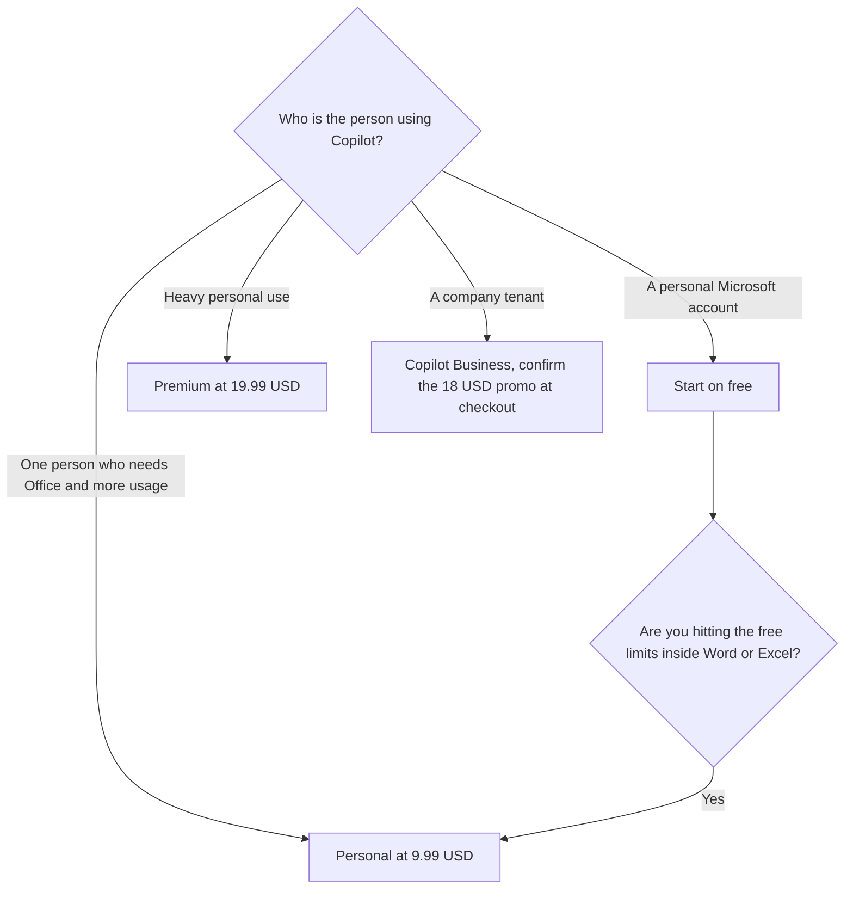

**Microsoft Copilot is free with a signed-in Microsoft account. Microsoft 365 Personal is $9.99 a month, Family is $12.99 a month, and Premium is $19.99 a month. Copilot Business was listed from $18 a user a month paid yearly, shown as reduced from $21.** The free product is a chatbot. The paid consumer plans are Microsoft 365 subscriptions that raise Copilot usage and include Office apps. The business plans are a per-user work seat. GitHub Copilot, the coding product, is a different invoice.

That coding invoice is [GitHub Copilot pricing explained](/blog/github-copilot-pricing-explained-2026/). The assistant that sits in Gmail and Docs instead of Word and Excel is [Gemini pricing explained](/blog/gemini-pricing-explained-2026/). A general chat seat with no Office apps is [ChatGPT review](/blog/chatgpt-review-2026/).

Prices are US list prices from Microsoft's pricing pages as recorded in the directory on October 16, 2026. The $18 Business figure is marked promotional on that record. Published October 24, 2026. We did not score answers. The card says annual billing on consumer plans saves up to 17 percent. It does not print the annual dollar, so this page does not compute one.

## The plans

| Plan | What you pay | Who the AI is for |
|---|---|---|
| Copilot free | $0 | The signed-in person, with usage limits on some features |
| Microsoft 365 Personal | $9.99 a month | That subscription, with higher Copilot usage than free, plus Office apps |
| Microsoft 365 Family | $12.99 a month | Up to 6 people for the Office subscription. AI features are for the subscription owner only |
| Microsoft 365 Premium | $19.99 a month | Advanced Copilot chat and extensive usage, on the card |
| Microsoft 365 Pro | $99.99 a month, monthly billing only | Highest usage, on the card. The directory says it was not available in every market |
| Microsoft 365 Copilot Business | From $18 a user a month paid yearly | A work seat. The card showed this as reduced from $21 |
| Business Standard with Copilot | From $23.50 a user a month paid yearly | The bundle, not the add-on alone |
| Business Premium with Copilot | $32 a user a month paid yearly | The higher bundle |

Family at $12.99 is not six Copilot seats. The directory is explicit: AI features are for the subscription owner only. The other people on the family plan are on the Office subscription. If they need Copilot, they need their own plan. Pro at $99.99 is monthly billing only on the card, and it was unavailable in the market the directory checked. Treat "not available" as a fact to re-check, not as a coupon.

## What the money is buying

**Free** is chat, image creation, and research, with limits. It is the right start when you do not live in Word, Excel, PowerPoint, Outlook, or Teams. Hitting a limit is the signal to look at Personal or Premium, not the signal to open a second free account.

**Personal at $9.99** is the first paid consumer step: higher usage than free, and the Office apps. **Premium at $19.99** is the card's "extensive usage" and advanced Copilot chat row. The directory says annual billing saves up to 17 percent on consumer plans. Until checkout shows the annual figure, quote the monthly price and the "up to 17 percent" line together, not a dollar you multiplied.

**Copilot Business from $18**, promotional, originally $21, is the work seat paid yearly. Monthly business options cost more, on the note, and this page does not print a monthly business dollar the card did not list. Business Standard with Copilot from $23.50 and Business Premium with Copilot at $32 are bundles. Adding $18 on top of a bundle you already modeled is how the invoice doubles. Read which row you are actually buying.

**GitHub Copilot Pro is $10 a user a month.** It is a coding assistant. It does not become Microsoft 365 Copilot because both names contain Copilot. If the job is the editor, use the GitHub article. If the job is the spreadsheet, use this one.

[ChatGPT](/tools/chatgpt/) Plus at $20 a month is the comparison when you do not need Office. [Gemini](/tools/gemini/) on Google AI Pro at $19.99 is the comparison when the files are in Google. Buying Copilot to sit inside a Google Doc is the wrong suite.

## What not to assume

Do not quote $18 as a permanent list price. The directory marks it promotional. Do not divide Family by six and call it the per-person AI price. Do not assume Pro at $99.99 can be purchased in every country because the US card listed it. Confirm the market. Do not treat a free chat as the same control set as a business tenant.

## FAQ

### Is Microsoft Copilot free?

Yes, with a signed-in Microsoft account, and with usage limits on some features. Word, Excel, and the higher limits are why the paid Microsoft 365 plans exist.

### Does Family include Copilot for everyone?

The Office subscription covers 1 to 6 people. The AI features are for the subscription owner only, on the October 16 card. Other family members who need Copilot need a plan that includes it for them.

### What is the business price?

The directory's business card showed Microsoft 365 Copilot Business from $18 a user a month paid yearly, reduced from $21. That is a promotion until checkout says otherwise. The bundles were from $23.50 and $32 a user a month paid yearly. Confirm which row is in the cart.

### Is this GitHub Copilot?

No. GitHub Copilot Pro is $10 a user a month and lives in the editor. This page is the Microsoft 365 assistant. The names are easy to mix in a purchase order. They are different products, and the GitHub pricing article is the other bill.

## Last verified

October 16, 2026, from Microsoft's US pricing pages as recorded in the directory. Published October 24, 2026.

**Sources:** [Copilot for individuals](https://www.microsoft.com/en-us/microsoft-copilot/for-individuals), [Microsoft 365 Copilot pricing](https://www.microsoft.com/en-us/microsoft-365-copilot/pricing).

*Published by Andrew for [AI Tools Optimizer](https://aitoolsoptimizer.com).*

[Microsoft Copilot](/tools/microsoft-copilot/) is in the [chatbots and assistants directory](/tools/category/chatbots-assistants/). Directory pages may use affiliate links. A purchase through them may earn us a commission at no extra cost to you.
