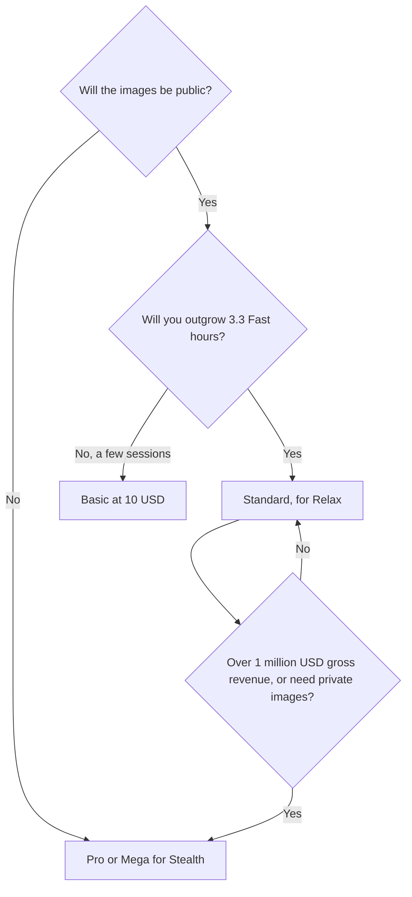

**Midjourney pricing is a Fast GPU clock, with Relax as the reason to leave Basic, and Stealth as the reason to leave Standard.** The plan names are not quality levels. Basic can generate with the same models. It cannot do it for long, it cannot fall back to an unlimited slower queue, and it cannot keep the images private.

Prices are US list prices excluding tax, from Midjourney's plan comparison as checked October 16, 2026. This explainer is published October 24, 2026. A live refetch of the help page that day did not return the article, so the table keeps the October 16 figures. The product review is [Midjourney review](/blog/midjourney-review-2026/). A first week of use is [Midjourney for beginners](/blog/midjourney-for-beginners-2026/).

## The four plans

| Plan | Monthly | Annual, per month | Annual total | Fast GPU time | What you crossed a paywall to get |
|---|---|---|---|---|---|
| Basic | $10 | $8 | $96 | 3.3 hours | A subscription. Commercial use under the terms, with the revenue rule below. Images are public. No Relax |
| Standard | $30 | $24 | $288 | 15 hours | Unlimited Relax image generation |
| Pro | $60 | $48 | $576 | 30 hours | Stealth Mode. Unlimited Relax SD video. Required, with Mega, if the company earns over $1,000,000 gross a year |
| Mega | $120 | $96 | $1,152 | 60 hours | The larger Fast clock. Same privacy and revenue class as Pro |

Annual billing is 20% off the monthly list. Extra Fast time is $4 an hour on top of the allowance. There is no free plan.

## Fast, Relax, and the V8 exception

Fast time is the priority queue. Basic includes 3.3 hours of it. Standard includes 15, Pro 30, Mega 60. When the clock is gone, you either wait until next month, buy hours at $4, or use Relax if your plan has it.

Relax is the slower unlimited queue. For images, it starts on Standard. For SD video, it starts on Pro. It is the feature that makes Standard the practical plan for anyone who explores. Basic is a metered plan. Standard is a metered priority plan plus an unlimited backup.

V8, which entered alpha in 2026, does not support Relax yet. If the look you are buying is V8, Standard's "unlimited" does not apply to that model. You are on the Fast clock, and the $4 hour is the overflow. Check the current V8 note before you tell a team that Standard is unlimited. The alpha announcement is the source for that limit, not a rumor about image quality.

Video is included as a product, and Relax for SD video is a Pro and Mega line. A Standard subscriber making video is spending Fast time. Price a clip before you assume the image plan covers a storyboard.

## Commercial use is not privacy

Subscribers may use images and videos under Midjourney's terms. Separately, a company with more than $1,000,000 in gross annual revenue must be on Pro or Mega. A freelancer under that line is not forced onto Pro by the revenue rule. A freelancer who cannot put client work on a public gallery is forced onto Pro by Stealth. Those are different gates. People merge them and either overpay or leak a client image.

Stealth is only on Pro and Mega. It is not a toggle you add to Basic for a small fee in the comparison we read. If privacy matters, the price is $60 a month, or $48 on annual billing, not $10.

## Who stops at which plan

**A hobbyist or a student making personal images.** Basic, if 3.3 Fast hours holds a month. If you are re-rolling for fun, you will leave Basic. Standard's Relax is the cheaper way to re-roll than buying Fast hours at $4.

**A designer with a style to repeat.** Standard. Style references and moodboards are the product. The plan is the one that lets you explore after the Fast clock ends. Move to Pro when the client requires privacy or the revenue rule applies. The three-way with other models is [Midjourney vs Leonardo vs Flux](/blog/midjourney-vs-leonardo-vs-flux-2026/).

**A company over the revenue line, or any team with private work.** Pro. Mega only when 30 Fast hours is the measured shortage, especially on V8 where Relax is absent. Mega is not a sharper model. It is a longer clock.

**Someone who needs words in the image, or a licensed-training claim.** Leave Midjourney for that job. [Ideogram](/tools/ideogram/) Plus is $15/month on yearly billing and is the text tool. [Adobe Firefly](/tools/adobe-firefly/) Standard is $9.99/month and is the licensed-content conversation. [Leonardo.Ai](/tools/leonardo-ai/) has a free plan and a $12 Essential tier if the reason you bounced off Midjourney was the missing free start. [FLUX](/tools/flux/) is the per-image API, from under a cent. The tour is [best AI image generators](/blog/best-ai-image-generators-2026/).

## The mistakes that inflate the bill

- **Annual Basic before you know if 3.3 hours is enough.** Monthly is $2 more. Use it for one month. Then take the 20% if you stayed.
- **Pro for "commercial rights."** Commercial use is not reserved for Pro. The revenue rule and Stealth are.
- **Mega because a tutorial used it.** Buy hours you measured. $4 an hour of extra Fast time is often cheaper than a permanent jump from Pro to Mega, until the extra hours are every week.
- **Expecting Relax on V8.** It was not supported in the alpha notes we used.
- **Using a public plan for client work and hoping to hide it later.** Stealth is a plan you are on while you generate.

## FAQ

### How much does Midjourney cost?

Basic is $10/month, Standard $30, Pro $60, and Mega $120. Annual billing is 20% off: $8, $24, $48, and $96 a month. There is no free plan. Extra Fast GPU time is $4 an hour.

### Is Standard enough?

For unlimited slower images and 15 Fast hours, yes, for many individuals. It is not enough if images must be private, if the company is over $1,000,000 in gross revenue, or if you are spending the month in V8 and the Fast clock is the only queue.

### Can I use Midjourney images commercially?

Yes, under Midjourney's subscriber terms, with the revenue rule: companies above $1,000,000 gross annual revenue need Pro or Mega. That is a terms question. It is not a quality question, and it is not the same thing as Stealth.

### What is the difference between Fast and Relax?

Fast spends the monthly GPU allowance and runs at higher priority. Relax waits and, on Standard and above, does not draw down that image allowance. SD video Relax starts on Pro. V8 alpha did not offer Relax when we checked.

## Last verified

October 16, 2026. Published October 24, 2026. The plan article did not return a fresh fetch that day. Confirm V8's Relax support before you rely on unlimited generation for that model.

**Sources:** [Comparing Midjourney plans](https://docs.midjourney.com/hc/en-us/articles/27870484040333-Comparing-Midjourney-Plans), [V8 alpha](https://updates.midjourney.com/v8-alpha/).

[Midjourney](/tools/midjourney/) is in the [image generation directory](/tools/category/image-generation/). Directory pages may use affiliate links. A purchase through them may earn us a commission at no extra cost to you.
