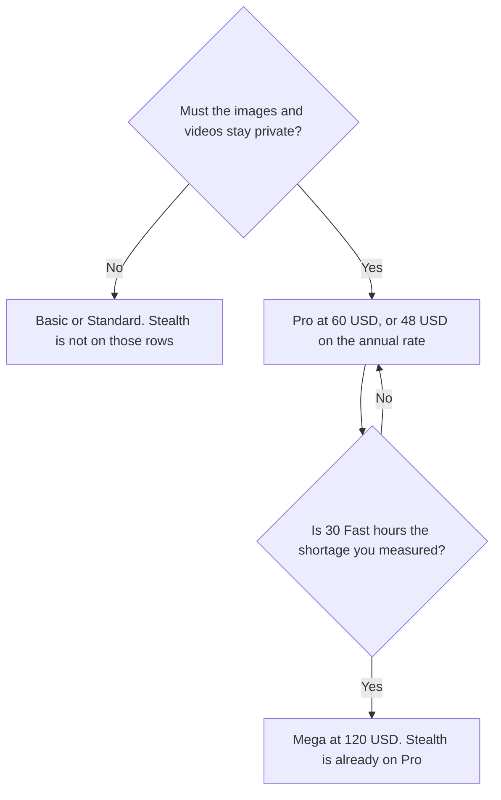

**Midjourney Stealth Mode is included on Pro and Mega only. Pro is $60 a month, or $48 a month billed annually ($576 a year). Mega is $120 a month, or $96 a month billed annually ($1,152 a year).** Basic at $10 and Standard at $30 do not include Stealth. There is no separate Stealth add-on on the plan comparison fetched October 24, 2026, from docs.midjourney.com/docs/plans. The full ladder, including Relax and Fast hours, is [Midjourney pricing explained](/blog/midjourney-pricing-explained-2026/).

The product review is [Midjourney review](/blog/midjourney-review-2026/). This page is the privacy gate. It does not score images.

## What you pay to keep images private

| Plan | Monthly | Annual total | Stealth, on the October 24 page | What the extra dollars buy besides privacy |
|---|---|---|---|---|
| Basic | $10 | $96 ($8 a month) | No | 3.3 Fast hours. Images are not on Stealth |
| Standard | $30 | $288 ($24 a month) | No | Unlimited Relax images, 15 Fast hours |
| Pro | $60 | $576 ($48 a month) | Yes | 30 Fast hours, unlimited Relax images and SD video |
| Mega | $120 | $1,152 ($96 a month) | Yes | 60 Fast hours. The same Stealth line as Pro |

The October 24 page says Stealth Mode keeps your images and videos private, and that it is only available on Pro and Mega. Extra Fast GPU time is $4 an hour on every plan, including the plans that do not have Stealth. Buying hours does not add privacy.

On monthly billing, the step from Standard to Pro is $60 − $30 = $30 a month. On annual billing, the step is $576 − $288 = $288 a year. That difference is the whole plan change. It is not a line item called Stealth. You also receive Pro's Fast hours and Relax for SD video. If you only needed privacy, you still pay the plan. The page does not sell the privacy line alone.

Mega versus Pro is $60 a month more, or $576 a year more on the annual totals ($1,152 − $576). Both include Stealth. Mega is the longer Fast clock. Do not buy Mega because a brief said "maximum privacy."

## What Stealth does not change

**Commercial terms.** The October 24 page says subscribers may use images and videos under the general commercial terms, and that a company making more than $1,000,000 in gross revenue per year must purchase Pro or Mega. A freelancer under that line is not forced onto Pro by the revenue rule. A freelancer who cannot put client work on a public gallery is forced onto Pro by Stealth. Those are different gates. The pricing article walks the rest of the ladder.

**The Fast clock.** Pro still has 30 Fast hours. Stealth does not make generation free. Relax for images starts on Standard, which does not include Stealth. If you need both unlimited Relax images and private images, Pro is the first row that has both, on that page.

**A public image you already made.** Stealth applies to the plan you are on while you generate. The October 24 comparison does not describe a control that hides an older public job. Generate the client frame on Pro or Mega from the start.

**V8.** The October 16 directory recorded that V8 alpha did not support Relax. The October 24 plans page we fetched did not repeat that sentence. Do not tell a team that Stealth restores Relax on a model the current notes exclude. Read the model note before you promise an unlimited private queue.

## Other bills people mix in

**FLUX, when you need a per-image API price instead of a private gallery.** [FLUX](/tools/flux/) Klein is $0.008 per image at 768×768 on the October 16 directory card. That is not Stealth, and it is not a Midjourney plan. The ad-frame split is [Midjourney vs FLUX for ad creatives](/blog/midjourney-vs-flux-for-ad-creatives-2026/).

**Firefly, when the question is training data rather than a private gallery.** [Adobe Firefly](/tools/adobe-firefly/) Standard is $9.99 a month on the October 16 card. A licensed-training claim is a different purchase. It does not add Midjourney Stealth.

**Leonardo, when you wanted a free start.** [Leonardo.Ai](/tools/leonardo-ai/) has a free plan and Essential at $12 a month on that card. Leaving Midjourney for a free tier does not hide a job you already generated on Basic.

## What not to assume

Do not describe Basic as "private enough" because the Discord channel feels quiet. Do not add $4 Fast hours and call that Stealth. Do not buy Mega for a second privacy tier. Do not treat the revenue rule and Stealth as the same sentence. A company over $1,000,000 needs Pro or Mega even if it would have accepted public images.

## FAQ

### How much does Midjourney Stealth cost?

It is included on Pro and Mega. Pro is $60 a month, or $576 a year. Mega is $120 a month, or $1,152 a year. Basic and Standard do not include it. Fetched October 24, 2026. There was no Stealth add-on price on that comparison.

### Is Standard enough if I delete the images afterward?

The page describes Stealth as the mode that keeps images and videos private, and it places that mode on Pro and Mega only. This article does not promise that deleting a public job makes it private. If privacy matters while you generate, the plan is Pro or Mega.

### How is this different from the Midjourney pricing article?

That article is Fast hours, Relax, the revenue rule, and which plan to stop on. This article is only the privacy gate: which plans include Stealth, what the step up from Standard costs, and what Stealth does not buy. Use the other page for Relax. Use this page when a client frame cannot be public.

### Does Mega hide images better than Pro?

The October 24 page lists Stealth on both. Mega's published difference is the Fast clock, 60 hours versus 30, and higher concurrency. Buy Mega when you measured a Fast-hour shortage. The privacy line is already on Pro.

## Last verified

October 24, 2026, from the Midjourney plan comparison. FLUX, Firefly, and Leonardo figures are from directory pages checked October 16, 2026. The V8 Relax note is from that directory record, not from the October 24 plans page. Published October 24, 2026.

**Sources:** [Midjourney plans](https://docs.midjourney.com/docs/plans).

*Published by Andrew for [AI Tools Optimizer](https://aitoolsoptimizer.com).*

[Midjourney](/tools/midjourney/) is in the [image generation directory](/tools/category/image-generation/). Directory pages may use affiliate links. A purchase through them may earn us a commission at no extra cost to you.
