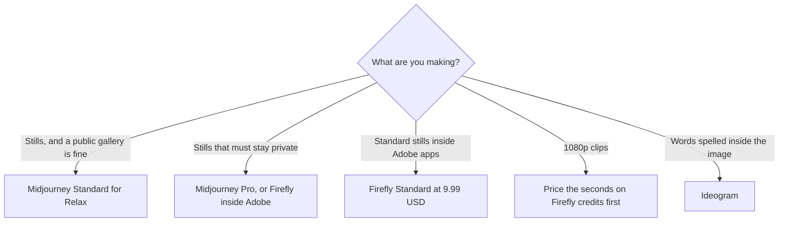

**Choose Midjourney when you want a paid image subscription and you can live with public images until you buy Stealth. Choose Adobe Firefly when standard stills should be unlimited on a paid plan and the metered work is video, audio, or a partner model.** They are both image products. The invoices measure different things, and the license story is the other half of the choice.

Prices are US list prices excluding tax. Midjourney's plan comparison and Firefly's rates are the figures in [Midjourney pricing explained](/blog/midjourney-pricing-explained-2026/) and [Adobe Firefly review](/blog/adobe-firefly-review-2026/), checked October 16, 2026. A live refetch of Midjourney's help page on October 24 did not replace those figures. Published October 24, 2026. We did not score which pictures look better.

## The bill

| | Midjourney | Adobe Firefly |
|---|---|---|
| Free | No free plan | Limited daily generations |
| Entry paid | Basic $10 a month, or $8 billed annually ($96 a year) | Standard $9.99 a month, 2,000 credits |
| What the entry plan meters | 3.3 hours of Fast GPU time. No Relax queue | Credits for premium work. Standard images and vectors do not spend credits |
| The plan people actually stay on | Standard $30, or $24 annual, for 15 Fast hours plus unlimited Relax images | Pro $19.99, 4,000 credits, plus Photoshop on the web and mobile and Express Premium |
| Privacy | Stealth is Pro $60 ($48 annual) or Mega $120 ($96 annual) | Adobe's license terms, which you read for the asset. This article is not legal advice |
| Video | Spends Fast time. Relax for SD video starts on Pro | 1080p is 100 credits a second on the rate card we used. Standard's 2,000 credits are 20 seconds at that setting |

## How to spend the entry plan

Midjourney Basic is a short Fast clock. Standard is the plan that adds unlimited Relax image generation, which is why people leave Basic. Relax did not cover V8 in the alpha notes those articles used. If the look you want is V8, you are on Fast hours, and extra Fast time was $4 an hour. Pro is the plan for Stealth, and it is required, with Mega, when the company earns over $1,000,000 gross a year. Commercial use itself is not reserved for Pro. The review is [Midjourney review](/blog/midjourney-review-2026/).

Firefly Standard at $9.99 is the stills plan: unlimited standard image and vector generations, and a 2,000-credit pool for everything Adobe marks as premium. Firefly Image 5 was 10 credits a generation on that rate card. Generate Video was 20 credits a second at 540p, 50 at 720p, and 100 at 1080p. Credits reset monthly and do not roll over. Pro at $19.99 is the plan if you also wanted Photoshop on the web and mobile. The three-way with other models is [FLUX vs Ideogram vs Firefly](/blog/flux-vs-ideogram-vs-firefly-2026/).

[Adobe Express](/tools/adobe-express/) Premium is $9.99 a month with 250 generative credits on the Firefly review's October 16 note. Buying Express Premium and Firefly Standard is two $9.99 bills. Firefly Pro includes Express Premium. Price Pro before you stack them.

## When neither headline is the job

| Constraint | Open this |
|---|---|
| The image must contain a spelled word | [Ideogram](/tools/ideogram/). Plus is $15 a month on yearly billing in the Firefly review |
| You want the image inside a chat you already pay for | [ChatGPT Images](/tools/dall-e/). Plus is $20 a month. The stills comparison is [Midjourney vs DALL·E](/blog/midjourney-vs-dalle-2026/) |
| You are placing the still in a social template | [Canva](/tools/canva/) Pro is $18 a month or $180 a year. Generate the hard still elsewhere if type matters, then place it |
| You need a survey of the category | [Best AI image generators](/blog/best-ai-image-generators-2026/) |

A Firefly render can be a partner model. The unlimited-image rule applies to the generations Adobe classifies as standard. Check the model name before you assume a click was free.

## FAQ

### Is Firefly cheaper than Midjourney?

Standard Firefly at $9.99 and Basic Midjourney at $10 are the same neighborhood for a month of light stills. Firefly's paid plans include unlimited standard images. Midjourney Basic includes 3.3 Fast hours and no Relax. The cheaper plan is the one whose meter matches the month you will actually run. Video makes Firefly's credits the constraint and Midjourney's Fast clock the constraint.

### Does Midjourney include Photoshop?

No. Firefly Pro is the $19.99 plan that includes Photoshop on the web and mobile. Midjourney is the image product. The edit happens in whatever tool you export to.

### Which one can I use in a client deck?

Read the license for the plan you are on. Midjourney subscribers may use images under its terms, with the revenue rule and Stealth described above. Firefly's non-beta generative features are the ones Adobe presents as commercially usable. Confirm the current terms on the day you ship. This article is not legal advice.

### Is there a free way to try Midjourney?

Not on the plan comparison we used. Firefly has a limited free daily refresh. Use that to see the Adobe workflow. Use a month of Basic if you need to know whether Midjourney's look is the one you will repeat.

## Last verified

October 16, 2026 for the Midjourney and Firefly figures this article repeats from the pricing explainer and the Firefly review. Published October 24, 2026.

**Sources:** [Midjourney plans](https://docs.midjourney.com/docs/plans), [Adobe Firefly plans](https://www.adobe.com/products/firefly/plans.html).

*Published by Andrew for [AI Tools Optimizer](https://aitoolsoptimizer.com).*

[Midjourney](/tools/midjourney/) and [Adobe Firefly](/tools/adobe-firefly/) are in the [image generation directory](/tools/category/image-generation/). Directory pages may use affiliate links. A purchase through them may earn us a commission at no extra cost to you.
