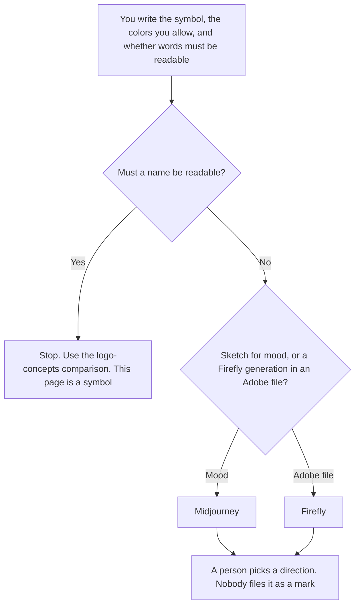

**Use Midjourney when you are exploring a simple symbol and the letters, if any, can be wrong. Use Adobe Firefly when the sketch should be made with Firefly's own image models inside an Adobe file, and you are relying on Adobe's statement about how those models were trained.** Either tool may produce options from a brief you wrote. Neither produces a trademark, a final icon system, or a guarantee the symbol is unused. A wordmark, where the name has to be readable, is [Midjourney vs Ideogram for logo concepts](/blog/midjourney-vs-ideogram-for-logo-concepts-2026/). The stills comparison, which is not this icon job, is [Midjourney vs Adobe Firefly](/blog/midjourney-vs-adobe-firefly-2026/).

Prices are from directory pages checked October 16, 2026. Claude's prices are from claude.com/pricing on October 24, 2026. Published October 24, 2026. We did not score likeness. We did not audit training data.

## Which icon you are sketching

| The board | Start here | First paid step | The limit |
|---|---|---|---|
| Mood and a simple shape, words optional | [Midjourney](/tools/midjourney/) | Basic is $10 a month, or $8 billed annually | Treat the result as a sketch. Letters may be wrong |
| A symbol you want in an Adobe file, on Firefly models | [Adobe Firefly](/tools/adobe-firefly/) | Standard is $9.99 a month | Credits on that plan are not the standard images. Read the pricing article |
| The brief, in words you will reuse | [Claude](/tools/claude/) | Pro is $17 a month billed annually, or $20 monthly | It does not draw the icon |
| A board for the options you kept | [Canva](/tools/canva/) | The October 16 card is the price record. This page does not invent a Canva icon fee | A board is not a trademark filing |

An icon the model calls "on brand" because you typed the company name is still a sketch. If the brief says no text, delete any option that renders letters. Companies earning over $1,000,000 in gross revenue must use Midjourney Pro or Mega, on the October 16 directory card's record of Midjourney's terms. Basic at $10 is the wrong quote for that company. The ladder is [Midjourney pricing explained](/blog/midjourney-pricing-explained-2026/).

Firefly Standard at $9.99 includes unlimited standard image generations on the October 16 card. The 2,000 credits on that plan are for premium work such as video and partner models. The invoice is [Adobe Firefly pricing explained](/blog/adobe-firefly-pricing-explained-2026/). The directory records Adobe's statement that Firefly models are trained on licensed content such as Adobe Stock and on public-domain content. That is Adobe's account. This page does not repeat it as an independent audit. Partner models on the same app are a different training story. If the icon must stay on Firefly's own models, say so in the brief and check which model the generation used.

## What you may keep

A small set of directions, the prompt you used, and the date. You may not keep a customer's logo as a style reference unless you have the right to. You may not ship the sketch as the app icon. A designer, or the brand owner, accepts a direction. Then someone draws the real asset.

**Midjourney Basic** is the mood path. Standard at $30 a month is the plan with unlimited Relax image generation on that card, if you are making many quiet variations. Pro at $60 is the Stealth plan on that card, and the plan the revenue rule points at.

**Firefly Standard** is the Adobe-file path for standard images. Pro at $19.99 adds Express Premium and Photoshop on web and mobile, on the same card. You do not need Pro to generate a standard image.

**Claude Pro** writes the brief: shape, color, and "no text." It does not pick the winner. The review is [Claude review](/blog/claude-review-2026/).

A prompt that holds the line:

"List icon directions from the shapes and colors I pasted. If I said no text, reject any option that shows letters. Do not call a sketch a logo. Do not say it is unused."

## What not to delegate

Do not ask for a trademark-safe icon. Do not paste a competitor's mark and ask for "the same, but ours." Do not skip the revenue rule on Midjourney because Basic is cheaper. The brand owner picks a direction. A grid of images is not a brand system.

## FAQ

### How is this different from the logo-concepts page?

That page is a wordmark, and Ideogram is in the comparison because the name has to be readable. This page is a simple symbol, and Firefly is here because the file may need to stay in Adobe. If the name must be read, leave this page.

### Does Firefly make the icon commercially safe?

The October 16 directory card records Adobe's statement about licensed and public-domain training for Firefly models. This site did not audit that corpus. Partner models in the same app are not that statement. A sketch can still resemble an existing mark. A person checks.

### Which plan is the icon plan?

For a symbol sketch, Midjourney Basic at $10 or Firefly Standard at $9.99 is the first paid step on the October 16 cards, unless Midjourney's revenue rule moves you to Pro or Mega. More credits do not make the symbol yours.

### Who may put the icon in the product?

The brand owner, after a person has redrawn or approved a final asset. A generation is a direction. It is not the shipping file.

## Last verified

October 16, 2026 for Midjourney, Adobe Firefly, and Canva's directory cards. October 24, 2026 for Claude. Published October 24, 2026.

**Sources:** [Midjourney](https://www.midjourney.com/), [Adobe Firefly](https://firefly.adobe.com/), [Claude pricing](https://claude.com/pricing), [Canva](https://www.canva.com/).

*Published by Andrew for [AI Tools Optimizer](https://aitoolsoptimizer.com).*

[Adobe Firefly](/tools/adobe-firefly/) is in the [image generation directory](/tools/category/image-generation/). Directory pages may use affiliate links. A purchase through them may earn us a commission at no extra cost to you.
