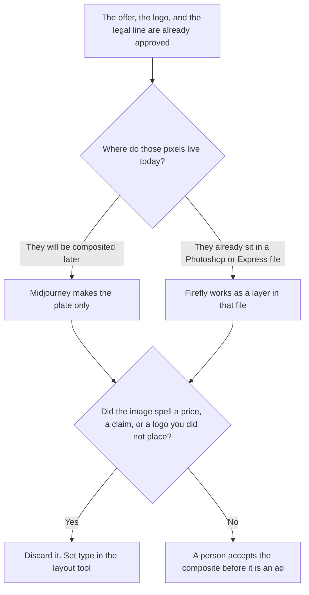

**Use Adobe Firefly when the social ad is a layer inside a Photoshop or Express file that already holds the logo, the legal line, and the offer. Use Midjourney when you need a background plate only, and a person will composite those locked elements in a layout tool.** The offer, the price, and the claim are words you already wrote. The image does not invent them. The look-study cut, including Stealth and the revenue line on Midjourney's card, is [Midjourney vs Firefly for social ads](/blog/midjourney-vs-firefly-for-social-ads-2026/). This page assumes the offer is already approved and asks where the logo's pixels live.

The pair without this composite constraint is [Midjourney vs Adobe Firefly](/blog/midjourney-vs-adobe-firefly-2026/). A brand-system file, which is a different job, is [Midjourney vs Firefly for brand assets](/blog/midjourney-vs-firefly-for-brand-assets-2026/). The invoices are [Adobe Firefly pricing explained](/blog/adobe-firefly-pricing-explained-2026/) and [Midjourney pricing explained](/blog/midjourney-pricing-explained-2026/).

Prices are US list prices excluding tax from directory pages checked October 16, 2026. A live fetch of vendor pricing pages on October 24, 2026 returned HTTP 401, as the look-study article records, so this page stays on the directory record. Published October 24, 2026. We did not score creatives. This page is not legal advice about either license.

## Where the locked elements live

| The file | Start here | First paid step | The limit |
|---|---|---|---|
| A background plate, and a person will add the logo and the offer later | [Midjourney](/tools/midjourney/) | Standard is $30 a month, or $24 billed annually | The plate does not contain the price, the logo, or the legal line |
| A layer inside a Photoshop or Express file that already has those elements | [Adobe Firefly](/tools/adobe-firefly/) | Standard is $9.99 a month, 2,000 credits | Standard image generations are unlimited on paid plans, on the directory card. Video spends credits |
| The layout where the offer is set in type, outside either generator | [Canva](/tools/canva/) | Pro is $18 a month or $180 a year, for one person | Business is $250 a person a year when two people share it |
| An Express file, if that is the Adobe surface you already use | [Adobe Express](/tools/adobe-express/) | See the Express pricing article before you quote a second Adobe seat | Do not assume Firefly Standard includes a second product's seat |

Midjourney Basic is $10 a month, or $8 billed annually, with 3.3 hours of Fast GPU time and no Relax queue, on the October 16 card. Pro at $60, or $48 billed annually, is the Stealth row the look-study article explains, including the directory's note that companies over $1 million in gross revenue a year must use Pro or Mega. Mega is $120, or $96 billed annually. This page does not restudy that license line. If the plate must stay out of a public gallery, read that article before you buy Standard.

Firefly Pro is $19.99 a month for 4,000 credits. Pro Plus is $49.99 for 10,000. Premium is $199.99 for 50,000. Those pools are for video, audio, partner models, and the premium image models the card names. A standard still inside the file you already have is the Standard plan, not Premium.

## What the image is allowed to contain

A scene you described. Not the offer. Not a competitor's logo. Not a price. If the legal line must be readable, it is set in [Canva](/tools/canva/) or in the Adobe file, in the words legal already approved. The Canva seat rule is [Canva pricing explained](/blog/canva-pricing-explained-2026/). Pro is one person. Two people on one Pro login is the mistake that article warns about.

**Midjourney Standard** is the plate. The review path is the pricing article above. We did not score taste.

**Firefly Standard** is the layer. The product page is [Adobe Firefly review](/blog/adobe-firefly-review-2026/).

**Canva Pro** is the type. If the company needs an admin to own the file, Business is the plan that states company-style controls, at $25 a person a month or $250 a person a year on the October 16 card.

A prompt that holds the line:

"Describe only the background scene I pasted. Do not render the price, the logo, the legal line, or a claim. If I did not describe the scene, write Scene not set. Do not invent an offer."

## What not to delegate

Do not ask which image will "stop the scroll." Do not let the generator spell the discount. Do not ship a plate that accidentally contains a word. The person who owns the ad accepts the composite. A generated still is not a media buy.

## FAQ

### How is this different from Midjourney vs Firefly for social ads?

That page chooses Firefly when the still should stay inside Adobe and may be shipped, and Midjourney when you are exploring a look and can accept a public gallery until you pay for Stealth. This page chooses Firefly when the logo and the legal line already live in the Adobe file, and Midjourney when you only need a plate for someone else to composite. Both pages keep the offer out of the image. Use that page for the gallery and the license line. Use this page for the composite.

### How is this different from the brand-asset page?

That page is the file a brand system keeps. This page is one social placement. A brand icon can be the logo you refuse to regenerate. A social plate can be discarded. Do not promote a plate into the brand system because it looked finished.

### How is this different from Midjourney vs Adobe Firefly with no ad constraint?

That page is the general stills comparison. This page adds the rule that the offer, the logo, and the legal line are already approved and must not be redrawn by the model. A general still can be a study. An ad composite has a type layer a person owns.

### Who may publish the ad?

The person who owns the placement. A plate with readable type you did not set is not accepted. A Firefly layer that moved the legal line is not accepted. The layout file is the record.

## Last verified

October 16, 2026, from the directory cards, matching the October 24 pricing articles cited above. A live fetch of vendor pricing pages on October 24 returned HTTP 401. Published October 24, 2026.

**Sources:** [Midjourney plans](https://docs.midjourney.com/docs/plans), [Adobe Firefly](https://firefly.adobe.com), [Canva pricing](https://www.canva.com/pricing/).

*Published by Andrew for [AI Tools Optimizer](https://aitoolsoptimizer.com).*

[Adobe Firefly](/tools/adobe-firefly/) is in the [image generation directory](/tools/category/image-generation/). Directory pages may use affiliate links. A purchase through them may earn us a commission at no extra cost to you.
