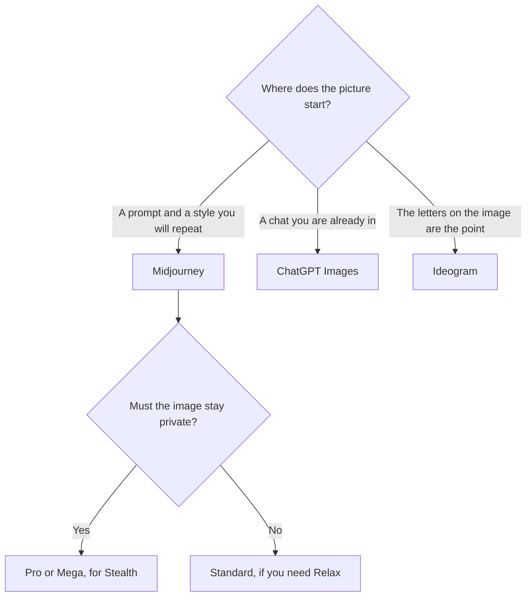

**Use Midjourney when you want a stylized image from a dedicated generator and you will pay a subscription for GPU time. Use ChatGPT Images when the picture is a turn in a conversation you are already having.** Midjourney has no free plan. ChatGPT can make a limited image on Free. They are not two prices for the same canvas.

DALL·E as a separate API name was removed on May 12, 2026. Image creation in ChatGPT now runs on GPT Image models. The directory page is [ChatGPT Images](/tools/dall-e/). The older head-to-head, under the old name, is [Midjourney vs DALL·E](/blog/midjourney-vs-dalle-2026/). The clock on the Midjourney side is [Midjourney pricing explained](/blog/midjourney-pricing-explained-2026/).

Prices are US list prices excluding tax from directory pages checked October 16, 2026. Published October 24, 2026. We did not score images.

## The job, then the bill

| You are doing | Start here | First paid step | Not this |
|---|---|---|---|
| A stylized still, many variations, a look you will reuse | [Midjourney](/tools/midjourney/) | Basic is $10 a month, or $8 billed annually, for 3.3 Fast hours. No Relax on Basic | A chat seat, if the look is the product |
| "Make this, now crop it, now change the shirt" | [ChatGPT](/tools/chatgpt/) Images | Free includes limited image creation. Go is $8. Plus is $20 | Midjourney, for a one-off edit in prose |
| Words that must be readable on the image | [Ideogram](/tools/ideogram/) | Plus is $20 a month, or $15 billed yearly | Either of the two, until you have tested the letters |
| A commercial still inside Adobe | [Adobe Firefly](/tools/adobe-firefly/) | Standard is $9.99 a month for 2,000 credits | Midjourney, if the license story is the point |
| An app that generates images | The GPT Image API, not the Plus seat | Sunburst standard is $8 per million image input tokens and $30 per million image output tokens. Batch is half price on that card | A Midjourney login inside your product |

## What each bill is actually for

**Midjourney** sells Fast GPU time. Basic is $10 a month or $96 a year, with 3.3 Fast hours, and images are public. Standard is $30, or $24 billed annually, with 15 Fast hours and unlimited Relax image generation. Pro is $60, or $48 annually, and Mega is $120, or $96 annually. Extra Fast time is $4 an hour. Stealth Mode is only on Pro and Mega. Companies with more than $1,000,000 in gross annual revenue need Pro or Mega. V8 entered alpha in March 2026. Relax is not supported for V8 yet, on the directory card. The review is [Midjourney review](/blog/midjourney-review-2026/). The shelf is [best AI image generators](/blog/best-ai-image-generators-2026/).

**ChatGPT Images** is a feature of the chat plan. Free includes limited image creation. Go at $8 raises messages, uploads, images, and memory, and may include ads. Plus at $20 is the seat OpenAI positions for heavier use, including more complex image work, alongside everything else Plus does. Pro, from $100 a month, is the high-limit tier, and the directory says Pro offers unlimited, faster image creation. You edit by asking for a change. That conversational loop is the reason to stay. It is a poor reason to expect Midjourney's style references, moodboards, and Relax queue.

The API is a third bill. GPT-Image-2.5 Sunburst is $8 per million image input tokens and $30 per million image output tokens on standard processing. Batch is half price, on the directory page. A Plus subscription does not include that production key. The explainer is [what an API for AI tools is](/blog/what-is-an-api-for-ai-tools-2026/).

## How to choose without a taste test you invent

If you are learning prompts and you already pay for ChatGPT, make the image there. Leave when you need a private gallery, a Relax queue, or a look you will keep consistent with style references. Basic at $10 is the Midjourney test. Standard at $30, or $24 annual, is the plan that adds unlimited Relax images. Do not buy Mega because a chat image disappointed you once.

If the words on the poster have to be right, test [Ideogram](/tools/ideogram/) before you blame either of these. Free is 30 credits a week. The card is [Ideogram pricing explained](/blog/ideogram-pricing-explained-2026/). If the asset has to live in Photoshop, test [Adobe Firefly](/tools/adobe-firefly/). The comparison on that side is [Midjourney vs Adobe Firefly](/blog/midjourney-vs-adobe-firefly-2026/).

None of these is a score. Generate one image you already know how to judge. Keep the tool whose failure you can see: a public gallery, a letter that broke, or a chat that ignored the crop.

## FAQ

### Is ChatGPT Images still DALL·E?

The directory records that DALL·E 2 and DALL·E 3 were shut down in OpenAI's API on May 12, 2026. ChatGPT image creation now uses GPT Image models. People still say DALL·E. The bill does not.

### Is Midjourney cheaper than Plus?

Basic is $10 and Plus is $20, and they buy different products. Plus includes chat, files, and Codex usage, not only images. Basic includes a short Fast clock and public images. Compare them after you know which of those you needed.

### Can I use both?

Yes. ChatGPT for a quick concept inside a conversation. Midjourney when that concept has to become a series with a consistent style. Paying both to make the same one-off is a duplicate.

### Which one renders text better?

This page did not measure that. The directory's own guidance sends text-heavy graphics to Ideogram. Test the exact words you need to print.

## Last verified

October 16, 2026 for Midjourney, ChatGPT, Ideogram, Firefly, and the Sunburst API rates named above. Published October 24, 2026.

**Sources:** [Midjourney plans](https://docs.midjourney.com/hc/en-us/articles/27870484040333-Comparing-Midjourney-Plans), [ChatGPT pricing](https://chatgpt.com/pricing), [OpenAI image generation](https://platform.openai.com/docs/guides/image-generation).

*Published by Andrew for [AI Tools Optimizer](https://aitoolsoptimizer.com).*

[Midjourney](/tools/midjourney/) is in the [image generation directory](/tools/category/image-generation/). Directory pages may use affiliate links. A purchase through them may earn us a commission at no extra cost to you.
