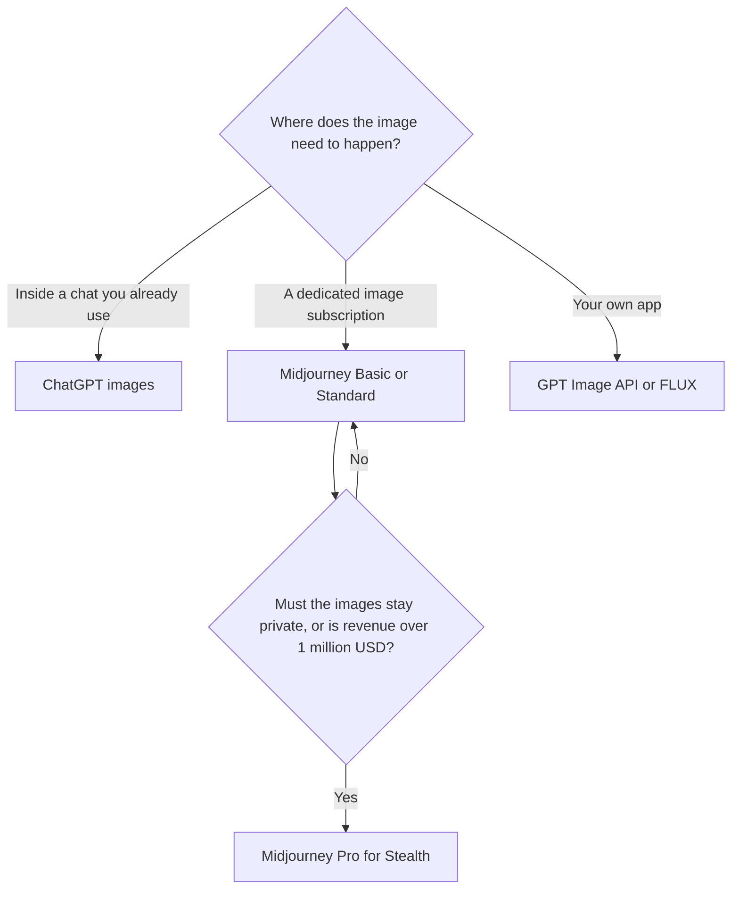

**Use Midjourney when you want a subscription built around image generation, with a Fast GPU clock and a public gallery unless you pay for Stealth. Use ChatGPT when the image is a step inside a conversation you already have, including a free tier with limits.** DALL·E as a product name is the old API. OpenAI removed DALL·E 2 and 3 from its API on May 12, 2026. Image creation in ChatGPT now runs on newer GPT Image models.

That history is on the [ChatGPT Images directory page](/tools/dall-e/). Midjourney's plans are [Midjourney pricing explained](/blog/midjourney-pricing-explained-2026/). ChatGPT's seat ladder is [ChatGPT Go vs Plus vs Pro](/blog/chatgpt-go-vs-plus-vs-pro-2026/).

Prices are US list prices excluding tax from directory pages checked October 16, 2026. Published October 24, 2026. We did not run a blind image test.

## The bill, side by side

| | Midjourney | ChatGPT images, formerly DALL·E |
|---|---|---|
| Where you work | Midjourney's product. A Discord habit still exists for many users | The ChatGPT conversation, or the GPT Image API |
| Free | No free plan | Free includes limited image creation |
| First paid step | Basic $10/month, or $8 billed annually, with 3.3 Fast hours | Go is $8/month for more image creation. Plus is $20 |
| The plan people outgrow into | Standard $30/month, or $24 annual, for unlimited Relax images | Plus at $20 for more complex image creation. Pro from $100 for unlimited, faster creation, with abuse guardrails |
| Privacy | Images are public on Basic and Standard. Stealth starts on Pro at $60/month, or $48 annual | Follow ChatGPT's plan terms. This article does not restate a privacy tier Midjourney-style, because the directory page does not publish one in those words |
| API | A subscription product first | GPT-Image-2.5 Sunburst at $8 per 1 million image input tokens and $30 per 1 million image output tokens |
| Commercial use | Allowed under the terms, with a revenue rule: companies over $1,000,000 gross a year need Pro or Mega | Included in the ChatGPT plan you are on. Read the current terms for the API separately |

Other image subscriptions are in [Midjourney vs Leonardo vs Flux](/blog/midjourney-vs-leonardo-vs-flux-2026/) and [FLUX vs Ideogram vs Firefly](/blog/flux-vs-ideogram-vs-firefly-2026/).

## Midjourney, when the gallery and the GPU clock are the product

Basic at $10 a month buys 3.3 hours of Fast GPU time. There is no Relax queue on Basic, and images are public. Standard at $30 adds unlimited Relax image generation and 15 Fast hours. Pro at $60 adds Stealth and is the plan, with Mega at $120, required when the company earns over $1,000,000 gross a year. Annual billing is 20% off. Extra Fast time is $4 an hour.

Buy Basic for a few sessions a month if public images are acceptable. Buy Standard when you will wait on Relax rather than watch a 3.3-hour clock. Buy Pro when privacy or the revenue rule applies. The beginner path is [Midjourney for beginners](/blog/midjourney-for-beginners-2026/). The review is [Midjourney review](/blog/midjourney-review-2026/).

Midjourney is a weak fit when the picture has to be edited inside Photoshop by a designer who needs a licensed-training claim. That brief points at [Adobe Firefly](/tools/adobe-firefly/), from $9.99 a month for Firefly Standard. The review is [Adobe Firefly review](/blog/adobe-firefly-review-2026/).

## ChatGPT images, when the prompt is already a conversation

The practical product is [ChatGPT](/tools/chatgpt/). Free can make a limited number of images. Go at $8 raises image creation. Plus at $20 is the plan the directory describes as more complex and accurate image creation. Pro from $100 lists unlimited and faster image creation, with abuse guardrails. You describe the picture in the same thread as the brief. That is the workflow DALL·E's name used to cover.

Developers should budget the API, not the Plus seat. The Sunburst rates above are standard processing. The directory page says Batch is half price. A subscription to Midjourney does not include that API, and a ChatGPT Plus seat does not include a production key for your app.

[FLUX](/tools/flux/) is the other API shape: from $0.008 per image at 768×768 for FLUX 3 Klein, with no seat. [Ideogram](/tools/ideogram/) Plus is $20 a month, or $15 billed yearly, when the words inside the image are the requirement. Pick the API when you are generating at volume. Pick Plus when a person is exploring.

## Which failure belongs to which tool

**Readable text in the image.** Ideogram's plans exist for that job. Neither Midjourney's Fast hours nor a ChatGPT seat is a promise that small type will render. Test the actual string.

**A private client concept.** Midjourney Basic and Standard are public. Use Pro, or use a tool whose plan you have read for privacy. Do not assume a consumer chat is a private studio without reading the current retention settings.

**A product photo of a real SKU.** Generate around a photograph you took. The workflow is [how to generate product photos with AI](/blog/how-to-generate-product-photos-with-ai-2026/). An invented product is a different asset from the one you ship.

## FAQ

### Is DALL·E still available?

As a separate API name, no. OpenAI removed DALL·E 2 and 3 from the API on May 12, 2026. In the ChatGPT app you still ask for an image. The model behind it is a GPT Image model.

### Is Midjourney included in ChatGPT?

No. They are separate subscriptions. ChatGPT Plus at $20 and Midjourney Basic at $10 solve different habits: images inside chat, or a dedicated image plan with a GPU clock.

### Which is better for commercial work?

Both publish commercial terms. Midjourney adds a gross-revenue rule that pushes companies over $1,000,000 a year onto Pro or Mega. ChatGPT's rights depend on the plan and, for developers, the API terms. Read the term that matches the channel you will sell through. This article does not rank image quality.

### What if I need an image model with a licensed-training story?

Price Firefly, and read Adobe's training claim on the current page. The comparison with other models is [FLUX vs Ideogram vs Firefly](/blog/flux-vs-ideogram-vs-firefly-2026/).

## Last verified

October 16, 2026. Published October 24, 2026. The May 12, 2026 API removal date is the date recorded on the ChatGPT Images directory page.

**Sources:** [Midjourney plans](https://docs.midjourney.com/hc/en-us/articles/27870484040333-Comparing-Midjourney-Plans), [ChatGPT pricing](https://openai.com/chatgpt/pricing/), [Adobe Firefly](https://firefly.adobe.com).

*Published by Andrew for [AI Tools Optimizer](https://aitoolsoptimizer.com).*

[Midjourney](/tools/midjourney/) and [ChatGPT Images](/tools/dall-e/) are in the [image generation directory](/tools/category/image-generation/). Directory pages may use affiliate links. A purchase through them may earn us a commission at no extra cost to you.
