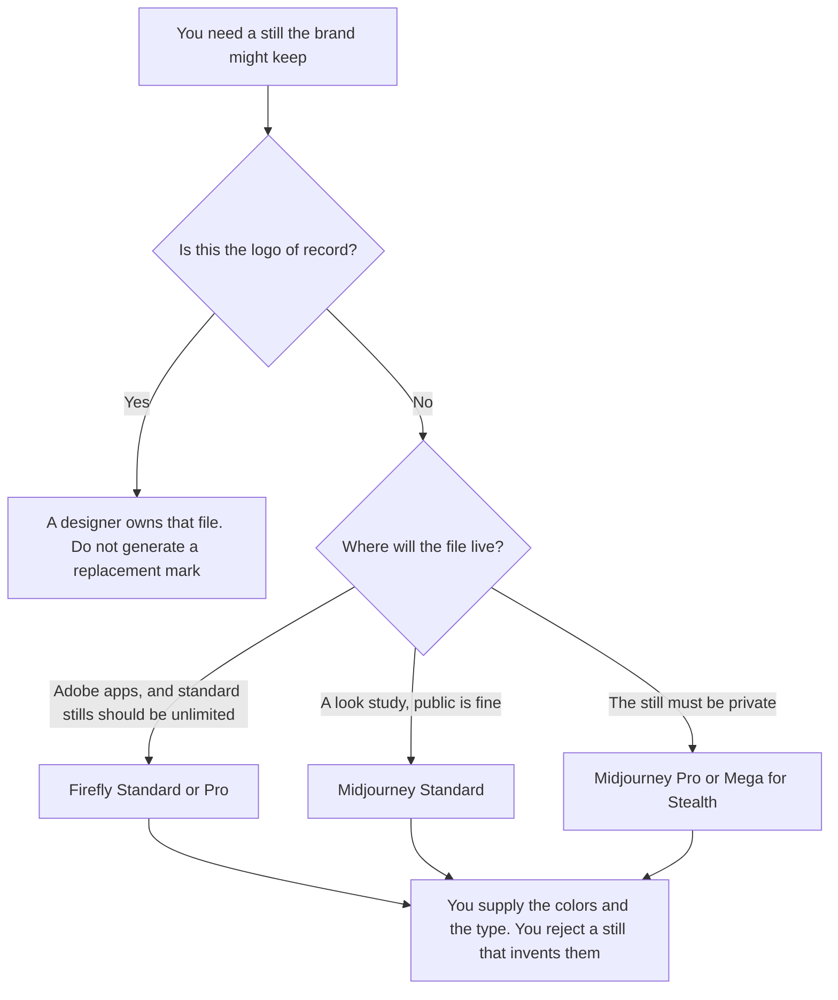

**Use Adobe Firefly when the asset has to live next to Photoshop or Express and standard stills should not spend a credit. Use Midjourney when you are exploring a look and you can accept a public gallery until you pay for Stealth.** A brand asset, on this page, is a still a brand system will keep: a campaign image, an icon study, a texture. It is not the logo of record. The logo of record is a file a designer owns. Generating a new mark and calling it the logo is how a brand grows a second identity.

The general invoice comparison is [Midjourney vs Adobe Firefly](/blog/midjourney-vs-adobe-firefly-2026/). The seat that holds a template system is [Canva pricing explained](/blog/canva-pricing-explained-2026/). The rules the prompt should repeat are [how to create a brand voice with AI](/blog/how-to-create-a-brand-voice-with-ai-2026/).

Prices are US list prices excluding tax from directory pages checked October 16, 2026. Published October 24, 2026. We did not score images. This page is not legal advice about either license.

## Which plan matches the asset

| The asset you actually need | Start here | The limit |
|---|---|---|
| A look study you can show in a public gallery | [Midjourney](/tools/midjourney/) Basic at $10 a month, or $8 billed annually | 3.3 hours of Fast GPU time. No Relax queue |
| Ongoing stills, public gallery is acceptable | Midjourney Standard at $30, or $24 billed annually | 15 Fast hours, plus unlimited Relax images on the card |
| Stills that must stay private | Midjourney Pro at $60, or $48 billed annually, for Stealth | Mega is $120, or $96 billed annually. Companies over $1M gross a year must use Pro or Mega |
| Standard stills inside Adobe, on a credit plan | [Adobe Firefly](/tools/adobe-firefly/) Standard at $9.99 a month, 2,000 credits | Standard images and vectors do not spend credits, on the card we used. Premium models do |
| You also need Photoshop on the web and Express | Firefly Pro at $19.99, 4,000 credits | Pro includes Express Premium and Photoshop on web and mobile |
| The still has to sit in a social template | [Canva](/tools/canva/) Pro at $18 a month or $180 a year, one person | Canva is the layout. Generate the hard still in the tool you picked above |

Firefly Pro Plus is $49.99 for 10,000 credits. Premium is $199.99 for 50,000. Those tiers are for volume of premium generations, including video, not for a handful of campaign stills. The rate card this site recorded: Firefly Image 5 at 10 credits a generation. Video is a different meter and a different article. The invoice detail is [Adobe Firefly pricing explained](/blog/adobe-firefly-pricing-explained-2026/).

## What you hand the model

The palette, the type rules you can state in words, the do-not-include list, and a reference still you are allowed to use. You do not hand it "make our brand but cooler" and then file whatever comes back. If the still introduces a color the brand file does not have, it is a study, not an asset. Studies stay in a folder named studies.

**Midjourney Standard** is the paid path for volume stills when privacy is not the constraint. Relax image generation is why people leave Basic. Stealth is not on Standard. If the brand cannot be public, Standard is the wrong plan even when the pictures are good. The review is [Midjourney review](/blog/midjourney-review-2026/).

**Firefly Standard** is the paid path when the file needs to stay in Adobe and you want unlimited standard images. Pro is the path when Express Premium and Photoshop on the web are part of the same seat. [Adobe Express](/tools/adobe-express/) Premium alone is $9.99 with a smaller credit pool, recorded on the Firefly review. Stacking Express Premium and Firefly Standard is two $9.99 bills. Price Pro first.

**Canva Pro** is one person, at $180 a year. A second designer who needs the paid brand kit is Canva Business at $250 a person a year. The brand system file itself, before any generator, is the designer's job. The shelf for that person is [best AI tools for brand designers](/blog/best-ai-tools-for-brand-designers-2026/).

A prompt that holds the line:

"Generate a campaign still using only the colors and the subject I listed. Do not design a logo, a wordmark, or a new color. If a required reference is missing, say Missing. Leave type off the image unless I supplied the exact words."

## What not to delegate

Do not generate the logo, the wordmark, or a "simplified" version of either. Do not ship a still that contains a claim, a price, or a person's likeness you did not provide. Do not treat a public Midjourney gallery as a private brand archive. If privacy matters, pay for Stealth or keep the work in Firefly, and read the license you are actually on.

## FAQ

### Which one looks more on-brand?

We did not score that. On-brand, here, means the still uses the colors and the subject you supplied and does not invent a mark. Both tools will invent a mark if you ask them to. The brand file is the check, not the model.

### Do we need Stealth for every brand still?

You need Stealth on Midjourney when the image must not be public, and Pro or Mega is required on that card for companies over $1,000,000 in gross annual revenue. Firefly's privacy story is Adobe's terms, which you read for the plan you buy. This page does not summarize those terms into a yes.

### Can Firefly replace the brand kit?

No. Firefly can generate a still. The kit is the colors, the type, and the logo file a person maintains. [Canva](/tools/canva/) or Express can hold a kit. A generated still that disagrees with the kit is a study.

### What about words in the image?

Leave type off unless you supplied the exact words, and expect to fix spelling in the layout tool. The general comparison points at Ideogram when spelled words inside the image are the actual job. A brand asset with a misspelled product name is not an asset.

## Last verified

October 16, 2026 for Midjourney, Adobe Firefly, Canva, and Adobe Express. Published October 24, 2026.

**Sources:** [Midjourney plans](https://docs.midjourney.com/docs/plans), [Adobe Firefly](https://firefly.adobe.com), [Canva pricing](https://www.canva.com/pricing/), [Adobe Express](https://www.adobe.com/express/).

*Published by Andrew for [AI Tools Optimizer](https://aitoolsoptimizer.com).*

[Adobe Firefly](/tools/adobe-firefly/) is in the [image generation directory](/tools/category/image-generation/). Directory pages may use affiliate links. A purchase through them may earn us a commission at no extra cost to you.
