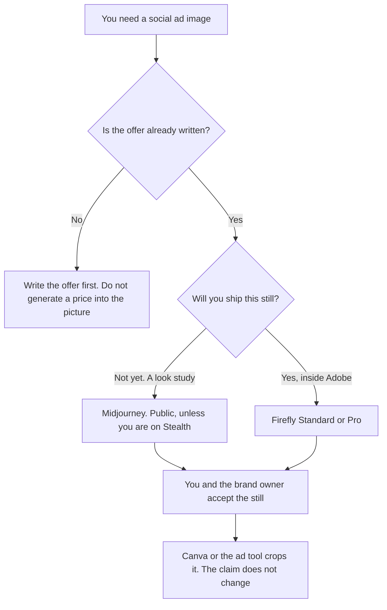

**Use Adobe Firefly when the social ad is a still you may ship and it should stay inside Adobe's apps. Use Midjourney when you are exploring a look, and you can accept a public gallery until you pay for Stealth.** The offer, the price, and the claim are words you already wrote. The image does not invent them. This page is not legal advice about either license.

The file a brand system keeps, which is a different job, is [Midjourney vs Firefly for brand assets](/blog/midjourney-vs-firefly-for-brand-assets-2026/). The invoices are [Adobe Firefly pricing explained](/blog/adobe-firefly-pricing-explained-2026/) and [Midjourney pricing explained](/blog/midjourney-pricing-explained-2026/). A short video ad in other generators is [Runway vs Kling for ads](/blog/runway-vs-kling-for-ads-2026/).

Prices are US list prices excluding tax from directory pages checked October 16, 2026. A live fetch of vendor pricing pages on October 24, 2026 returned HTTP 401, so this page stays on the directory record. Published October 24, 2026. We did not score creatives.

## Which plan matches the ad

| The ad you actually need | Start here | The limit |
|---|---|---|
| A look study you can show in a public gallery | [Midjourney](/tools/midjourney/) Basic at $10 a month, or $8 billed annually | 3.3 hours of Fast GPU time. No Relax queue |
| Ongoing stills, and a public gallery is acceptable | Midjourney Standard at $30, or $24 billed annually | 15 Fast hours, plus unlimited Relax images on the card |
| The still must stay private, or the company is over $1M gross revenue a year | Midjourney Pro at $60, or $48 billed annually, for Stealth | Mega is $120, or $96 billed annually. The directory says companies over that revenue line must use Pro or Mega |
| A standard still inside Adobe | [Adobe Firefly](/tools/adobe-firefly/) Standard at $9.99 a month, 2,000 credits | The directory says standard image generations are unlimited on paid plans. Video spends credits |
| You also need Photoshop on the web | Firefly Pro at $19.99, 4,000 credits | Pro includes Express Premium and Photoshop on web and mobile |
| The crop and the caption live in a template | [Canva](/tools/canva/) Pro at $18 a month, or $180 a year, for one person | Canva is the layout |

Firefly's directory page says Adobe positions its own models as trained on licensed content, including Adobe Stock, and on public-domain content. Paid plans include unlimited standard image generations on that page. Video is a premium feature: the directory's sample rate card lists 20 credits a second at 540p, 50 at 720p, and 100 at 1080p. A social still and a social video are different bills. Partner models use credits. This page does not convert that rate card into a campaign budget.

Midjourney has no free plan on the directory card. Subscribers may use images under Midjourney's terms, and companies above $1,000,000 in gross annual revenue must use Pro or Mega. Stealth, which keeps images private, is Pro and Mega only. If the ad is a surprise, Basic is the wrong plan.

## What the picture is allowed to say

Nothing the copy deck did not say. No price, no percentage, no "official partner" mark, no rendered logo you treat as the logo of record. Put those in the layout, as text, from the file the brand already owns. The brand-asset article is where that rule is longer.

**Firefly Standard** is the ship path for a still in Adobe. **Firefly Pro** is the step when the same person also needs Photoshop on the web and Express Premium. Premium at $199.99 is a credit pool, not a requirement for one social still.

**Midjourney Standard** is the exploration path when a public gallery is acceptable and the company is under the revenue line the directory records. **Pro** is the private path and the path the directory requires for larger companies.

**Canva Pro** holds the sizes. Generate the still in the tool you picked, then place it. [AdCreative.ai](/tools/adcreative-ai/) is a different product: Starter is $39 a month, or $20 a month billed yearly, and credits are consumed on download, on the directory card. Use it when the job is variations scored for ads, and read [AdCreative.ai pricing explained](/blog/adcreative-ai-pricing-explained-2026/). It does not replace the license question on this page.

A prompt that holds the line:

"Describe a still for the offer I pasted. Do not render a price, a percentage, a logo, or a claim. If I did not paste the offer, write Offer missing and stop."

## What not to delegate

Do not generate the legal line, the price, or the logo. Do not ship a Midjourney still from a company that the directory says must be on Pro or Mega, while you are on Basic. Do not assume a Firefly video costs the same as a Firefly still. The credit math is the rate card, and you confirm it before a batch.

## FAQ

### Which one makes better ads?

We did not score that. Firefly fits a still you may ship inside Adobe. Midjourney fits a look study, with the privacy and company-size rules on the directory card. The ad is fit to run when the claim in the layout matches the copy a person approved.

### Do I need Firefly Pro for a single image?

Standard at $9.99 is the first paid Firefly card, with 2,000 credits, and the directory says standard image generations are unlimited on paid plans. Pro is the card that adds Photoshop on the web and Express Premium. Buy Pro if you need those apps. A still alone does not require them.

### How is this different from the brand-asset article?

That page is a still the brand system might keep: a texture, an icon study, a campaign image in the system. This page is a paid social placement with an offer. The license notes overlap. The job does not. Read both if the still might become a brand file.

### Can I put the discount in the image prompt?

Put the discount in the layout as text, from the number you approved. A model that paints "50%" into a scene will paint a different number next time. The picture should survive a price change.

## Last verified

October 16, 2026 for Midjourney, Firefly, Canva, and AdCreative.ai. Published October 24, 2026. This page is not legal advice.

**Sources:** [Midjourney plans](https://docs.midjourney.com/hc/en-us/articles/27870484040333-Comparing-Midjourney-Plans), [Adobe Firefly](https://www.adobe.com/products/firefly.html), [Canva pricing](https://www.canva.com/pricing/), [AdCreative.ai](https://www.adcreative.ai).

*Published by Andrew for [AI Tools Optimizer](https://aitoolsoptimizer.com).*

[Adobe Firefly](/tools/adobe-firefly/) is in the [image generation directory](/tools/category/image-generation/). Directory pages may use affiliate links. A purchase through them may earn us a commission at no extra cost to you.
