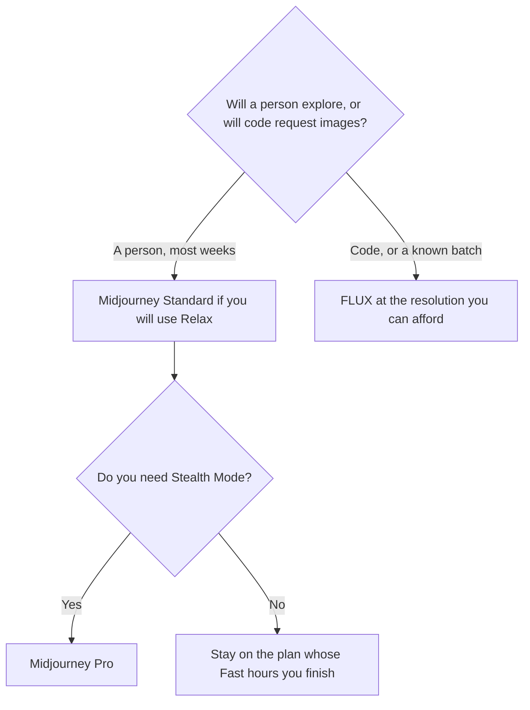

**Choose Midjourney when you want a subscription, a web app, and Fast GPU hours for ongoing art direction. Choose FLUX when you want a price per image, an API, and no seat.** The meters are different. A "cheaper" answer depends on how many images you actually render, at which size.

The three-way with Leonardo is [Midjourney vs Leonardo vs FLUX](/blog/midjourney-vs-leonardo-vs-flux-2026/). The subscription clock alone is [Midjourney pricing explained](/blog/midjourney-pricing-explained-2026/). The per-image card is [FLUX pricing explained](/blog/flux-pricing-explained-2026/). This page stays on the two-way: a plan versus a meter.

Prices are US list prices from directory pages checked October 16, 2026. Published October 24, 2026. We did not score image quality.

## The meter, side by side

| | [Midjourney](/tools/midjourney/) | [FLUX](/tools/flux/) |
|---|---|---|
| How you pay | A plan. Basic is $10 a month, or $96 a year ($8 a month) | Credits. 1 credit is $0.01. No subscription on the card |
| The first number people quote | Standard is $30 a month, or $24 a month billed annually, with 15 Fast hours | FLUX 3 Klein is $0.008 at 768×768, $0.009 at 1K, $0.014 at 2K, $0.036 at 4K |
| A heavier individual step | Pro is $60 a month, or $48 billed annually, with Stealth Mode | Other FLUX models have their own rates. The directory's public calculator default showed $0.048 an image |
| What "unlimited" means | Relax mode on Standard and above for images. Relax is not on Basic | No unlimited tier on the card. You pay for each image |
| Video | SD on Basic. SD and HD from Standard up. Extra Fast GPU time is $4 an hour | Video is billed per second. This page does not print a per-second rate the card did not isolate as a single number |
| Best documented job | A person exploring a look in the product | An app or a batch that can call an API |

## What the Midjourney clock includes

Basic is the trial of a real habit: 3.3 Fast hours, no Relax, SD video. Standard is the plan the directory points at when you generate often: 15 Fast hours and unlimited Relax images. Pro at $60 adds 30 Fast hours, Stealth Mode, and more concurrent Fast jobs. Mega is $120 a month, or $96 billed annually, with 60 Fast hours.

Annual billing is $96, $288, $576, and $1,152 a year for Basic, Standard, Pro, and Mega. Extra Fast GPU time is $4 an hour on every plan. In the V8 alpha note on the card, Relax is not supported yet, and some jobs run slower. Read that note before you buy Standard for Relax and then work only in a mode that has no Relax.

The product page is [Midjourney review](/blog/midjourney-review-2026/). The beginner path is [Midjourney for beginners](/blog/midjourney-for-beginners-2026/).

A year of Standard on the annual card is $288. If you render a handful of finals a month and spend the rest of the plan idle, the subscription is the expensive way to buy ten pictures. That is the FLUX case.

## What the FLUX meter includes

FLUX 3 Klein at 768×768 is $0.008. One hundred of those images are $0.80. One hundred at 4K, $0.036 each, are $3.60. One thousand at 2K, $0.014 each, are $14. The bill scales with the job. It does not scale with a month you forgot to cancel.

The directory says the same credit price applies in the API and the playground. Enterprise is custom, with volume discounts and SLAs. Open-weights licensing is a separate decision from the playground price. Check the license before you ship a fine-tune. The review is [FLUX review](/blog/flux-review-2026/).

A third shape, a token plan with a free tier, is Leonardo. Essential is $12 a month on the directory card. That comparison is the three-way linked above, and the two-way [Midjourney vs Leonardo](/blog/midjourney-vs-leonardo-2026/). Type-in-image and licensed-training claims are a different trio: [FLUX vs Ideogram vs Firefly](/blog/flux-vs-ideogram-vs-firefly-2026/).

## How to choose

Pick Midjourney Standard when a designer will spend the month in the product and Relax is part of the mode they use. Pick Basic only to see if the habit sticks, then move. Pick Pro when Stealth Mode is a requirement, not a badge.

Pick FLUX when engineering will call an API, or when you can count the images. Prototype at the cheap resolution. Render finals at the size the layout needs. Do not 4K a contact sheet.

Neither tool is a design system. A template editor is [Canva Magic Studio pricing explained](/blog/canva-magic-studio-pricing-explained-2026/). An image inside a chat seat is [Midjourney vs ChatGPT images](/blog/midjourney-vs-chatgpt-images-2026/).

## FAQ

### Is FLUX cheaper than Midjourney?

At $0.008, a few hundred small images cost less than Basic's $10 month. A person who lives in Relax on Standard is buying a workflow, not a unit price. Compare a month of your own counts. Do not compare a sticker to a vibe.

### Does Midjourney have an API on these plans?

This page prices the subscription and GPU hours on the directory card. It does not add an API product the card did not list as the thing you are buying here. If you need a key in your app, start from FLUX's meter and confirm the current API page.

### Can I use either for client work?

You can, if the plan and the license cover that use. Stealth Mode is a Midjourney Pro and Mega feature on the card. FLUX's open-weight license is not the same sentence as the playground price. Read both before a client file leaves your machine.

### Which looks better?

This page did not run that test. Generate the same brief on Basic, or on a few dollars of FLUX credits, and keep the one you can defend. A blog score would be a costume.

## Last verified

October 16, 2026 for Midjourney and FLUX prices named above. Published October 24, 2026.

**Sources:** [Comparing Midjourney plans](https://docs.midjourney.com/hc/en-us/articles/27870484040333-Comparing-Midjourney-Plans), [Black Forest Labs pricing](https://bfl.ai).

*Published by Andrew for [AI Tools Optimizer](https://aitoolsoptimizer.com).*

[Midjourney](/tools/midjourney/) and [FLUX](/tools/flux/) are in the [image generation directory](/tools/category/image-generation/). Directory pages may use affiliate links. A purchase through them may earn us a commission at no extra cost to you.
