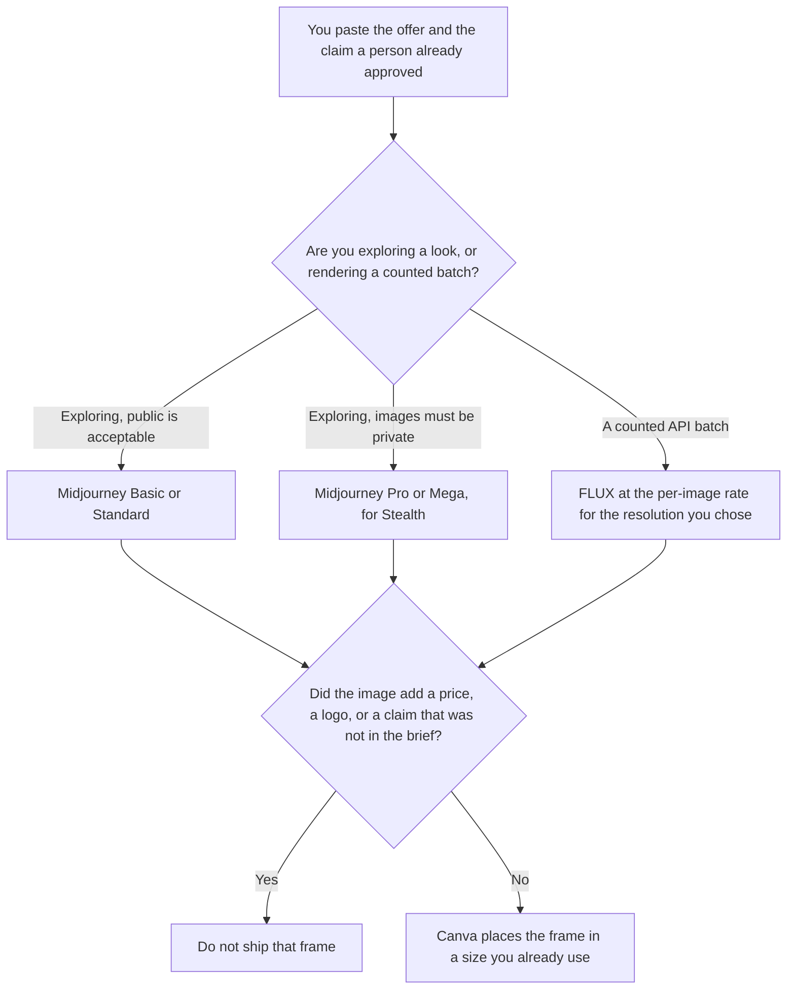

**Use Midjourney when you are exploring a look on a subscription and you know whether the images may be public. Use FLUX when you need a counted batch through an API, at a per-image price you can put on a row.** Neither tool writes the offer, the price, or the claim on the ad. A product photo from a reference you have rights to use is [Midjourney vs Leonardo for product shots](/blog/midjourney-vs-leonardo-for-product-shots-2026/). The plan ladder is [Midjourney pricing explained](/blog/midjourney-pricing-explained-2026/).

Midjourney's prices are from the plan comparison at docs.midjourney.com/docs/plans, fetched October 24, 2026. FLUX, AdCreative.ai, and Canva prices are from directory pages checked October 16, 2026. This page did not refetch the FLUX price card on October 24. Published October 24, 2026. We did not score images. We did not run an ad.

## Which creative you are making

| The job | Start here | First paid step | The limit |
|---|---|---|---|
| Explore a look, images may be public | [Midjourney](/tools/midjourney/) | Basic is $10 a month, or $8 billed annually | No Relax on Basic. 3.3 Fast hours |
| Explore, and the images must stay private | [Midjourney](/tools/midjourney/) | Pro is $60 a month, or $48 billed annually, for Stealth | Mega is more Fast time, not a second privacy tier |
| A counted batch on an API | [FLUX](/tools/flux/) | FLUX 3 Klein is $0.008 per image at 768×768 | No subscription on that card. 1 credit = $0.01 |
| A sized ad file after the look exists | [Canva](/tools/canva/) | Pro is $18 a month, or $180 a year | The layout does not invent a claim |

Standard is $30 a month, or $24 billed annually ($288 a year), with unlimited Relax image generation. Pro is $60, or $48 billed annually ($576 a year). Mega is $120, or $96 billed annually ($1,152 a year). Extra Fast time is $4 an hour on every plan. Stealth, which keeps images and videos private, is only on Pro and Mega on the October 24 page. A company with more than $1,000,000 in gross revenue per year must be on Pro or Mega. That revenue rule is not the same sentence as Stealth. The privacy gate, on its own, is [Midjourney Stealth pricing explained](/blog/midjourney-stealth-pricing-explained-2026/).

FLUX prices on the October 16 card: FLUX 3 Klein is $0.008 at 768×768, $0.009 at 1K, $0.011 at 1.5K, $0.014 at 2K, and $0.036 at 4K. The card says 1 credit equals $0.01, and the same price applies in the API and the playground. Another model in that card's public calculator showed $0.048 per image. Use the row for the model you will call. Do not price a 4K job at the 768 rate.

Ten Klein images at 768×768 are 10 × $0.008 = $0.08, before tax, on that card. That arithmetic does not include retries. A second generation spends the price again. Midjourney's Basic plan is $10 before you have a per-image row. The bills are not comparable until you know how many frames you will keep.

## What the frame is allowed to say

The product, the offer, and the claim a person approved. A discount that was not in the brief stays out of the prompt. Text in the image is a separate risk: if the words must be exact, read every glyph before the file is an ad. [AdCreative.ai](/tools/adcreative-ai/) Starter is $20 a month billed yearly, or $39 billed monthly, on the October 16 card, with a 7-day trial and 10 credits. That is a download-credit product. It is not a Midjourney hour and it is not a FLUX cent. Use it when the job is that product's sized ads, and still check the claim.

**Midjourney** is the exploration seat. Basic is a short Fast clock and public images. Standard adds Relax for images. Pro is the first Stealth plan. The review is [Midjourney review](/blog/midjourney-review-2026/).

**FLUX** is the counted image. There is no subscription on the card we used. Enterprise and open-weights licensing are separate lines on that card. Read the license for the weights you will actually ship. This page does not restate a license we did not open on October 24.

**Canva Pro** is the layout after a frame is approved. It does not clear a claim. The directory is [Canva](/tools/canva/).

A prompt that holds the line:

"Describe an ad frame from the product and the claim I pasted. Do not add a price. Do not add a logo. Do not add a discount. If the claim is missing, write Claim not set."

## What not to delegate

Do not ask which image will "convert." Do not put a client's unreleased product on a public Midjourney plan. Do not treat a FLUX generation as cleared for an ad because the API returned a file. The person who owns the claim accepts the frame. A private gallery is a plan you are on while you generate, not a setting you add later.

## FAQ

### How is this different from a product-shot comparison?

That page is a reference image you have rights to use, of a product you sell. This page is an ad frame: a look you explore, or a batch you count. A product shot can become an ad later. It does not skip the claim check. Leonardo is not the API meter on this page. FLUX is.

### When is Stealth the reason to leave Standard?

When the images must not be public. Standard's Relax queue does not include Stealth on the October 24 plan page. Pro is the first plan that does. Mega adds Fast hours. It does not add a stronger privacy label. The revenue rule can force Pro or Mega even when you would have accepted public images. Read both sentences before you buy.

### How do I compare $10 with $0.008?

You do not, until you have a frame count. Basic is $10 before the first image, with 3.3 Fast hours. FLUX Klein at 768 is $0.008 on the October 16 card, per image you generate, including the ones you throw away. Write the count. Then compare that total with the subscription you would have paid for the same week.

### Who may publish the ad?

The person who owns the claim, after they have read the words in the image. A generated file is not a media buy. A public generation on Basic is already public. Stealth does not pull it back.

## Last verified

October 24, 2026 for Midjourney's plan page. October 16, 2026 for FLUX, AdCreative.ai, and Canva. Published October 24, 2026. This page did not refetch the FLUX card on October 24.

**Sources:** [Midjourney plans](https://docs.midjourney.com/docs/plans), [Black Forest Labs pricing](https://bfl.ai/pricing), [AdCreative.ai pricing](https://www.adcreative.ai/pricing), [Canva pricing](https://www.canva.com/pricing/).

*Published by Andrew for [AI Tools Optimizer](https://aitoolsoptimizer.com).*

[FLUX](/tools/flux/) is in the [image generation directory](/tools/category/image-generation/). Directory pages may use affiliate links. A purchase through them may earn us a commission at no extra cost to you.
