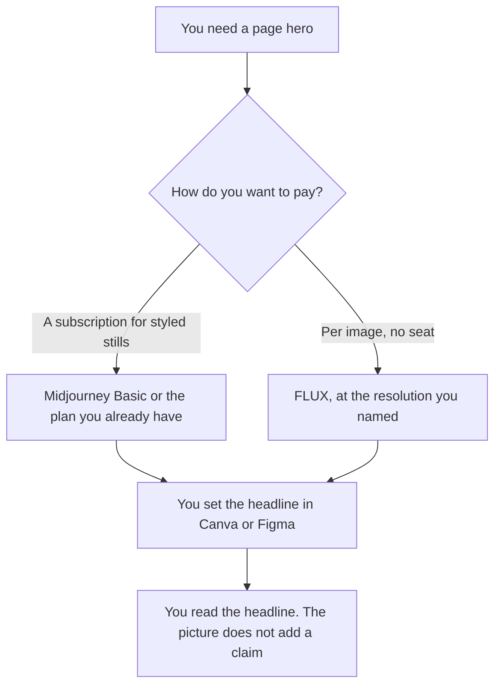

**Use Midjourney when the hero is one styled still and you already want a subscription. Use FLUX when you want to pay per image, with no seat, and you are willing to work in an API or a playground.** The model may generate the scene you described. It may not invent a claim, a price, or a logo. Words that have to be readable inside the image are a different choice: [Midjourney vs Ideogram for thumbnails](/blog/midjourney-vs-ideogram-for-thumbnails-2026/). A mark a vendor embeds in an output is [what an AI output watermark is](/blog/what-is-ai-output-watermark-2026/).

Prices are US list prices from directory pages checked October 16, 2026. Published October 24, 2026. We did not generate a scored set. A direct re-fetch of the vendor pages was not required for figures that are already on those cards.

## Which bill matches the hero

| The frame | Start here | First paid step | The limit |
|---|---|---|---|
| One styled still, and a subscription is fine | [Midjourney](/tools/midjourney/) | Basic is $10 a month, or $8 a month billed annually, $96 a year | No free plan on that card. The title is typeset later |
| Many sizes, paid per image, no seat | [FLUX](/tools/flux/) | 1 credit is $0.01. FLUX 3 Klein is $0.008 at 768×768, up to $0.036 at 4K, on that card | No subscription. Resolution changes the price |
| The title and the crop after the still | [Canva](/tools/canva/) | Pro is $18 a month, or $180 a year, for one person | The still is an input. The claim is yours |
| The frame in a design file | [Figma](/tools/figma/) | Professional is $16 a month per Full seat, billed annually | You place the image. The file does not approve the headline |

A hero that renders the words "fastest" or "official" because the prompt said "premium product" is a claim you did not approve. Keep the words out of the generation unless you have a separate reason, and then read every letter. The thumbnail article is that path.

## What the cards actually price

**Midjourney Basic** is the entry paid plan. Standard is $30 a month, or $24 a month on annual billing. Extra Fast GPU time is $4 an hour on every plan, on that card. Relax mode and Stealth are not on Basic. A single hero does not require a video plan. The invoice is [Midjourney pricing explained](/blog/midjourney-pricing-explained-2026/).

**FLUX** has no subscription on the October 16 card. The same prices apply in the API and the playground, on that card. Video is priced per second and is a different asset than a hero still. Open weights are a license question, not a free commercial hero. The invoice is [FLUX pricing explained](/blog/flux-pricing-explained-2026/).

**Canva Pro** or **Figma Professional** is where the headline and the crop land. Quote those seats from the October 16 cards above, and re-check checkout on the day you buy. The invoices are [Canva pricing explained](/blog/canva-pricing-explained-2026/) and [Figma pricing explained](/blog/figma-pricing-explained-2026/).

A prompt that holds the line:

"Generate a hero image of the scene I described. Do not render words, a price, a logo, or a badge. Use only the aspect ratio I wrote."

## What not to delegate

Do not ask which image will convert. Do not put a customer's face or a real person's likeness in the prompt. Do not ship a hero whose crop cuts off a claim you then add in type without reading it at the final size.

## FAQ

### Which one looks more like a brand hero?

We did not score that. Midjourney is the subscription path for a styled still. FLUX is the per-image path, including a 768×768 Klein image at $0.008 on the October 16 card. The hero is ready when the scene matches the brief and the headline you set is the one you approved.

### Do I need both?

You need the bill that matches how often you generate. Paying a subscription and a per-image API for the same still is optional. Do not composite two generations and call the join a brand system unless a person checks it.

### What size should the hero be?

The size the page template requires. Name the resolution in the FLUX request, because the card's price changes with it. Name the aspect ratio in the Midjourney prompt. This article does not pick a universal pixel size.

### Who may publish it?

The person who owns the page. A generated still is a draft until the headline, the crop, and any claim in the type have been read.

## Last verified

October 16, 2026 for Midjourney, FLUX, Canva, and Figma directory cards. Published October 24, 2026.

**Sources:** [Midjourney](https://www.midjourney.com), [Black Forest Labs pricing](https://bfl.ai/pricing), [Canva](https://www.canva.com), [Figma](https://www.figma.com).

*Published by Andrew for [AI Tools Optimizer](https://aitoolsoptimizer.com).*

[FLUX](/tools/flux/) is in the [image generation directory](/tools/category/image-generation/). Directory pages may use affiliate links. A purchase through them may earn us a commission at no extra cost to you.
