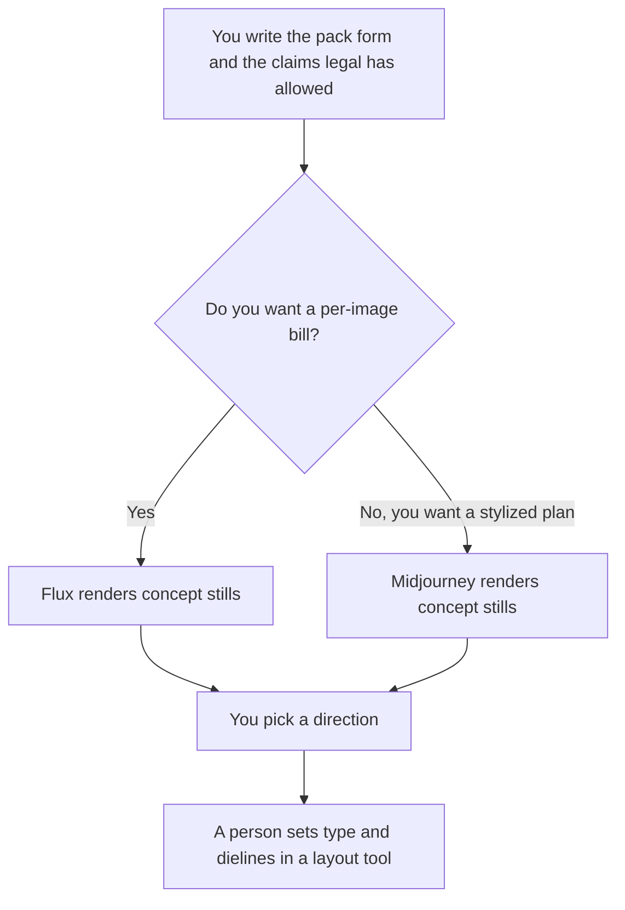

**Use Flux when you want a pay-per-image concept of a pack and a bill you can tie to a shoot. Use Midjourney when you want a stylized hero render and you already accept a GPU-time subscription.** Both can suggest a look. Neither produces a dieline, a barcode, or legal label copy. The print file is a layout a person builds after the concept is chosen.

The plan math is [Midjourney pricing explained](/blog/midjourney-pricing-explained-2026/) and [Flux pricing explained](/blog/flux-pricing-explained-2026/). A wider image comparison is [Midjourney vs Leonardo vs Flux](/blog/midjourney-vs-leonardo-vs-flux-2026/). Text drawn inside the picture is a known weak spot. The trio aimed at readable type is [Flux vs Ideogram vs Firefly](/blog/flux-vs-ideogram-vs-firefly-2026/).

Prices are US list prices excluding tax from directory pages checked October 16, 2026. Published October 24, 2026. We did not score image quality, and we did not print a package.

## Which spend matches the mock

| The artifact you actually need | Start here | What you still do |
|---|---|---|
| A few look explorations, billed per image | [Flux](/tools/flux/) from $0.008 an image at 768×768 on FLUX 3 Klein | You write the pack form, the colors, and the claims you are allowed to show |
| A 4K still from the same meter | Flux up to $0.036 an image at 4K, on that card | 1 credit equals $0.01. Confirm the debit |
| A stylized hero for a pitch, on a plan | [Midjourney](/tools/midjourney/) Basic at $10 a month, or $8 billed annually | No free plan. Fast GPU time on Basic is 3.3 hours |
| More Fast time for a brand exploration | Standard at $30 a month, or $24 annually, with 15 Fast hours | Unlimited Relax image generation starts on Standard |
| A company above $1 million gross revenue, or private images | Pro at $60 a month, or $48 annually. Mega is $120, or $96 annually | Stealth mode is only on Pro and Mega |
| The panel the printer will use | [Canva](/tools/canva/) or your design tool | Put real type, barcodes, and legal lines in the layout |

Extra Fast time on Midjourney is $4 an hour, on the directory card. Relax is not a promise that a job finishes on a campaign deadline. V8's Relax support was recorded as not yet available. Read the pricing article before you plan a queue.

[Adobe Firefly](/tools/adobe-firefly/) Standard is $9.99 a month when the team needs a commercially positioned Adobe model and already lives in that suite. [Ideogram](/tools/ideogram/) Plus is $20 a month, or $15 billed yearly, when the concept must show readable label words inside the image. This page does not claim either replaces the dieline.

## What the prompt may include

Name the container, the material, the camera, and the words that are already approved. Do not ask the model to invent a health claim, a net weight, or a certification mark. Those are legal lines. A pretty pack with a fake badge is a problem, not a concept.

**Flux** is the right meter when packaging is occasional and you can explain $0.01 credits to finance. There is no seat fee on the card we recorded. Open-weight options exist for teams that run models themselves. This page does not quote a self-hosting price. The video rate is per second on that card, and this article does not print a per-second dollar it does not have.

**Midjourney** is the right meter when the team wants a look and will generate many variants inside Fast hours they already pay for. Companies over $1 million in gross revenue need Pro or Mega, on the directory card. Basic is the wrong plan for that company even if the images look fine.

A prompt that holds the line:

"Render a packaging concept only. Container, material, and colors as I wrote them. Do not invent label claims, badges, barcodes, or net weight. Leave a blank panel where type will go. Do not add awards."

## What not to delegate

Do not send a concept render to a printer. Do not put unapproved claims in the prompt so the picture "looks finished." Do not use a customer's product photo as a reference unless you have the right to. The layout step is where [Canva](/tools/canva/) Pro, at $18 a month or $180 a year for one person, can hold real text. Magic Studio's allowance is a separate article: [Canva Magic Studio pricing explained](/blog/canva-magic-studio-pricing-explained-2026/).

## FAQ

### Which one looks more like real packaging?

We did not score that. Pick Flux to pay per still. Pick Midjourney for a stylized subscription. Judge the stills against the brief you wrote, then rebuild the chosen direction in a layout file.

### Can the model set the label type?

It can leave a blank panel. Type that must be read, including the product name, belongs in the layout. If you need words inside the concept image, read the Ideogram comparison and still reset the type before print.

### Is a 4K Flux image the print file?

It is a higher-resolution concept. Print needs the dieline, bleed, and color process your printer specified. Resolution on a generated still does not answer those requirements.

### Do we need Pro on Midjourney for a freelance mock?

Basic is the published entry plan for an individual. The Pro and Mega rule on the card is about company revenue and about Stealth. Read that rule against the entity that owns the account before you subscribe.

## Last verified

October 16, 2026 for Midjourney, Flux, Canva, Adobe Firefly, and Ideogram. Published October 24, 2026.

**Sources:** [Midjourney](https://www.midjourney.com/), [Flux](https://bfl.ai/), [Canva pricing](https://www.canva.com/pricing/).

*Published by Andrew for [AI Tools Optimizer](https://aitoolsoptimizer.com).*

[Flux](/tools/flux/) is in the [image generation directory](/tools/category/image-generation/). Directory pages may use affiliate links. A purchase through them may earn us a commission at no extra cost to you.
